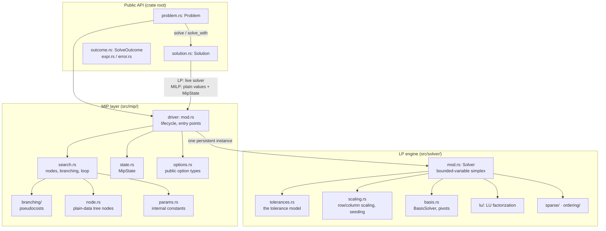
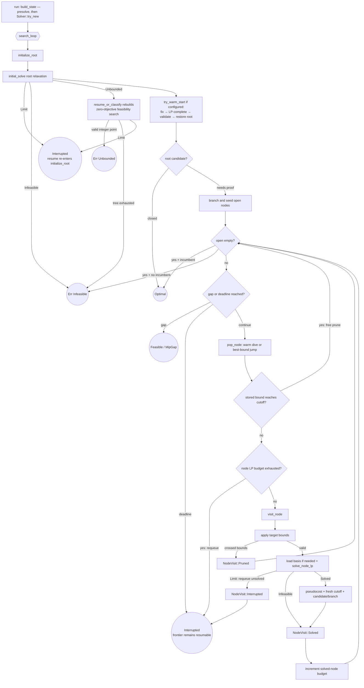
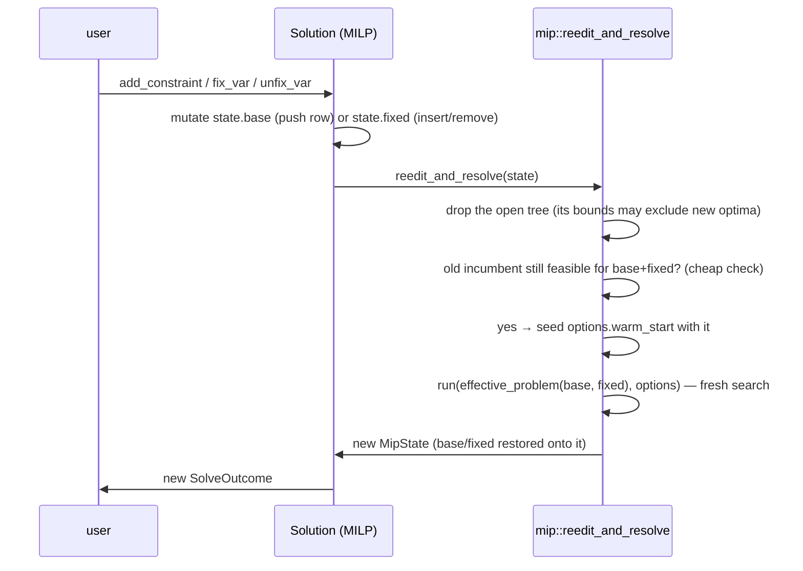

# microlp Architecture

This document explains how the solver works: how a problem flows from the public API
through the simplex engine and the branch & bound search, why the pieces are shaped the
way they are, and where to plug in improvements. It is written to be sufficient on its
own — a person (or an agent) who has read this should be able to navigate the codebase,
predict its behavior, and extend it safely.

---

## 1. The big picture

microlp solves **linear programs** (LP: continuous variables, linear constraints, linear
objective) and **mixed-integer linear programs** (MILP: same, but some variables must take
integer values). It is organized as two layers with a deliberately narrow interface between
them:



Three principles shape everything:

1. **One persistent LP solver per search.** The branch & bound tree never clones the solver
   and never grows the LP. Branching is expressed purely as *variable bound changes* on the
   single `Solver` instance, and tree nodes are plain data that describe how to reconstruct
   a state on that instance.
2. **No unfinished node LP is consulted.** A deadline is observed between completed simplex
   pivots and may stop a solve before optimality. The driver pushes that node back
   **unsolved** and makes no bound, candidate, or branch decision from the unfinished state.
   The next visit rebuilds the node from its own data. Node budgets and global search
   decisions are applied between node LP solves.
3. **Loud failures over silent wrong answers.** Child-LP errors are never conflated with
   infeasibility; numerical failures either recover through a documented valve or propagate
   as errors; candidate solutions are re-validated before being accepted. Where the code
   cannot do something properly it panics with a message rather than approximating.

### Module map

| File | Responsibility |
|---|---|
| `src/lib.rs` | Crate root: the module wiring and the `pub use` re-exports that define the public API's paths; every public item lives in a sibling module. |
| `src/problem.rs` | `Problem`, `VarDomain`, and the solve entry points. Owns solve/edit timing and the pure-LP model-to-engine seam in `Problem::solve_with` (presolve, then `Solver::try_new`). |
| `src/solution.rs`, `src/outcome.rs` | `Solution` (a validated assignment, its read-out and its post-solve edits) and `SolveOutcome` / `InterruptedSolve` (what a call returns and how it is resumed). |
| `src/expr.rs`, `src/error.rs` | The model vocabulary (`OptimizationDirection`, `Variable`, `LinearExpr`, `ComparisonOp`) and the `Error` type. |
| `src/range.rs` | The recommended coefficient range: the spread of each row and column as written, which the loud errors of a solve, a resume or an edit name (§7.7). |
| `src/presolve/` | Presolve's exact reductions: redundant-row elimination, and in MIP mode integer bound rounding and tightening, integer fixings (forcing and singleton rows, dual fixing) with substitution, and binary coefficient tightening; a continuous variable keeps its bounds. All on the original variable indices, so there is no postsolve (§2, §7.4). `mod.rs` holds the contract and the entry point, `work.rs` the reduction passes, `model.rs` the data, `params.rs` the constants. |
| `src/solver/` | The simplex engine. `mod.rs` is `Solver` itself (bounded-variable primal/dual simplex, basis management, and the small contract surface the MIP layer uses); `tolerances.rs` the tolerance model; `scaling.rs` the scaled representation and the starting vertex; `basis.rs` the basis inverse and the pivot descriptions; `costs.rs` the dual simplex's working costs and `bounds.rs` the primal simplex's working bounds; `cycling.rs` the cycling and stall detection of both; `proof.rs` the infeasibility proof and its last resorts (§3, §7.3). |
| `src/lu/`, `src/sparse/`, `src/ordering/` | LU factorization with eta-file updates, sparse containers, and the column ordering of the factorization (`order_simple`: the sparsest columns first, from the bucket queue in `ordering/cols_queue.rs`). |
| `src/mip/mod.rs` | The branch & bound lifecycle: building a search from a `Problem`, starting / resuming / re-editing it, bound and gap accounting, and validating a candidate against the user's original rows. |
| `src/mip/search.rs` | The search itself: node visits, warm starts, branching, pruning, and the outer search loop. |
| `src/mip/state.rs` | `MipState` (the complete, resumable search state) and `MipRun`. |
| `src/mip/options.rs` | The public option and report types: `SolveOptions`, `ResumeOptions`, `Tolerances`, `Stats`, `SolutionStatus`, `TerminationReason`. |
| `src/mip/node.rs` | `Node` (plain-data tree node) and `effective_bounds` (bound-change collapsing). |
| `src/mip/branching/` | Integrality checks and branch-variable selection (pseudocosts). |
| `src/mip/params.rs` | Named, documented internal constants (see §7). |
| `tests/suite/` | The problem-based correctness suite (see §9) — the safety net for all of this. |

---

## 2. Problem representation

`Problem` stores the model in original user terms: objective coefficients, per-variable
bounds and domains (`Real`, `Integer`, `Boolean`), and constraint rows.

These normalizations happen at the boundary and hold everywhere inside:

- **Internal objective space is always MINIMIZE.** `Maximize` problems negate their
  objective coefficients at variable-creation time (`internal_add_var`), and the sign is
  flipped back exactly once per read (`Solution::objective`, user-facing `Stats.best_bound`).
  Everything inside the driver — incumbents, bounds, pruning, gaps — is minimize-space.
  When editing driver code, never reason about direction; it does not exist there.
- **A bound of magnitude 2^52 or more on its side of infinity is infinite.** When a var is
  added (`internal_add_var`), `entry_bounds` turns a lower bound at or below
  `-INFINITE_BOUND` (`-2^52`) into `-∞` and an upper bound at or above `2^52` into `+∞`, and
  `Problem` stores the converted bounds, which presolve, the engine, the MIP's base problem,
  the post-edit incumbent prefilter and `Solution::fix_var`'s check all read (bounds that
  presolve derives are left as they are). So `f64::MAX` and `i64::MAX` behave as
  `f64::INFINITY` everywhere, and no check refuses an answer beyond such a bound. Each side is
  judged on its own (`x ∈ [5e15, f64::MAX]` is `x ≥ 5e15`: a value beyond the threshold is
  data, which the solve may report and `fix_var` fix a var at), and a range that is a point
  or empty keeps its bounds as written, so a var fixed beyond the threshold stays fixed and
  an empty range stays infeasible. The threshold is 2^52 because a row beside a var at a
  bound `B` with a coefficient `a` is held only to about `1e-14 |a| B` (§7.1), tens of units at
  2^52 when `|a|` is near one, so a larger bound written for infinity changes the answer once
  a var sits at it. The price: a bound of 2^52 or more meant as a bound is none (`max x` with
  `x ≤ 5e15` is `Unbounded`), even where small coefficients would let the rows resolve it.
  Both sides are pinned in `src/tests/regressions.rs`. A row's right-hand side is not cut
  off: it is used as given, so the same `x ≤ 5e15` written as a row binds.
- **Every constraint row gets a slack variable.** A row `a·x ≤ b` becomes `a·x + s = b`
  with `s ∈ [0, +∞)`; `≥` gives `s ∈ (−∞, 0]`; `=` gives `s ∈ [0,0]`. So the `Solver`'s
  variable universe is `num_vars` *structural* variables followed by one slack per row
  ("total vars"), and every constraint is an equality against the basis matrix. A row's
  original sense is recoverable from its slack's bounds — `Solver::first_violated_row`
  exploits exactly this.
- **The matrix is scaled by powers of two, rows and columns.** Before the simplex engine
  sees a model, `column_scales` derives a power-of-two factor per structural column: the
  rounded geometric mean of the column's extreme coefficients, iterated against row factors,
  skipped entirely when every coefficient already lies within `[1/8, 8]`, and never applied
  to a fixed column. The factors are limited only by the range of `f64`, since the engine
  takes any finite coefficient and a capped factor can leave a row too wide for the stable
  pivots of its genuine entries (see `column_scales`). Each row is then equilibrated so that
  its largest coefficient of a var that can move lies in `[1, 2)`. The engine works on
  `x'_j = x_j / s_j`; powers of two mean no datum is rounded, integrality of `s_j x'_j` is
  exact, and a bound change in user units maps to exactly one internal bound. Everything that
  crosses the `Solver` boundary — values, bounds, the objective, the row checks — is
  converted, so the MIP layer and the public API only ever see user units. A coefficient
  that is tiny only because its row or column is written in awkward units thereby becomes of
  order one, which is what makes the pivot tolerances below meaningful.

- **Presolve runs before the engine sees the model** (`src/presolve/`, on by default,
  `SolveOptions::presolve`). It never changes the variable set: a variable it removes is
  fixed by `lo == hi` bounds (the engine prices such vars out natively) and its value is
  substituted out of every row for presolve's own deductions; rows may be dropped or
  rewritten freely because nothing outside the `Solver` addresses them by index. That is
  what makes a postsolve layer unnecessary — solution read-out, resume, warm starts and
  post-solve edits all work off original indices, and the MIP search's root bounds are the
  presolved bounds. Surviving rows are emitted as the user wrote them, fixed terms included
  (a row keeps the tolerance of its full magnitude only with them in it); only a row whose
  coefficients were rewritten is rebuilt, and the rows presolve dropped or rewrote go to the
  engine as written, for the checks at the boundary (§3.1). The reductions are exact; what
  they keep is §7.4. When presolve finds the model infeasible, or reduces nothing, the solve
  goes on with the model as written (`presolve::reduced_model`, logged at debug level).

`prepare_row` is the single row-normalization contract used by both `Solver::try_new` and
incremental `Solver::add_constraint`. It settles the rows whose data alone decide them
(`trivial_row_verdict`, which presolve applies too: an empty row is held to the contract at
activity zero, an infinite right-hand side is no constraint on the side the row leaves open
and unsatisfiable on the side it constrains, and a NaN or an infinite coefficient makes a
row no point satisfies), computes the power-of-two scale, scales coefficients and the
right-hand side together, and derives slack bounds.
The two callers still own their genuinely different work: initial matrix/basis construction
versus extending a live matrix and repairing the current basis.

---

## 3. The LP engine (`src/solver/`)

The simplex core is the minilp lineage: a **bounded-variable
revised simplex** with both primal and dual iterations, steepest-edge pricing, the Harris
two-pass ratio test for numerical stability (in the dual simplex, a bound-flipping ratio
test in Harris groups: a boxed var the dual step passes is moved to its other bound instead
of entering), and an LU-factorized basis updated by eta matrices (refactorized when the eta
file outgrows the factors).

Both methods carry an anti-degeneracy package (details and constants in §7.8). A dual phase
works on *working costs* (`src/solver/costs.rs`): the costs in force, with its starting dual
infeasibilities corrected and an entering var's cost shifted wherever the dual step would
otherwise run backwards. A primal phase works on *working bounds* (`src/solver/bounds.rs`):
the true bounds, shifted wherever a basic var ends outside them beyond its tolerance. The
first phase of a re-solve, phase 1 (a dual phase on the artificial objective) again where
its values fail the verification, and the primal phase after phase 1 (the real
optimization) also perturb them at the start unless they start near optimal; every other
phase cleans up after the one before it, unperturbed. A phase restores the true costs or
bounds when it ends; `run_phases` verifies the result, and the next phase removes the
infeasibility that uncovers. A vertex hash makes a basis change
that keeps returning to visited vertices taboo, and a stall bound ends a phase whose
objective does not move (`src/solver/cycling.rs`); both end in a loud error, never a hang.

A basis the factorization finds singular is repaired wherever it is factorized: each
dependent column is replaced by the slack of a row no pivot took, whose unit column completes
the factors (`src/lu/`), the dependent var leaves the basis at its working bound nearest its
value (0 if free), and the values and reduced costs are recomputed. Within a phase, the change
back is taboo (§7.8), unless the step whose refactorization found the basis singular moved its
row.

The dual simplex returns `Infeasible` only on a proof (`src/solver/proof.rs`): a certificate
summed from the model's data that leaves a gap beyond the room the engine can give its
terms, the violated row's basic var its tolerance and every other term the room by which its
bound can be widened. A row that no var can repair and whose certificate proves nothing is
made taboo; when only such rows are left, its last resorts are a pivot on a genuine entry
below the pivot tolerance, then widening the bounds of the vars that can help by that room
for the rest of the solve, before a loud error (§7.3).

State you need to know when reading it:

- `basic_vars[row]` — which variable is basic in each row; `basic_var_vals` their values,
  `basic_var_mins`/`basic_var_maxs` their bounds (during a primal phase, the working bounds of
  `bounds.rs`).
- `nb_vars[col]` / `nb_var_vals` / `nb_var_states{at_min, at_max}` — non-basic variables
  sit exactly at one of their (working) bounds (or at 0 if free), and the state names that
  bound, never a tolerance test: a var whose range is narrower than its tolerance is at one
  bound and can move to the other. A var past a bound (it left the basis where it sat,
  within its tolerance, §7.2) is at that bound, and one between its bounds (where a bound
  change left it) at neither. The bounds are those in force: the model's, or one the
  widening of §7.3 moved by the var's tolerance for the rest of the solve, which the
  boundary's checks and the edits never see.
- `is_primal_feasible` — whether the values meet the bounds: a round runs the dual simplex
  where it is false, then verifies the values and the reduced costs recomputed from the
  multipliers, and runs the primal simplex where those are dual infeasible.
  `is_dual_feasible`, kept by the phases and the edits, is asserted by `add_constraint`;
  the rounds do not decide on it. `initial_solve` = restore primal feasibility (dual
  simplex, phase 1 on the artificial objective from a start neither primal nor dual
  feasible) then optimize (primal simplex).
- `cur_obj_val`, `nb_var_obj_coeffs` (reduced costs), `lp_iterations` (cumulative pivot
  counter for stats).

### 3.1 The contract surface the MIP layer relies on

The engine exposes a small contract surface; everything the B&B does goes through these.

**`set_var_bounds(var, min, max) -> Result<(), Error>`** — change a variable's bounds in
place. Basic variable: update the row's bound mirrors, flag primal-infeasible if its value
fell outside. Non-basic variable: move it to the new bound its state names (a var that was
fixed goes to the bound at which its reduced cost is dual feasible, and one between its
bounds stays where it is if they still hold it), propagate the delta into the basic values
through the variable's column (same mechanism as `fix_var`), and downgrade
`is_dual_feasible` if the move broke the reduced-cost/bound pairing. Crossing bounds
(`min > max`) or either bound being NaN returns `Err(Infeasible)` with state untouched.
Infinite bounds remain valid. It does **not** run simplex — callers decide when to
reoptimize.

*Why this is the branching primitive:* tightening a bound leaves every reduced cost
untouched, so the current basis stays **dual feasible** — re-solving is a short dual-simplex
run warm-started from the parent's optimal basis, typically a handful of pivots. This is the
single biggest performance lever in the design (see §10).

**`reoptimize() -> Result<StopReason, Error>`** — the re-solve entry: dual simplex if primal
feasibility is broken, then (only if needed, e.g. after loosening bounds or a basis load
with drift) recompute reduced costs and run primal simplex. Returns `StopReason::Limit` if
the deadline fires mid-run — leaving the honest feasibility flags so a later call continues
where it left off.

**`snapshot_basis() / load_basis(&Basis)`** — a `Basis` is one status per total variable:
`Basic | AtLower | AtUpper | Free` (~1 byte each). That is the *entire* warm-start state a
tree node needs. `load_basis` rebuilds everything from statuses + **current** bounds:
non-basic values from their status's bound, basic values and reduced costs recomputed from
scratch, LU refactorized, feasibility flags recomputed honestly. Two contracts matter:

- *Statuses are interpreted against the current bounds.* A status pointing at a bound that
  has since moved is remapped (nearest finite bound, else 0) rather than rejected — B&B
  jumps load a parent basis **after** applying different bounds, so this is load-bearing
  by design, not sloppiness.
- *A singular basis loads repaired* (§3): a dependent var leaves at the value the slack basis
  gives a non-basic var (the lower bound if finite, else the upper, else 0). `load_basis`
  fails only on a basis of the wrong shape, a bug, and leaves the state untouched then.

**`reported_values()`** — the verified point in user units, as the engine computed it: what
every read-out and every candidate is. Nothing is snapped: a fixed var's value is within its
bound tolerance of its value (a fixed integer var's on it, §7.2), an integer var's within the
search's `int_tol` of an integer.

**`first_violated_row(values)` / `first_violated_bound(values)` / `objective_of(values)`** —
evaluate an explicit structural-variable vector (user units) against the stored rows (sense
recovered from slack bounds) and bounds within the **absolute** user tolerance floored at
the round-off of the row or bound (`row_tolerance`, through `outside`), and compute its
objective. A value or row activity that is not finite violates every bound and row. These
are the contract check, applied by the incumbent guard (§5.4) and the pure-LP path
(`SolveOutcome::from_lp_stop`, on every solve, edit and resume). A row is summed in
compensated arithmetic (`implied_slack`: products exact, the sum to about an ulp of the
result), so the verdict does not depend on the order of the terms. The engine holds each
row to the contract less the round-off of its own evaluation (§7.2), so a point it verified
passes, and the checks are independent of the current basis values.
`first_violated_row` also checks the rows presolve dropped or rewrote, as the user wrote
them (`validation_rows`, installed from `Presolved`): the engine never pivots on them, so the
answer is held to the whole model only here. An LP answer that misses one is no error: the
engine takes the row over (`hold_validation_rows`, through `add_constraint`) and resumes
from its basis, within the call's deadline, so a reduction presolve got wrong costs pivots,
not the answer; a MIP candidate that misses one is rejected (§5.4).

---

## 4. The MIP data model (`src/mip/node.rs`, `MipState`)

```rust
// A tree node is PLAIN DATA — no solver machinery anywhere:
Node {
    bound_changes: Vec<(var, lo, hi)>, // cumulative from the root; later entries win
    basis: Basis,                      // the PARENT's optimal basis (warm start)
    lp_bound: f64,                     // parent's LP objective = valid lower bound here
    depth, parent_id,                  // parent_id detects warm dives (§5.2)
    branch_var: Option<usize>,         // None for the root, Some(var) for children
    branch_up, branch_frac             // metadata feeding pseudocost updates (§5.6)
}
```

Reconstructing any node's starting state = apply its `bound_changes` on top of the root
bounds, load its `basis`, reoptimize. That is the whole trick: because nodes carry no live
state, they are trivially storable, resumable, and cheap (a basis is `total_vars` bytes; a
bound-change list is `depth` entries).

The optional branch variable is a correctness distinction: the root has no creating branch
and therefore must never record a pseudocost observation. Every child stores the variable
and direction that created it.

`MipState` is the complete, resumable search:

| Field | Role |
|---|---|
| `solver` | the ONE live LP engine |
| `root_bounds`, `applied` | original bounds + which changes are currently applied to the solver (for diffing when switching nodes) |
| `open: Vec<Node>` | the frontier (LIFO tail = current dive; best-bound scan on jumps) |
| `incumbent: Option<Incumbent>` | best integral solution: its values as computed + `objective = c·x` |
| `node_seq`, `last_solved_id`, `diving` | warm-dive detection + node-selection mode |
| `pseudocosts`, `stats`, `options`, `deadline`, `direction` | search intelligence and bookkeeping |
| `base: Problem`, `fixed: BTreeMap<var, val>` | the CLEAN user problem + user-level fixes — the substrate for post-solve edits (§5.8) |

`Solution` for a MILP holds `SolutionStatus`, `TerminationReason`, and this `MipState`
boxed. User reads come from its validated incumbent's values, as the engine computed them.
`InterruptedSolve` also retains the live state for resume, but exposes only its reason and
statistics. For a pure LP, `Solution` keeps the live solver (that is what makes LP
incremental editing cheap).

---

## 5. The branch & bound search (`src/mip/`)

### 5.1 Lifecycle



### 5.2 Visiting a node: warm dives vs jumps

When a node is popped, its target bounds are diffed against `applied`: variables no longer
constrained are reset to root bounds, changed ones are set. Then one question decides the
cost of the visit: **is the solver already sitting at this node's parent's optimum?**

- `last_solved_id == node.parent_id` → **warm dive**: the parent was the immediately
  previously solved node, its basis is live in the solver, and the child differs by exactly
  one tightened bound. Skip the basis load entirely; `reoptimize` is a short dual-simplex
  run. This is the common case while diving.
- Otherwise → **jump**: load the node's stored parent basis (one refactorization), then
  reoptimize. `last_solved_id` is cleared on every path where the solver moves away from a
  just-solved optimum (prune-after-solve, infeasible, requeue, incumbent adoption), so the
  warm-dive check can never false-positive: ids are unique per branching.

### 5.3 Node LP solving and the robustness valves

`solve_node_lp` wraps `reoptimize` and owns error discrimination:

- `Err(Infeasible)` → genuinely infeasible node → prune. Correct and cheap: the engine
  returns it only on a proof checked on the model's data (or on bounds that cross), never on
  a row it merely cannot repair, so an unproven verdict cannot prune a feasible subtree. The
  one gap is the proof's concession (§7.3): a coefficient on an infinite bound counts as zero
  where the error of the multipliers could make it zero, so a node could be pruned wrongly
  only if a coefficient the data leave lay within that error (some `1e-30` of its terms in
  well-conditioned bases) and, times its var's value, made room at every point of the node.
- `Err(Unbounded)` → impossible for a bounded node → surfaced as `InternalError`.
- Any other error, such as a row the dual simplex can neither repair nor prove infeasible
  → **retry once from the slack basis** (all slacks basic), re-solving the node from
  scratch; a second failure propagates. The retry is per-node-visit — it cannot mask a
  systematic failure.
- `Ok(Limit)` → the deadline fired mid-solve → the node is pushed back **unsolved** and the
  search returns `Interrupted`. Nothing uses the coherent but non-optimal state as a solved
  node: the next visit starts from its own bounds + basis data.

Inside the engine, `run_phases` alternates the dual phase (`restore_feasibility`) and the
primal phase (`optimize`) until a state passes verification (§7.5): a phase's own exit test
runs on incrementally updated numbers, so a phase may end on drifted values, and only a
verified state is reported as `Finished`. A vertex no factorization represents starts the
solve over from the slack basis once, inside the engine, before the node's own retry. "No
eligible entering column for a violated row" is not a proof of infeasibility: the dual phase
first rebuilds (fresh factorization, values, reduced costs) and re-examines the row, where a
phantom violation dissolves, and declares infeasibility only if the row's certificate proves
it (§7.3). The rebuild is armed once per stall and any successful pivot re-arms it, so it
cannot loop; a row the proof leaves open is made taboo, and its last resorts end in a loud
error rather than a verdict.

### 5.4 Incumbents and the feasibility guard

When a node's LP solution is integral within `int_tol` (default `1e-6`), it is a *candidate*
— not yet an incumbent. Integral means every integer variable the search can branch on lies
within `int_tol` of an integer; a variable whose node bounds fix it cannot be branched on,
and the engine holds it exactly at its value (an integer variable its bounds fix has no
bound tolerance, §7.2). Every solver-produced candidate enters `try_adopt_incumbent`, which
takes the values as the engine computed them (nothing is rounded) and applies one validation
funnel:

1. `candidate_variables_feasible` rejects malformed lengths, non-finite values, invalid
   bounds, violations of the model's bounds (the root's: a warm-start hint fixes a variable
   up to `HINT_BOUNDS_SLACK` outside them, so the node's are not always within them), and
   integer variables off their integer by more than `int_tol`.
2. `Solver::first_violated_row` validates the vector against the rows, the ones presolve
   dropped or rewrote included, within the absolute `Tolerances::feasibility` (default
   `1e-7`) floored at each row's round-off (§7.1).
3. `objective_of` must produce a finite objective before the incumbent can change.

Post-edit warm-start filtering deliberately remains separate: `incumbent_feasible` checks
the clean `Problem` plus its fix overlay in original user scale before a solver exists. Both
paths share variable/domain validation, but their row representations are not conflated.

The engine verified its own rows and bounds at these very values, within their contract
less the round-off of its own evaluation, so a candidate can fail only on a row presolve
dropped or rewrote:

- Guard **passes** → adopt the values with `objective = c·x`, and close the node: its
  objective is the node's bound.
- Guard **fails** → do not adopt; **branch on an integer variable off its integer** (at
  `int_tol = 0`: children `⌊v⌋` / `⌊v⌋+1` fix its bounds), and the dive resolves the truth.
  A row presolve rewrote holds as written only where its binaries are exactly integral
  (§7.4), and the LP vertex itself, not only its round-off, can put a binary off its integer
  within `int_tol`, or past its bound within its bound tolerance: `-x0 + x3 = 0` with
  `-2 x0 - 10 x3 <= 7.642e-7` puts `x0` at `-7.6e-8` once presolve has rewritten the second
  row. The row as written rejects that point, and the child that fixes the binary holds it
  exactly at its value, where the row holds
  (`a_binary_the_lp_puts_past_its_bound_under_a_row_presolve_rewrites_solves`); where the
  child's point then needs two rows' tolerances at once, the proof leaves the node open and
  the widening moves the rows' slack bounds to reach it
  (`a_node_fixing_a_binary_feasible_only_within_two_rows_tolerances_is_solved`, §7.3). A
  candidate that fails with every integer variable exactly integral, nothing left to branch
  on, is returned as an internal error rather than force-accepted: presolve's reduction did
  not keep that point.

The **big-M caveat**: with `int_tol = 1e-6`, a relaxation value like `y = 1e-6` counts as
integral, and under a row `x <= 1e7 y` it lets `x` reach 10. That point meets the row as
written at its values, so it is a valid answer within the contract, and the search may
report it. Rounding such values, as the API docs advise where an exact integer is needed,
can break the row; the docs warn of it, and a big-M coefficient no larger than the model
needs keeps that room small.

During zero-objective unboundedness classification, the same funnel runs first; only a valid
integer point returns `Err(Unbounded)`. If classification is interrupted before an incumbent
exists, the public objective is evaluated from the original model coefficients and the
current working values rather than from the temporary zero objective.

The tolerance is deliberately **absolute**, never scaled by row magnitude: a relative
tolerance (`1e-7·|rhs|`) evaluates to ~100 on a 1e9-scale row and would accept violations
of that size. A false *rejection* from the absolute check is benign (extra exact-fixing
branching); a false acceptance would be a wrong answer.

### 5.5 Node selection, bound, and gap

- **Plunging DFS with best-bound jumps** (`pop_node`): while the last processed node
  produced children (`diving == true`), pop LIFO — cheap warm dives, incumbents found fast.
  When a dive dies out (prune/infeasible/leaf), jump to the open node with the **lowest**
  `lp_bound` (linear scan, first-minimum tie-break, `swap_remove`).
- **Global dual bound** = min over open nodes' `lp_bound`, clamped by the incumbent
  (stale nodes may carry looser bounds than a fresher incumbent). Open list empty →
  the bound *is* the incumbent: proof complete. Valid only between nodes — a popped node's
  subtree is otherwise unaccounted.
- **Gap** = `(incumbent − bound) / max(|incumbent|, ε)` in minimize space (sign-free — the
  formula is direction-invariant). `mip_gap > 0` may stop the search early with a feasible
  solution and `TerminationReason::MipGap`; the default `0.0` demands exact proof and adds
  zero overhead (the check short-circuits). During a positive-gap check, equality of the
  incumbent and global bound is still classified as an exact proof even when the open list
  contains dominated nodes.
- **Pruning** uses `cutoff(incumbent) = incumbent − max(ε, ε·|incumbent|)` with
  `ε = Tolerances::prune_epsilon` (default 1e-9), applied twice per node: against the stored
  parent bound *before* any LP work, and against the fresh objective after.

### 5.6 Pseudocost branching (`src/mip/branching/`)

The driver learns **pseudocosts**: per variable and direction, the average objective
degradation per unit of fractionality observed across solved child nodes.

- *Recording*: when a node with `branch_var = Some(var)` solves, its creating branch
  (`branch_up`, `branch_frac`) contributes
  `max(0, z_child − parent_bound) / branch_frac`. The root and every
  infeasible/interrupted node record nothing.
- *Selection*: maximize the product score
  `max(est_down·f_down, ε) · max(est_up·f_up, ε)` — variables whose BOTH directions hurt
  the relaxation are the ones worth deciding early. Before any observations exist, estimates
  fall back to `|objective coefficient| + ε` — with uniform coefficients this degrades
  gracefully to most-fractional.
- *Dive order*: of the two children, the one with the LOWER estimated degradation is pushed
  last (popped first) — dive toward the side more likely to stay feasible and good.

### 5.7 Warm starts

`SolveOptions::warm_start` accepts a (possibly partial) assignment. Evaluation happens once,
right after the root LP: fix the hinted variables to their (rounded, bounds-checked) values,
LP-complete the rest, and if the completion is integral, adopt it **through the same
feasibility guard as every other incumbent** — hints get no shortcut. Then restore the root
state (bounds back, root basis reloaded, everything recomputed, and re-solved, which only
verifies it unless the load had to repair it) so the search starts from the true
relaxation. Hints are advisory by design: unknown variables, out-of-range values,
infeasible or fractional completions, and completions that fail with an engine error all
just drop the hint with a debug log — a bad hint must never break a solve.
Dropping one costs at most speed, since the search solves the whole model without it (a node
LP's error, after its retry, stays fatal: skipping a node could lose the optimum). Only the
`Unbounded` verdict a completion can give during unboundedness classification (§5.4) is
returned, once the temporary bounds and root basis have been restored; an error restoring
them propagates.

A warm start seeds the *incumbent*, which powers pruning; it does **not** carry the search
tree. Restarting the same model with an unchanged hint and the same deterministic node
budget repeats the same search prefix. Wall-clock cutoffs may vary, but still retain no
frontier. Consequently:

- To **continue** an interrupted solve of an unchanged problem: use `SolveOutcome::resume` —
  it keeps the open list and continues where it stopped, budget-for-budget.
- Restart-with-hint is the right tool when the problem **changed** (edits) or the state was
  lost. In a restart loop, once the carried hint stops improving, grow the budget so a later
  round can progress beyond the repeated search prefix (see
  `tests/suite/cases/warm_restart.rs`).

### 5.8 Post-solve edits

Applying post-solve edits to whatever internal state the search ended in — an incumbent
*leaf*, with branch bound-fixings still applied — would let feasible edits report
`Infeasible`. The edit model makes that impossible:



`base` is a clean copy of the user's problem that accumulates edits; `fixed` is the
`fix_var` overlay (so `unfix_var` can restore original bounds). Every edit re-solves the
*composed* problem from the root, warm-started by the surviving incumbent. Edits exist only
on a validated `Solution`, including a feasible-but-unproven one; an `InterruptedSolve`
cannot be edited. `unfix_var` returns `Result<(SolveOutcome, bool), Error>`, so every
limited re-solve remains typed explicitly.

### 5.9 Interruption and resume, end to end

Timing is centralized without hiding the entry points' different policies:

- A pure LP's initial timer starts before presolve and `Solver::try_new`, so construction and
  the initial simplex solve share one deadline. `SolveOutcome::resume_with` uses its explicitly
  supplied fresh budget; LP edits use the current operation time limit. `timed_lp_call` always accumulates
  elapsed time, including calls that return an error.
- A MILP's initial run and each post-edit rebuild use its `SolveOptions`. `resume_with`
  replaces all three per-call controls on the retained search state with exactly the supplied
  `time_limit`, `node_limit`, and `mip_gap` values; `None` means unlimited budgets or no gap
  target. Plain `resume()` instead passes back the options used by the immediately preceding
  solve or resume call.

MIP interruption points, in loop order, are: empty open list; when a positive gap target is
active, exact incumbent/bound equality and then the gap target; deadline; then node budget.
Checking proof conditions first prevents a completed proof from being mislabeled as interrupted
or merely gap-satisfied. `node_limit` is per search call, so every `resume` receives a fresh node
budget; the retained frontier still supplies continuity between calls.

`SolveOutcome` makes answer safety structural:

| Outcome | Status/reason | Accessors |
|---|---|---|
| `Solution` | `Optimal / ProvenOptimal` | objective, values, gap, stats, edits |
| `Solution` | `Feasible / MipGap`, `TimeLimit`, or `NodeLimit` | objective, values, gap, stats, edits |
| `Interrupted` | `TimeLimit` or `NodeLimit` | reason, stats, resume only |

A limit is an outcome, never an `Error`. Solve failures use `Infeasible`, `Unbounded`,
`InvalidOptions`, `InvalidOperation`, or `InternalError`.

---

## 6. Public API tour

```rust
let mut problem = Problem::new(OptimizationDirection::Minimize);
let x = problem.add_integer_var(3.0, (0, 10));
let y = problem.add_var(4.0, (0.0, 10.0));
problem.add_constraint(&[(x, 1.0), (y, 2.0)], ComparisonOp::Ge, 5.0);

let mut options = SolveOptions::default();
options.time_limit = Some(Duration::from_secs(10));
options.node_limit = Some(100_000);          // deterministic alternative
options.mip_gap   = 0.01;                    // stop at a proven 1% gap
options.warm_start = Some(vec![(x, 2.0)]);   // advisory hint
options.tolerances.feasibility = 1e-7;       // expert knobs, see §7

let mut outcome = problem.solve_with(options)?;
if matches!(
    outcome.termination_reason(),
    TerminationReason::TimeLimit | TerminationReason::NodeLimit
) {
    let mut resume = ResumeOptions::default();
    resume.time_limit = Some(Duration::from_secs(10));
    outcome = outcome.resume_with(resume)?;
}

if let Some(sol) = outcome.solution() {
    let _ = (
        sol.status(),
        sol.termination_reason(),
        sol.objective(),
        sol.var_value(x),
        sol.gap(),
        sol.stats(),
    );
}

// resume() would reuse the satisfied gap. resume_with(default) replaces it
// with no gap target and continues toward exact proof.
let outcome = outcome.resume_with(ResumeOptions::default())?;
```

Reading values: `var_value`/`iter`/indexing return the values as the engine computed them:
the incumbent's for a MILP with an incumbent, the optimal live working values for a pure LP.
An integer variable's value lies within `int_tol` of an integer, not necessarily on it, and a
fixed one's on it (round it where an exact integer is needed, §5.4);
`var_value_raw` is a deprecated alias of `var_value`. Interrupted outcomes expose no
answer-value accessors.

---

## 7. Numerical policy: one tolerance model

Every layer holds a point to one contract: the user's absolute tolerance, floored at the
round-off of the quantity checked (§7.1). The engine holds a box just inside it, the
contract less the round-off of its own evaluation (§7.2); the infeasibility proof certifies
that box, integer and fixed vars on their bounds (§7.3), presolve keeps its integral points
(§7.4), and the end of a solve checks the answer against the contract on the model as
written (§7.5). Every other constant is a property of `f64` or of the factorization. The
model is `src/solver/tolerances.rs`.

**User-facing knobs** (`SolveOptions`, and its `Tolerances`):

| Knob | Default | Gates |
|---|---|---|
| `presolve` | `true` | the exact reductions of §7.4 before the solve; off, the engine gets the model as written |
| `int_tol` | `1e-6` | whether a value is integral: an integral LP point is adopted as computed and closes its node, so integer values are reported within it (§5.4); the integer `Solution::fix_var` fixes a value at; the post-edit incumbent prefilter's integrality. Finite, in `[0, 0.5)` |
| `mip_gap` | `0.0` | early-stop proof quality (relative gap, §5.5) |
| `tolerances.feasibility` | `1e-7`, absolute, at least `1e-10` | the contract (§7.1), which presolve, the engine, the incumbent guard, the LP answer check and the post-edit incumbent prefilter all hold to |
| `tolerances.prune_epsilon` | `1e-9` | the pruning cutoff's slack (§5.5) |

**Internal constants** are documented at their definitions: the search's in
`src/mip/params.rs` (`SCORE_EPS`, `PSEUDOCOST_INIT_EPS`, `BRANCH_FRAC_GUARD`,
`GAP_DENOM_GUARD`, `HINT_BOUNDS_SLACK`), the engine's in `src/solver/`, and
`INFINITE_BOUND` (`2^52`) in §2. The subsections below name the ones the tolerance model
rests on; among the others, `MIN_DUAL_EDGE_WEIGHT` (`1e-4`) floors the dual steepest-edge
weights, and `DEADLINE_CHECK_INTERVAL` (`1000`) is the number of pivots between deadline
checks.

The layering: `feasibility` is the contract presolve, the engine and solution acceptance
hold to; the engine's tolerances decide *simplex* questions; `int_tol` decides *integrality*
questions; `prune_epsilon` decides *tree* questions.

### 7.1 The contract, and what an answer means

A point `x`, in user units, meets the contract when:

- every row's slack `b − a·x` lies in its range (`[0, ∞)` for `≤`, `(−∞, 0]` for `≥`,
  `[0, 0]` for `=`) within `row_tolerance(f, m) = max(f, 1e-14·m)`, `f` the feasibility
  tolerance and `m = |b| + Σ|a_j x_j|` at the point;
- every bound holds within `bound_tolerance`, the same rule at that bound's magnitude, each
  bound with its own;
- in a MILP, every integer var lies within `int_tol` of an integer;
- every row presolve dropped or rewrote holds as the user wrote it, by the same rule.

`outside` is the one comparison, `value < lo − tol || value > hi + tol`; a value or a row
activity that is not finite is outside. A row is summed in compensated arithmetic
(`implied_slack`: products exact, the sum within about an ulp of the result), so a verdict
does not depend on the order of the terms. The tolerance is absolute (§5.4 says why); only
its round-off floor is relative. The engine, the incumbent guard, the LP answer check and
presolve share `row_tolerance`, `bound_tolerance` and `outside`, so no two of them disagree
about a residual (`property_counterexample_with_bound_slack_one_ulp_over_the_row_budget`).
Every solution is checked against the model as written: an LP's on every solve, edit and
resume (`SolveOutcome::from_lp_stop`), a MILP candidate by the incumbent guard (§5.4).

What an answer means:

- **`Optimal`**: for an LP, the reported point meets the contract, and the reduced costs of
  its basis, recomputed from the multipliers refined once (§7.5), are dual feasible within
  `dual_tol`, `1e-10` in the user's units as in the engine's (§7.2), the units of a slack
  being those of its row's activity as written: a row written with large coefficients
  scales its slack's reduced cost down with them, and can hide an improving edge or ray
  (§7.9). It is optimal at its vertex, not over every point of the contract: the contract
  being absolute, a small coefficient beside a large one lets a point within it move the
  objective far, so on an ill-conditioned model the reported objective can lie far from the
  exact optimum of the model as written. For a MILP, the incumbent meets the contract, and
  every other node was pruned by its bound or proven infeasible.
- **`Infeasible`**: a proof, summed from the model's data, that no point has every row and
  every continuous var within the room the engine can give it, the integer and fixed vars
  within their bounds (§7.3); never a row the simplex could not repair. For a MILP, every
  node is so proven or has crossing bounds. A model feasible only beyond that room, through
  the round-off sliver of its rows, is reported infeasible, and so can be a model whose
  every point needs the integrality tolerance, where presolve or a branch holds an integer
  var to its integer (§7.9).
- **`InternalError`**: the solve could not reach an answer it can verify, and says so; no
  answer that fails the check is returned. Within the recommended coefficient range (§7.7)
  it is a bug or a known limitation (§7.9); outside it, the message names the constraint and
  the variable of the widest spread.

### 7.2 The engine's box

The engine works in scaled units (§2) and holds each quantity to its contract less what its
own evaluation can get wrong:

- **Rows** (`slack_tol`): a basic slack is within its row inside `α = τ − δ`.
  `τ = row_tolerance(f·r, m)` is the user's contract times the row's factor `r`, a power of
  two, at the row's magnitude at the current values; `δ = min((n + 2)·2^-53·m, τ/2)` for `n`
  terms (`slack_margin`) is the round-off of the engine's plain `f64` sum and of the
  boundary's compensated one. Where the cap binds (more than 43 terms at the round-off
  floor, `plain_sum_resolves`), the engine sums the row in compensated arithmetic too. `α`
  follows the values, refreshed whenever the rows are checked.
- **Vars** (`structural_tol`): every structural var gets its whole bound contract, `f / s_j`
  in scaled units floored at the round-off of the bound; the reported value is the engine's
  times `s_j`, exactly, so it needs no margin. The one exception: an integer var its bounds
  fix (a branch, an edit, presolve) has no tolerance, and the engine holds it exactly at its
  value, a basic one leaving the basis onto it (a fixed leaving var lands on its value). A
  row presolve rewrote holds as written only where its binaries are exactly integral (§7.4),
  and the search cannot branch on a var its node fixes (§5.4).
- **Nothing is snapped** (`reported_values`): the values reported are those the engine
  computed and verified. An integer var's value lies within `int_tol` of an integer, not
  necessarily on it, and a fixed var's within its bound tolerance of its value (a fixed
  integer var's on it). The user rounds where an exact integer is needed, with the big-M
  caveat of §5.4.
- **Non-basic state**: a non-basic var sits exactly at a bound in force, or between its
  bounds where a bound change left it, and its state names that bound, never a tolerance
  test (§3), so a var whose range is narrower than its tolerance can move from one bound to
  the other. A var that left the basis where it sat, past a bound within its tolerance, is
  at that bound.

The box closes the contract: a row the engine accepts is computed within `α` of its range,
its exact slack within the plain sum's round-off of that, and the boundary's compensated sum
within about an ulp of the exact one, both within `δ`, so the row passes the boundary at
`α + δ = τ`. The price is the sliver `δ`: a point that needs some row within `δ` of its
contract is not in the box.

| Comparison | Tolerance | Constants |
|---|---|---|
| Is a basic slack (row) within its bounds? | `slack_tol` (above) | `ROUNDOFF_FLOOR = 1e-14` |
| Is a structural var within its bounds? | `structural_tol` (above) | |
| Is a reduced cost zero? | `dual_tol`: `EPS` in the engine's units and in the user's, so that a cost a column factor shrinks still counts (`a_cost_tiny_beside_its_columns_coefficients_decides_the_optimum`), floored at the round-off of `\|c_j\| + Σ\|a_ij y_i\|`, refreshed with the multipliers | `EPS = 1e-10` |
| Is a tableau entry a pivot? Do its two computations agree? | §7.7 | `dual_pivot_tolerance`, `primal_pivot_tolerance`, `PIVOT_GROWTH_TOL = 1e-9`, `PIVOT_AGREEMENT_TOL = 1e-7` |
| Does a certificate prove infeasibility? | its gap beyond the room of its terms (§7.3) | `REFINEMENT_CONVERGED = 2^-53` |
| Is an LU pivot column singular? | its eligible part below `LU_SINGULAR_REL` of its largest transformed entry (§7.7) | `= ROUNDOFF_FLOOR` |

### 7.3 Infeasibility only from a proof

When no var can enter a violated row or absorb its move (§7.6), the ratio test concludes
nothing (`DualRatioTest::NoCandidate`): its row leaves out genuine entries below the pivot
tolerance, and can take the round-off of a computed vertex for a violation.
`src/solver/proof.rs` decides, on fresh data (after a rebuild, where a phantom violation
from drift dissolves):

- *The certificate*: the row of the basis inverse `ρ` combines the rows into one equation
  `p·z = β` over every var, the leaving var's coefficient one and every other basic var's
  zero, summed from the model's data in compensated arithmetic (the scaling is by powers of
  two, so the scaled data are the user's exactly). It proves infeasibility when the largest
  value `p·z` takes over the bounds falls short of `β` by more than the room of its terms.
  `ρ` is refined twice in doubled precision: through an ill-conditioned basis, its residual
  alone, times a huge bound, can void the proof of an infeasible node
  (`an_ill_conditioned_basis_does_not_void_a_nodes_proof`). A coefficient on a finite bound
  counts however far it cancelled, since it can be the data's own (`1` and `−(1 + 2^-50)`
  leave `−2^-50`: `room_through_a_round_off_coefficient`). A row whose multiplier would need
  its slack's infinite bound is left out, and a number that is not finite voids the proof.
- *The concession*: on an infinite bound a coefficient voids the proof unless the
  multipliers' error could make it zero (their second refinement corrections, where the
  refinement converged to `REFINEMENT_CONVERGED`, carried through the var's entries, plus
  the round-off of the compensated sum); then it counts as zero. That covers a coefficient
  that is zero for the exact multipliers (`issue_48_switchable_dc_network_solves`). No fixed
  threshold would do: one at the round-off of the terms takes the data's `2^-50` for zero,
  and a lower one fails the proofs of infeasible models. What is left: a coefficient the
  data leave within that bound, some `1e-30` of its terms in a well-conditioned basis,
  counts as zero and could prove a feasible model infeasible.
- *The room*: the gap must exceed what the engine can give the terms, each to the farthest
  value `f64` holds within its room (`band_edge`) times its coefficient: the leaving var its
  tolerance (`α` for a slack, the bound contract for a structural var, none for an integer
  var its bounds fix), every other term its widening room (a structural var's tolerance, a
  slack's `α − δ`; none for a bound already widened, an integer var or a fixed structural
  var), plus the round-off of the compensated sums. So a proof says that no point has every
  term within the room the engine can reach, and a row it leaves open is the last resorts',
  which reach that room: rows that agree only within their tolerances together are solved
  (`a_node_feasible_only_within_its_rows_tolerances_is_solved`). A model whose points all
  need more room is reported infeasible.
- *A failed proof* makes the row taboo (§7.8) until a rebuild.
- *The last resorts*, when only taboo rows are left on fresh data and one failed its proof:
  1. Once per rebuild, the dual ratio test over the genuine entries of that row, refined
     (§7.7), whatever their size (`genuine_entry_step`). They are the entries the proof
     cannot count as zero, so a row it leaves open has one, and such an entry can be a row's
     only repair (`1.5e-15` beside `1.95` in `wide_coefficients_reached_by_a_partial_move`).
     It comes after every regular pivot and every other row's proof, since its step is huge
     and the basis it leads to ill-conditioned.
  2. The widening (`certificate_repair`): the non-basic vars whose certificate coefficients
     are above round-off, sitting at their bound in the direction that helps, have that
     bound widened by their widening room, largest reach first, until the leaving var
     reaches its target, and move onto it; the side keeps no tolerance (a slack, only `δ`).
     The widened bounds stay in force for the rest of the solve, each side widened at most
     once, and the dual simplex goes on over them with the cycling detection restarted: the
     dual phase over the box the proof certifies, reached bound by bound
     (`the_repair_moves_vars_past_their_bounds_within_their_tolerances`). Integer vars and
     fixed structural vars are never widened: a rewritten big-M row holds exactly at an
     integral binary, and presolve checked the rows it substituted a fixed var out of at its
     value. The boundary's checks and the edits see the model's bounds (`model_bounds`), a
     widened slack's bound follows its row's room before each verification
     (`refit_widened_slacks`), and every solve restores the model's bounds
     (`restore_model_bounds`).

  Then the phase fails loudly: no var can repair the row, and it proves nothing. The search
  prunes a node only on a proof (§5.3).

### 7.4 Presolve's guarantee

Presolve (`src/presolve/`, module docs) applies only exact reductions: it drops rows the
emitted bounds make redundant, and in a MILP it rounds and tightens integer bounds, fixes
integer vars (forcing and singleton rows, dual fixing) and tightens the big-M coefficients
of binaries. A continuous var keeps its bounds as written: a fixing, or a row turned into
bounds, would take room the model leaves it, and the rooms of several vars can add up in a
row presolve keeps.

What it keeps: every point of the model as written within the engine's box whose integer
vars are exactly integral, up to round-off (dual fixing keeps an optimum instead). Every
decision is made in user units against the engine's contract:

- a row is held to the engine's budget, `slack_tol(f, m, n)`, at the magnitude of the corner
  the decision is about (never of the whole box, so a bound of `f64::MAX` cannot inflate
  it), the right-hand side as written and fixed terms not substituted out;
- activity ranges reach `Σ|a_j|·bound_tol_j` beyond the emitted bounds, since a var may sit
  outside them by its bound tolerance, and a bound implied by a row is relaxed by the row's
  budget, the round-off of the cancellation it came from and that slack, over the
  coefficient;
- an integer var's implied bound keeps every integral value that meets the row within its
  budget, and a forcing row fixes the var only where no other integer lies within the room
  the row leaves it;
- a big-M row rewritten by coefficient tightening admits no point beyond the row's contract
  and keeps every point of its budget whose rewritten binaries are exactly at one: its
  binding branch is relaxed by the contract the rewrites take out of it, and its bound
  derived from the one as written in compensated arithmetic, rounded outward;
- a row whose vars are all fixed is judged as the boundary judges it once dropped: as
  written, by `row_violation`, against the full contract.

Not kept: a point beyond the box by less than the round-off of evaluating a row (a working
bound keeps only the budget of the row that implies it), and a point within the box only
with an integer var off its integer, within `int_tol`, under a coefficient that makes the
offset count: fixing, tightening or rewriting that var takes it away (§7.9).

The rows presolve dropped or rewrote stay checked, as written, against every solution
(validation rows, §7.5), so a wrong reduction costs pivots or fails loudly, and never
returns a point the model rejects. Presolve's own `Infeasible` carries no certificate: the
solve then goes on with the model as written (`presolve::reduced_model`), where the engine
decides. An `Infeasible` the engine proves on the reduced model is final, but for a model
whose every point needs the integrality tolerance. `Mode::Lp` applies only reductions that
keep the feasible set, so the live solver stays sound under every later edit; `Mode::Mip`'s
are sound because MILP edits re-solve from the untouched base problem (§5.8).

### 7.5 The end of a solve

`run_phases` alternates the dual and the primal phase until a state passes verification: a
phase reports `Finished` only after `verify_primal` and exact reduced costs (recomputed
where pivots updated them incrementally).

- *Check* (`check_rows`): every basic slack is re-derived from its row at the current values
  (plain, or compensated where `δ` is capped), so a row's violation lives in its slack,
  where the dual simplex sees it; the slack tolerances are refreshed; and the basic values
  must solve every row whose slack is non-basic within that slack's tolerance, on the side
  the residual moves it (a widened side: `δ`).
- *Refinement* (`refine`): one step, the residual of every row whose slack is non-basic
  summed in compensated arithmetic, which sees what a plain sum over large terms rounds
  away, solved through the factorization. It runs where the rows hold too, since a residual
  they accept can sit in any basic var and the basis can amplify it into the objective
  (`a_residual_the_rows_accept_is_refined_out_of_the_values`). It is undone where it turns
  values the rows and bounds accept into ones they reject, as the exact values of an
  ill-conditioned vertex can be: those keep their computed values, within the contract
  (`a_vertex_whose_exact_values_miss_a_bound_keeps_its_computed_ones`, §7.9).
- *Dual check*: the reduced costs recomputed on multipliers refined once
  (`refine_multipliers`: the residual `c_B - Bᵀy`, each entry summed in compensated
  arithmetic, solved through the factorization). A solve leaves the multipliers with the
  round-off of the basis inverse, which a coefficient far below its row's others carries
  into reduced costs beyond their tolerance, and each primal phase would pivot back over it
  (`phases_settle_on_the_reduced_costs_of_refined_multipliers`). A rebuild within the primal
  phase refines them too: a ray is declared, and a phase that made no pivot ends, only on the
  reduced costs of a rebuild or of the verification.
- *The ladder*, where a row still misses: the values recomputed through a fresh
  factorization and refined, then, where the threshold in force is lower, through one at
  `LU_STABLE_THRESHOLD = 0.5`, whose pivots bound the growth of the factors; a factorization
  that repairs the basis leaves another vertex, unverified, to the phases. When no
  factorization represents the vertex, the solve starts over once from the slack basis, with
  the model's bounds and no absorption spent. Only then is the failure a loud
  `InternalError`.
- *Report*: the objective is recomputed from the verified values, which are what is
  reported, so they pass the boundary's compensated check (§7.1).
- *Takeover*: an LP answer that misses a row presolve dropped or rewrote is no error: the
  engine adds the row (`hold_validation_rows`, through `add_constraint`) and resumes from
  its basis within the call's deadline, once per row, so a reduction presolve got wrong
  costs pivots, not the answer. A miss of an engine row or a bound after that is an
  `InternalError`. A MILP candidate that misses a validation row is rejected and its node
  branched (§5.4).

Between phase exits, every recompute of the basic values sums `b − N x_N` in compensated
arithmetic: a plain sum keeps the round-off of a row's cancelling terms, which its tolerance
covers but the solve carries into rows it can miss many times over
(`a_cancelling_row_leaves_no_round_off_in_the_recomputed_values`). A recompute is no
verification: through an ill-conditioned basis it can leave a residual above a row's
tolerance, so the values wait for the next phase exit. The periodic refactorization checks
the rows once per basis turnover and recomputes values found drifted, which restarts the
cycling detection (§7.8).

The phases alternate for at most `MAX_PHASE_ROUNDS = 8` rounds before a loud error. Each
round after the first cuts the primal Harris allowance a hundredfold
(`LOOP_HARRIS_REDUCTION`), since a step that ends at a var's tolerance, which the
verification's recomputation finds an ulp past, would otherwise be undone and redone round
after round; a var past its bound by more than the cut allowance admits no step toward it,
its limit zero, never negative
(`a_var_past_its_bound_beyond_the_allowance_limits_the_step_to_zero`).

### 7.6 Absorption, once per solve

When no var can enter a violated row regularly, a non-basic continuous var or slack may
enter by crossing its bound (a slack, its fixed value) by no more than the tolerance the
phase holds it to once basic (a slack's, and no more than its row's at the current values),
so a round-off-level violation that a tightly held var cannot carry goes to a term that can,
such as an equality's slack. Integer vars and fixed structural vars never absorb, as the
engine keeps them on their bounds. The absorber enters on a zero dual step, its cost shifted
by its whole reduced cost and given back when it leaves (§7.8); among the absorbers within
the Harris relaxation of the smallest ratio of reduced cost (zero for a fixed slack) to
entry, the largest entry enters, held to the pivot tolerance and the growth test as any
pivot is (`wide_lp_558_reaches_the_optimum`).

The dual objective records no absorption, so two vars could hand a violation back and forth:
a var crosses a given bound by absorbing once per solve, and a later need for that room goes
to the proof, which grants it, and to the widening
(`an_lp_whose_equality_slack_must_absorb_twice_in_a_phase_solves`,
`a_node_feasible_only_through_two_tolerances_at_once_is_solved`). The widening would reach
such a point too; absorption reaches it at once, where one term's tolerance takes the whole
violation, and keeps the bound in force.

### 7.7 Pivots, and the recommended coefficient range

The pivot tolerances are absolute in the engine's scaled units, where rows and columns are
scaled to entries near one, and grow with the updates on the factorization an entry came
through: `dual_pivot_tolerance` `1e-9`, `3e-8`, `1e-6` and `primal_pivot_tolerance` `1e-9`,
`1e-8`, `1e-7`, below ten, below twenty and from twenty updates.

- *Dual*: entries above the tolerance are candidates, and the chosen pivot is held to a
  growth test: a pivot at most `PIVOT_GROWTH_TOL = 1e-9` of the row's largest entry over the
  slacks and the vars whose bounds do not fix them (a var fixed on entry keeps the user's
  units, so its `1e17` says nothing of a genuine `1` beside it) is small, so the row is
  refined and the test run again, after which a small pivot is left out. A row with no
  candidate left is the proof's (§7.3).
- *Primal*: an entry at or below the tolerance neither bounds the step nor pivots, its basic
  var's bound shifted where the step leaves it outside (§7.8). A step nothing above the
  tolerance bounds, toward an infinite bound, refines its column twice, and every entry
  beyond the error measured for it bounds the step (every nonzero one where the refinement
  did not converge): `Unbounded` comes only from a column whose blocking entries are zero
  within their error, as `Infeasible` only from a certificate (`x + y <= 1` and
  `x + (1 + 2^-48) y >= 1` block `x` through `2^-48`). It comes only on fresh data, too: a
  reduced cost updated pivot by pivot can drift past its tolerance on a column that blocks
  nothing, as a zero-cost var's can, so a ray found since the last rebuild is priced again
  after one (`a_ray_found_on_a_drifted_reduced_cost_is_priced_again_on_fresh_data`). The
  working bounds may be perturbed or shifted then: a ray depends only on which bounds are
  infinite, which they keep, and the phase started on values the verification accepted.
- *Genuine or round-off* is decided on refined values against the error the refinement
  measured, never on a size or on the plain computation, which can be off by any factor for
  a genuine entry two nearly parallel rows leave (`1.2e-15` computed as `7.1e-15`): an entry
  is genuine when the second refinement step moves it by less than its size (carried through
  its column), where round-off moves by its own size. A genuine entry far below the
  tolerance, from cancellation, nearly parallel rows or a chain of ratios, in range or not,
  can be a row's only repair; the dual simplex takes one only as its first last resort
  (§7.3).
- *Agreement*: the pivot element computed through the row and through the column must agree
  to `PIVOT_AGREEMENT_TOL = 1e-7` relatively, signs included, a refined one against the
  other refined too. Else the factorization is renewed and the iteration redone, at a
  threshold raised fivefold up to `LU_STABLE_THRESHOLD = 0.5` for the rest of the solver's
  life (unless ten or more updates sat on the factorization, the likelier cause). On a fresh
  factorization at the highest threshold the column's element is taken, in the dual simplex
  only if it is nonzero, of the row's sign and, unless refined, above the tolerance, else an
  `InternalError`. The column's element drives the step, the eta file and the steepest-edge
  updates, the row's the reduced costs.
- *The factorization*: threshold `LU_STABILITY_THRESHOLD = 0.1`, raised as above. A column
  whose eligible part is below `LU_SINGULAR_REL` of its largest transformed entry is
  dependent as far as `f64` can tell, and the basis is repaired with a slack (§3); an
  ill-conditioned basis is judged by the verification of its values (§7.5).

**The recommended coefficient range** (`src/range.rs`): within every row and every column,
the largest nonzero coefficient magnitude at most `1e6` times the smallest
(`RECOMMENDED_DYNAMISM`, the six-orders advice). It is measured on the model as written,
since the scaling balances rows against columns and can widen a row to narrow another (rows
`(1, 1)` and `(1e-6, 1e6)` both end at `1e6`). Nothing outside it is refused or changed, and
every solution is checked against the model as written all the same. It draws the line of
the solver's commitment: inside it a loud error is a bug or a known limitation (§7.9), while
outside it the spread of the data can leave the simplex no pivot it can trust. Each public
call that solves (a solve, a resume, an edit) passes its `InternalError` through
`CoefficientRange::annotate`, which names the constraint (in the order added, edits
included) and the variable of the widest spread, those of them outside the range.

### 7.8 Anti-degeneracy and cycling

A dual phase works on *working costs* (`src/solver/costs.rs`), a primal phase on *working
bounds* (`src/solver/bounds.rs`). Both return to the true ones however the phase ends, and
`run_phases` verifies the values before it recomputes the reduced costs, so a primal phase
never pivots on unverified values.

- *Perturbation*: when a phase starts, the costs (dual) or the bounds of the vars that are
  not fixed (primal) move by pseudo-random amounts of about `5e-7` relative, fixed by the
  var's index so that every solve is deterministic (`perturb_costs`, `perturb_bounds`); a
  cost of `INFINITE_COST` or more stays put. A phase that starts near optimal, or that
  cleans up after another (every phase of a re-solve after the first, except phase 1 run
  again where its values fail the verification and the primal phase that follows phase
  1), is not perturbed.
- *Correction* (dual), at the start and at every rebuild: a dual infeasible reduced cost is
  removed by moving a boxed var to its other bound, or by shifting the var's cost. Shifts
  replace flips where a flip would move the point for nothing: at the start, where the
  infeasibilities were small before the perturbation; in a cleanup, where a flip can move a
  node's integer var off its branching bound into a row the phase cannot repair, and back
  (`a_cleanup_dual_phase_shifts_a_boxed_var_rather_than_flipping_it`); and at a rebuild,
  since a step leaves out the entries at or below the pivot tolerance and can leave their
  vars far dual infeasible.
- *Shifting*: a dual step that would run backwards, or an absorption, is taken as zero, the
  entering var's cost shifted and given back when it leaves; after a primal step or a
  recompute, a basic var outside its working bounds beyond its tolerance has the bound moved
  just beyond where it sits. A value a ratio test weighs that is not finite is an
  `InternalError`: it would compare false with every bound and drop out unseen.
- *Primal steps*: the Harris pass counts each basic var's allowance from where it sits; the
  leaving var goes exactly to its working bound, a var fixed in the model to its value (an
  equality's slack then holds its row as computed, and a fixed integer var the value a
  rewritten row relies on). Where it already sits past that target the step is zero, not
  backwards (`property_counterexample_where_a_step_backwards_amplified_round_off`), and the
  var leaves where it sits, at that bound; the cleanup leaves it there while it is within
  its tolerance at the current values, since moving it would push its offset through a small
  entry into the basic vars.
- *Bound flipping* (dual): the vars that can help a violated row are taken in the order the
  dual step reaches their breakpoints, in Harris groups, while the groups so far leave the
  row short; the pivot is the largest entry of the last group that has one above a tenth of
  the largest grouped entry (or above one), and the groups before it move to their other
  bound, dual feasible where they land (Maros 2003; Koberstein 2005). Flips come only with a
  positive dual step.
- *Cycling* (`src/solver/cycling.rs`): every vertex a phase reaches is hashed (a term per
  basic var and per non-basic var at its upper bound:
  `vertex_hash_makes_a_repeated_basis_change_taboo`). A basis change that leads to a visited
  vertex right after another one did is recorded as bad and made taboo until a rebuild,
  which lifts the taboos and keeps the records; a record goes once a pivot moves its row
  beyond its tolerance. A basis repair records its change back as bad. A drift check that
  recomputes the values, and a widening, start the detection afresh, the phase having
  reached its vertices on other values or another LP
  (`a_vertex_left_on_drifted_values_can_be_returned_to`). When a rebuild leaves only taboo
  changes and no last resort, the phase fails with an `InternalError`, naming a singular
  basis where a change leads to one.
- *Stall bound*: every `STALL_ITERATIONS` (10,000) iterations the objective of a phase
  (dual: of the working costs) must have improved beyond round-off, or the phase fails
  loudly, so a cycle the hash misses cannot hang. The objective alone is measured, so a
  phase that progresses without improving it fails too, rarely: a zero objective started
  unperturbed, a large shift holding the objective back, a basis repair moving it.

### 7.9 Known limitations

Each is pinned by a test that passes while it stands and fails once a change fixes it: a
`#[should_panic]` test named `..._is_a_known_limitation` in `src/tests/magnitudes.rs` (drop
the attribute to keep the model as a regression test). The wide-coefficient
properties split at the range: a draw within it must solve, a draw outside it must give no
wrong answer.

- **Nearly dependent rows** (in range). An answer reached only through a basis the
  factorization finds singular, through a pivot on a genuine entry the refinement cannot
  settle, or through a proof whose refinement does not converge, can end in an
  `InternalError` ("no var can repair row", or a singular basis). The models found so are
  infeasible: `a_proof_of_infeasibility_through_a_singular_basis_is_a_known_limitation` (two
  rows whose columns differ by `2^-48`) and
  `an_infeasible_lp_of_nearly_dependent_rows_is_a_known_limitation` (a third row nearly a
  combination of the other two).
- **An ill-conditioned vertex keeps its computed values** (in range). Where the refined
  values would miss a bound the computed ones meet, the computed ones stay (§7.5), and the
  basis can amplify their round-off into the objective: `Optimal` within the contract but
  worse than the optimum, `-1.4288` against `-1.5`
  (`a_vertex_whose_exact_values_miss_a_bound_is_kept_as_computed_and_is_a_known_limitation`,
  row dynamism `7.5e5`).
- **A point within the round-off of the proof's room** (outside the range) is neither proven
  infeasible nor reached: the solve fails loudly, and in a MILP the node is not pruned
  (`a_node_point_within_the_round_off_of_its_rows_room_is_a_known_limitation`, row dynamism
  `1e10`).
- **An improving ray or edge through a row written with large coefficients** (in range). A
  slack's reduced cost is held to `1e-10` per unit of its row's activity as written, which a
  row's large coefficients make a tiny unit: `max x` s.t. `2e10 x >= 2e10` improves by
  `5e-11` per unit of the row's surplus, and is answered `Optimal` at `x = 1` though
  unbounded (`an_improving_ray_through_a_row_written_large_is_a_known_limitation`), and a
  model whose rows are written `1e12` times larger can end at a worse vertex.
- **A MILP point that needs `int_tol`** (in range too): presolve and the search keep the
  integral points of the box (§7.4), so a point within the box only with an integer var off
  its integer, under a coefficient that makes the offset count, is found only where an LP
  reaches it. Presolve takes it away where it fixes the var, tightens its bounds or rewrites
  its coefficient; the search where it branches on the var, whose children hold it to its
  integers; and the proof where the var lies past a bound, since it holds an integer var
  within its bounds (§7.3). So presolve off can answer `Infeasible`, or a worse optimum, too
  (`a_point_needing_the_int_tol_of_a_binary_a_branch_fixes_is_a_known_limitation`,
  `a_point_needing_the_int_tol_of_a_binary_in_range_is_a_known_limitation`), presolve on
  where presolve off finds one
  (`a_point_needing_the_int_tol_of_a_binary_presolve_fixes_is_a_known_limitation`), and an
  edit that fixes a var at a value only such points have
  (`a_fix_at_a_value_only_points_needing_int_tol_meet_is_a_known_limitation`).

---

## 8. Error handling and robustness

| Situation | Behavior |
|---|---|
| An objective coefficient is NaN or infinite | `InvalidOperation` from `solve_with`, before presolve and the engine (the value as the user gave it, with the var's index) |
| Root LP unbounded on a MILP | run a resumable zero-objective integer-feasibility search; any integer point proves `Unbounded`, exhaustion proves `Infeasible` |
| Node LP infeasible | prune (correct: the engine returns `Infeasible` only on a proof, §7.3) |
| A violated row no var can repair and whose certificate proves nothing, after the rebuild, the taboo and the last resorts | `InternalError`, never `Infeasible`; on a node LP, the one slack-basis retry, then the error |
| Node LP unbounded | impossible when the node is bounded → `InternalError` |
| A basis the factorization finds singular (after a pivot on an entry tiny beside its column, or loaded) | repaired: the slack of a row no pivot took replaces each dependent column, and the solve goes on; within a phase the change back is taboo, unless the step whose refactorization found the basis singular moved its row (§3, §7.8) |
| Basis bookkeeping found inconsistent when a singular basis is repaired (a var basic twice, or a slack's non-basic position held by another var) | panic: a bug, never repaired |
| Integral candidate failing the guard with no integer variable to branch on | `InternalError`, never force-accepted. The engine verified the point on its own rows, and with nothing to branch on every integer variable is exactly integral (one its bounds fix the engine holds on its value), where a row presolve dropped or rewrote holds as written: the failure is a reduction that did not keep the point (§5.4) |
| Verified state unreachable (`MAX_PHASE_ROUNDS` alternations, or a vertex whose values miss its rows through every factorization of the verification's ladder, again after the solve starts over from the slack basis) | `InternalError`, never an unverified optimum |
| Any `InternalError` of a model outside the recommended coefficient range | its message names the constraint and the variable whose coefficients span the most, those of them outside the range (§7.7) |
| A finished LP's answer misses a row presolve dropped or rewrote | the engine takes the row over and resumes from its basis (§3.1); a miss of an engine row or a bound after that is an `InternalError`: the engine holds both to the contract less the round-off of its own evaluation |
| A reduced cost the primal simplex would price or the dual ratio test would weigh, an entry of the dual ratio test's row or of the primal ratio test's column (or the value of a basic var it moves), or a steepest-edge weight, is not finite | `InternalError`: such a value would silently corrupt a verdict (a NaN compares false with every tolerance, so a NaN reduced cost could end a phase as optimal); a weight is checked before its floor, which would make a NaN finite |
| A basis of the wrong shape given to `load_basis` | `InternalError` (a bug), propagated |
| Phase-1 stall (“no entering column”) | rebuild (fresh LU + recomputed values and reduced costs, dual infeasibilities corrected) and retry once per stall; declare `Infeasible` only if the row, on fresh data, proves it (§7.3) |
| Simplex cycling: after a rebuild, every basis change left (a violated row's in the dual simplex, an entering var's in the primal) is taboo (it keeps leading to visited vertices, or to a basis the factorization found singular) | `InternalError`, never a hang, naming a singular basis when a change leads to one; on a node LP, the one slack-basis retry |
| Simplex stalled: the objective of a phase has not improved in `STALL_ITERATIONS` iterations | `InternalError`, never a hang |
| Deadline mid-LP | requeue the node unsolved; return `Interrupted` |
| Limit with no incumbent | `SolveOutcome::Interrupted`; only reason, stats, and resume are exposed |
| Search exhausted, no incumbent | `Err(Infeasible)` |
| Presolve finds the model infeasible | solve the model as written, without presolve (debug log): the engine or the search decides |
| Warm-start hint invalid, out of range, infeasible, fractional, or limited, or its LP completion fails with an engine error | hint dropped (debug log), root bounds and basis restored, solve proceeds cold |
| Error while restoring the root after a warm start | propagated: it belongs to the main search |
| Edit makes the problem infeasible | `Err(Infeasible)` from the re-solve — on the *composed base problem*, never on leaf state |

The standing project policy: when something cannot be done properly, fail loudly
(`panic!`/`unreachable!` with a comment) rather than approximate — a solver's silent wrong
answer is strictly worse than its crash.

---

## 9. Testing strategy

Three rings, innermost first:

1. **Unit tests** in each module: the solver primitives (bound changes vs fresh solves,
   basis round-trips, the repair of a singular basis), driver behaviors (optimum finding,
   infeasible detection, deterministic node-limit interruption/resume, exact-exhaustion
   status), pseudocost/selection arithmetic, and each presolve reduction with the tolerance
   policy it follows (`src/presolve/`; `src/tests/presolve_api.rs` checks the reductions end to
   end through the public API, edits and resumes included). Several encode adversarially
   verified invariants (e.g. the warm-start liveness test *fails if the hint wiring is
   disconnected*).
2. **Public-API integration tests** (`src/tests/mip_api/`, `src/tests/resume.rs`):
   status semantics, panics, sign handling, edit composition, warm starts, sliced resumes
   equal unlimited solves value-for-value.
3. **The correctness suite** (`tests/suite`, `cargo test --release --test suite`) — a
   problem-based harness (parallel runner, ≤ 8 cores) where every answer is independently
   known: netlib/MIPLIB published optima, constructed instances, DP/brute-force oracles,
   plus a shadow model that re-validates every claimed solution (feasibility, integrality,
   objective consistency, and solver-soundness checks like "a feasible incumbent must never
   beat the proven optimum"). Cases are tiered **easy / medium / hard / xhard**; a tier
   flag is a cumulative upper limit (`-- --hard` runs easy + medium + hard). Easy + medium
   is the default run; CI runs the full hard tier with each case's supplied solve budget
   clamped to five minutes (`-- --hard --max-case-seconds 300`). This is cooperative for
   custom cases: their runner must pass the supplied budget into every solve.
   **xhard** (`-- --xhard`) holds the MILPBench
   families beyond the solver's current ceiling, on 10-minute budgets with externally
   certified (HiGHS) optima — those cases assert clean interrupts and bound sanity rather
   than completion. File-based cases derive their tier from the folder their instance
   lives in (`tests/suite/data/<tier>/<source>/`), so moving a file re-tiers its cases.
   Both benchmark readers are thin adapters over external dev-dependency crates —
   `mps` for MPS files, `lp_parser_rs` for CPLEX-LP files — with the semantics layer
   (integer markers, bound conventions, objective offsets) owned and documented in
   `tests/suite/mps_milp.rs` and `tests/suite/lp_format.rs`.
   The `milp/warm-restart-*` and `milp/nodelimit-steps-*` families exercise the
   restart-with-hint loop on real problems with monotone-improvement assertions.

If you change ANYTHING in the solver, the default suite tier is the first thing to run.

---

## 10. Performance characteristics and current limits

**What bound-change branching buys, structurally:** a row-based B&B adds a constraint row
per branch (matrix rebuild + LU refactorization + a new slack column at every node) and
stores solver clones per tree node. This design's per-node cost is: one bound change + a short
warm-started dual simplex (dive), or one basis refactorization (jump); per-node memory is a
basis snapshot + a bound list. Pseudocost branching uses observed child degradation to
shrink the tree while preserving the same node-state representation.

**Known, accepted costs:** the best-bound jump and the (only when `mip_gap > 0`) bound scan
are `O(open)` linear scans — fine at current scales, a heap if profiling ever says otherwise.
Basis snapshots per node are `total_vars` bytes; basis *aging* (snapshot every k-th depth)
is the standard next step if memory becomes a concern on deep trees.

**Where the ceiling currently sits** (measured, MILPBench easy tier at 60s/instance):
Capacitated Facility Location instances solve to proven optimality in seconds; the
graph-structured families (MIS, MVC, Set Cover, Combinatorial Auctions, MIKS) at 20k–60k
rows produce clean `Interrupted` — the machinery survives 160k-variable models without
error, but proving optimality there needs the phase-4 items below.

---

## 11. Extension points (rough order of payoff)

The current seams give node propagation, reduced-cost fixing, root cuts, and incumbent
dives a specific home:

- **More presolve.** `src/presolve/` keeps the variable set and works on original
  indices (§2), so new reductions need no mapping layer — but a reduction that removed or
  aggregated variables would, and it would have to stay valid under the live pure-LP edit
  API or come with a deliberate rebuild policy. Any new reduction must be exact (keep, up
  to round-off, every point within the engine's box with its integer vars exactly integral)
  and decide against the tolerance contract the way the existing ones do (§7.4).
- **Node propagation.** Propagation belongs inside `visit_node`, after target bounds are
  applied and before `solve_node_lp`. Deduced bounds must be stored on the `Node` so children
  inherit them, and `state.applied` must mirror every partial tightening even when a
  contradiction prunes the node. The activity arithmetic and its tolerance rules already
  live in `src/presolve/`.
- **Reduced-cost fixing.** This belongs after a node LP solves and before candidate/branch
  inspection. Any bound change requires a reoptimization before integrality or branching
  reads the solver values.
- **Root cuts.** Root cut rounds belong in `initialize_root` before the first open node and
  its basis are snapshotted. Once the frontier exists, the row set must remain fixed because
  every stored basis is sized for it. Accepted cuts should use the same row-preparation
  contract as other solver rows.
- **Primal heuristics.** A bounded dive can run after a valid root or node LP. It must restore
  the search bounds/basis bookkeeping and submit a completed solver point through
  `try_adopt_incumbent(state)`; heuristic candidates receive no validation shortcut.
- **SOS1/SOS2.** Detection fits naturally in presolve. `Node.bound_changes` already supports
  multi-variable bound decisions, but propagation and basis bookkeeping must still obey the
  node-visit contracts above.
- **Basis aging / node memory**, **heap-based best-bound selection**, and an anti-cycling
  fallback remain independent engine/search-policy improvements; see §10.

---

## 12. Design boundaries

- Tree nodes remain plain data; live simplex machinery belongs only to `MipState::solver`.
- The open tree assumes a fixed solver row set. Any root transformation must finish before
  node bases are stored.
- Every solver-produced integer candidate goes through `try_adopt_incumbent`; user-scale
  prefilters do not replace active-solver row validation.
- `MipState::base` remains the clean user model. Search-only bounds, cuts, and transformed
  rows must not leak into the model used for public post-solve edits.
- Entry points own their time-budget policy; shared helpers may implement timing mechanics
  but must not make resume and edit budgets indistinguishable.
