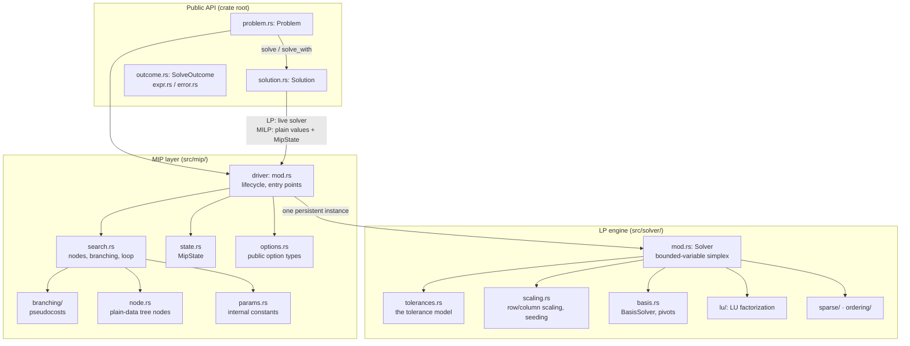
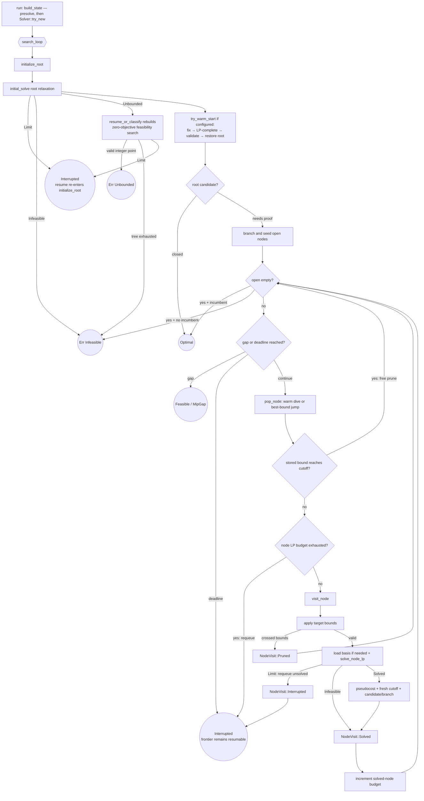
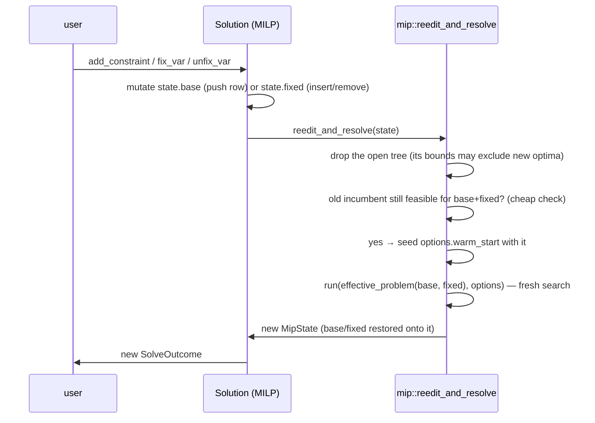

# microlp Architecture

This document explains how the solver works: how a problem flows from the public API
through the simplex engine and the branch & bound search, why the pieces are shaped the
way they are, and where to plug in improvements. It is written to be sufficient on its
own — a person (or an agent) who has read this should be able to navigate the codebase,
predict its behavior, and extend it safely.

---

## 1. The big picture

microlp solves **linear programs** (LP: continuous variables, linear constraints, linear
objective) and **mixed-integer linear programs** (MILP: same, but some variables must take
integer values). It is organized as two layers with a deliberately narrow interface between
them:



Three principles shape everything:

1. **One persistent LP solver per search.** The branch & bound tree never clones the solver
   and never grows the LP. Branching is expressed purely as *variable bound changes* on the
   single `Solver` instance, and tree nodes are plain data that describe how to reconstruct
   a state on that instance.
2. **No unfinished node LP is consulted.** A deadline is observed between completed simplex
   pivots and may stop a solve before optimality. The driver pushes that node back
   **unsolved** and makes no bound, candidate, or branch decision from the unfinished state.
   The next visit rebuilds the node from its own data. Node budgets and global search
   decisions are applied between node LP solves.
3. **Loud failures over silent wrong answers.** Child-LP errors are never conflated with
   infeasibility; numerical failures either recover through a documented valve or propagate
   as errors; candidate solutions are re-validated before being accepted. Where the code
   cannot do something properly it panics with a message rather than approximating.

### Module map

| File | Responsibility |
|---|---|
| `src/lib.rs` | Crate root: the module wiring and the `pub use` re-exports that define the public API's paths. Every public item lives in a sibling module and is re-exported here, so `microlp::Problem` and friends are unaffected by where the code sits. |
| `src/problem.rs` | `Problem`, `VarDomain`, and the solve entry points. Owns solve/edit timing and the pure-LP model-to-engine seam in `Problem::solve_with` (presolve, then `Solver::try_new`). |
| `src/solution.rs`, `src/outcome.rs` | `Solution` (a validated assignment, its read-out and its post-solve edits) and `SolveOutcome` / `InterruptedSolve` (what a call returns and how it is resumed). |
| `src/expr.rs`, `src/error.rs` | The model vocabulary (`OptimizationDirection`, `Variable`, `LinearExpr`, `ComparisonOp`) and the `Error` type. |
| `src/presolve/` | Presolve: activity-based bound tightening, forcing / singleton / redundant-row elimination, variable fixing and substitution, and in MIP mode integer bound rounding, binary coefficient tightening and dual fixing — all on the original variable indices, so there is no postsolve (§2, §7). `mod.rs` holds the contract and the entry point, `work.rs` the reduction passes, `model.rs` the data, `params.rs` the constants. |
| `src/solver/` | The simplex engine. `mod.rs` is `Solver` itself (bounded-variable primal/dual simplex, basis management, and the small contract surface the MIP layer uses); `tolerances.rs` is the tolerance model of §7; `scaling.rs` turns a user problem into the scaled representation and seeds the starting vertex; `basis.rs` is the basis inverse and the pivot descriptions; `costs.rs` is the dual simplex's working costs (perturbation, shifting, the correction of dual infeasibilities, the cleanup), `bounds.rs` the primal simplex's working bounds (perturbation, shifting, the cleanup), `cycling.rs` the cycling and stall detection of both, and `proof.rs` the proof of infeasibility the dual simplex needs before it may return `Infeasible`, with its last resorts (§3, §7). |
| `src/lu/`, `src/sparse/`, `src/ordering/` | LU factorization with eta-file updates, sparse containers, and the column ordering of the factorization (`order_simple`: the sparsest columns first, from the bucket queue in `ordering/cols_queue.rs`). |
| `src/mip/mod.rs` | The branch & bound lifecycle: building a search from a `Problem`, starting / resuming / re-editing it, bound and gap accounting, and validating a candidate against the user's original rows. |
| `src/mip/search.rs` | The search itself: node visits, warm starts, branching, pruning, and the outer search loop. |
| `src/mip/state.rs` | `MipState` (the complete, resumable search state) and `MipRun`. |
| `src/mip/options.rs` | The public option and report types: `SolveOptions`, `ResumeOptions`, `Tolerances`, `Stats`, `SolutionStatus`, `TerminationReason`. |
| `src/mip/node.rs` | `Node` (plain-data tree node) and `effective_bounds` (bound-change collapsing). |
| `src/mip/branching/` | Integrality checks and branch-variable selection (pseudocosts). |
| `src/mip/params.rs` | Named, documented internal constants (see §7). |
| `tests/suite/` | The problem-based correctness suite (see §9) — the safety net for all of this. |

---

## 2. Problem representation

`Problem` stores the model in original user terms: objective coefficients, per-variable
bounds and domains (`Real`, `Integer`, `Boolean`), and constraint rows.

Two normalizations happen at the boundary and hold everywhere inside:

- **Internal objective space is always MINIMIZE.** `Maximize` problems negate their
  objective coefficients at variable-creation time (`internal_add_var`), and the sign is
  flipped back exactly once per read (`Solution::objective`, user-facing `Stats.best_bound`).
  Everything inside the driver — incumbents, bounds, pruning, gaps — is minimize-space.
  When editing driver code, never reason about direction; it does not exist there.
- **A bound of magnitude 2^52 or more on its side of infinity is infinite.** `entry_bounds`
  (`INFINITE_BOUND`, the counterpart of HiGHS's `infinite_bound`) turns a lower bound at or
  below `-2^52` into `-∞` and an upper bound at or above `2^52` into `+∞` when a var is added
  (`internal_add_var`), and `Problem` stores the bounds so, as HiGHS's `assessBounds` writes
  them into its model. Presolve, the engine, the MIP's base problem, the post-edit incumbent
  prefilter and `Solution::fix_var`'s check all read those stored bounds, so none can compare
  a value with a bound as written (two such checks once refused an answer the solve itself
  had returned beyond one); bounds presolve derives are left as they are, as in HiGHS. So
  `f64::MAX` and `i64::MAX` behave as `f64::INFINITY` everywhere (issue #3): in the starting
  vertex, the ratio tests, every basis load, every edit, and the answer, which may lie beyond
  such a bound. Each side is judged on its own, as `assessBounds` converts them, so
  `x ∈ [5e15, f64::MAX]` is `x ≥ 5e15`, a var that lives beyond the threshold (such a var
  was once kept whole, started on its `f64::MAX` bound and overflowed its rows). HiGHS, whose
  infinity starts at its threshold, refuses a lower bound out there; here a value out there
  is data, as `fix_var` fixes a var at one the solve reported. A range that is a point or
  empty keeps its bounds as written, since its far bound does not lie beyond its near one: a
  var fixed beyond the threshold stays fixed and an empty range stays infeasible (HiGHS never
  widens such a range either: converting one of its bounds puts the other beyond the
  threshold too, which it refuses). HiGHS defaults to 1e20 (it accepts any threshold from 1e15);
  2^52 is chosen because a row beside a var at a bound `B` with a coefficient `a` is held only
  to about `1e-14 |a| B` (§7), units at 2^52 when `|a|` is near one: with 1e20, bounds in
  between written for infinity, `i64::MAX` among them, changed answers on the fuzz corpus (the
  measurement is in `INFINITE_BOUND`'s doc; both sides are pinned in
  `src/tests/regressions.rs`). The price: a bound in `[2^52, 1e20)` meant as a bound is none
  (`max x` with `x ≤ 5e15` is `Unbounded`, where HiGHS at its default returns 5e15, and so is
  `max x` with `x ∈ [5e15, 1e16]`), even where small coefficients would let the rows resolve
  it, since the threshold, like HiGHS's, is on the bound as given, not on `|a| B`.
- **Every constraint row gets a slack variable.** A row `a·x ≤ b` becomes `a·x + s = b`
  with `s ∈ [0, +∞)`; `≥` gives `s ∈ (−∞, 0]`; `=` gives `s ∈ [0,0]`. So the `Solver`'s
  variable universe is `num_vars` *structural* variables followed by one slack per row
  ("total vars"), and every constraint is an equality against the basis matrix. A row's
  original sense is recoverable from its slack's bounds — `Solver::first_violated_row`
  exploits exactly this.
- **The matrix is scaled by powers of two, rows and columns.** Before the simplex engine
  sees a model, `column_scales` derives a power-of-two factor per structural column (the
  rounded geometric mean of the column's extreme coefficients, iterated against row factors
  as HiGHS's `equilibrationScaleMatrix` and SoPlex's `SPxGeometSC` do, but not bounded to
  HiGHS's `2^±20`, since this engine takes coefficients HiGHS refuses (1e15 and more) and a
  bounded factor leaves such a row too wide for its pivot floors (see `column_scales`);
  skipped entirely when every coefficient already lies within `[1/8, 8]`, and never for a
  fixed column), and each row is then equilibrated so that its
  largest coefficient of a var that can move lies in `[1, 2)`. The engine works on
  `x'_j = x_j / s_j`; powers of two mean no datum is rounded, integrality of `s_j x'_j` is
  exact, and a bound change in user units maps to exactly one internal bound. Everything
  that crosses the `Solver` boundary — values, bounds, the objective, the row checks — is
  converted, so the MIP layer and the public API only ever see user units. A coefficient
  that is tiny only because its row or column is written in awkward units thereby becomes
  of order one, which is what makes the pivot tolerances below meaningful.

- **Presolve runs before the engine sees the model** (`src/presolve/`, on by default,
  `SolveOptions::presolve`). It never changes the variable set: a variable it removes is
  fixed by `lo == hi` bounds (the engine prices such vars out natively) and its value is
  substituted out of every row for presolve's own deductions; rows may be dropped or
  rewritten freely because nothing outside the `Solver` addresses them by index. That is
  what makes a postsolve layer unnecessary — solution read-out, resume, warm starts and
  post-solve edits all work off original indices, and the MIP search's root bounds are the
  presolved bounds. Surviving rows are emitted as the user wrote them, fixed terms included
  (a row keeps the tolerance of its full magnitude only with them in it); only a row whose
  coefficients were rewritten is rebuilt. `Mode::Lp` (the pure-LP path) applies only
  feasible-set-exact reductions, so the live solver stays sound under every later edit;
  `Mode::Mip` adds reductions that preserve the integer feasible set or merely some
  optimum, sound because MILP edits re-solve from the untouched base problem and incumbents
  are validated against the original rows. Every presolve decision is made against the
  engine's tolerance contract (§7), and presolve hands the rows it dropped or rewrote to
  the engine as they were written, for the checks at the boundary (§3.1): a reduction
  that is wrong shows as a loud error, never as a returned point that violates a row.

`prepare_row` is the single row-normalization contract used by both `Solver::try_new` and
incremental `Solver::add_constraint`. It settles the rows whose data alone decide them
(`trivial_row_verdict`, which presolve applies too: an empty row is held to the contract at
activity zero, an infinite right-hand side is no constraint on the side the row leaves open
and unsatisfiable on the side it constrains, and a NaN or an infinite coefficient makes a
row no point satisfies), computes the power-of-two scale, scales coefficients and the
right-hand side together, and derives slack bounds.
The two callers still own their genuinely different work: initial matrix/basis construction
versus extending a live matrix and repairing the current basis.

---

## 3. The LP engine (`src/solver/`)

The simplex core is the minilp lineage: a **bounded-variable
revised simplex** with both primal and dual iterations, steepest-edge pricing, the Harris
two-pass ratio test for numerical stability (in the dual simplex as a bound-flipping ratio
test in Harris groups, as HiGHS's `HEkkDualRow::chooseFinal`: a boxed var the dual step
passes is moved to its other bound instead of entering), and an LU-factorized basis updated
by eta matrices (refactorized when the eta file outgrows the factors).

The dual simplex carries HiGHS's anti-degeneracy package (`src/solver/costs.rs`,
`src/solver/cycling.rs`; details and constants in §7): a dual phase works on *working costs*
— the costs in force, perturbed at the start of the phase unless it starts near optimal, with
its starting dual infeasibilities corrected (boxed vars moved to their dual feasible bound,
other costs shifted) and an entering var's cost shifted wherever the step would otherwise run
backwards — and it ends by restoring the costs in force; `run_phases` recomputes the reduced
costs from them once it has verified the values, and its primal phase removes any dual
infeasibility that uncovers.
The primal simplex carries its counterpart (`src/solver/bounds.rs`): a primal phase works on
*working bounds* — the true bounds, perturbed at the start of the phase unless it starts near
optimal, and shifted wherever a step or a recomputation leaves a basic var outside them beyond
its tolerance — and it ends by restoring the true bounds, taking the non-basic vars that sat at
a moved bound back to the true one; `run_phases` verifies the point, and the dual phase of its
next round removes the primal infeasibility that uncovers. Only the first phase of a re-solve
may be perturbed, and the primal phase after a phase-1 dual phase on the artificial objective
(it is the real optimization, not a cleanup); every other phase cleans up after the one before
it, as HiGHS runs its cleanup passes: unperturbed, and a dual cleanup with phase 2 forced (its
dual infeasibilities shifted, never corrected by flipping a boxed var).
Around both, a vertex hash makes a basis change that keeps returning to visited vertices taboo,
and a stall bound ends a phase whose objective does not move; both end in a loud error, never
a hang.
The dual simplex returns `Infeasible` only on a proof (`src/solver/proof.rs`, HiGHS's
`proofOfPrimalInfeasibility`): when no var can repair a violated row, the row of the basis
inverse, refined twice (its corrections kept to twice the precision of an `f64`, the second
bounding the error of each multiplier), suggests a certificate, which is summed from the
model's data in compensated arithmetic and must leave a gap beyond the tolerance of the row's
basic var (every coefficient counts at its finite bound, however small, and makes the range
unbounded at an infinite bound, unless the error of the multipliers could make it zero: the
one concession, which HiGHS makes up to an absolute `1e-9` and SCIP within its dual
feasibility tolerance). A row whose certificate proves nothing is made taboo and the
phase goes on with the other rows; when only such rows are left, the last resorts are SoPlex's
instable pivot and then a move of the vars whose entries are below round-off, as the
certificate says they can repair the row, and after them a loud error (§7, *Infeasibility only
from a proof*).

State you need to know when reading it:

- `basic_vars[row]` — which variable is basic in each row; `basic_var_vals` their values,
  `basic_var_mins`/`basic_var_maxs` their bounds (during a primal phase, the working bounds of
  `bounds.rs`).
- `nb_vars[col]` / `nb_var_vals` / `nb_var_states{at_min, at_max}` — non-basic variables
  sit at one of their bounds, within its tolerance (or at 0 if free).
- `is_primal_feasible` / `is_dual_feasible` — honest flags; every solve path is a state
  machine over them. `initial_solve` = restore primal feasibility (dual simplex /
  phase-1-style) then optimize (primal simplex).
- `cur_obj_val`, `nb_var_obj_coeffs` (reduced costs), `lp_iterations` (cumulative pivot
  counter for stats).

### 3.1 The contract surface the MIP layer relies on

The engine exposes a small contract surface; everything the B&B does goes through these.

**`set_var_bounds(var, min, max) -> Result<(), Error>`** — change a variable's bounds in
place. Basic variable: update the row's bound mirrors, flag primal-infeasible if its value
fell outside. Non-basic variable: clamp its value to the new range, propagate the delta into
the basic values through the variable's column (same mechanism as `fix_var`), recompute its
at-bound flags, and downgrade `is_dual_feasible` if the move broke the reduced-cost/bound
pairing. Crossing bounds (`min > max`) or either bound being NaN returns
`Err(Infeasible)` with state untouched. Infinite bounds remain valid. It does **not** run
simplex — callers decide when to reoptimize.

*Why this is the branching primitive:* tightening a bound leaves every reduced cost
untouched, so the current basis stays **dual feasible** — re-solving is a short dual-simplex
run warm-started from the parent's optimal basis, typically a handful of pivots. This is the
single biggest performance lever in the design (see §10).

**`reoptimize() -> Result<StopReason, Error>`** — the re-solve entry: dual simplex if primal
feasibility is broken, then (only if needed, e.g. after loosening bounds or a basis load
with drift) recompute reduced costs and run primal simplex. Returns `StopReason::Limit` if
the deadline fires mid-run — leaving the honest feasibility flags so a later call continues
where it left off.

**`snapshot_basis() / load_basis(&Basis)`** — a `Basis` is one status per total variable:
`Basic | AtLower | AtUpper | Free` (~1 byte each). That is the *entire* warm-start state a
tree node needs. `load_basis` rebuilds everything from statuses + **current** bounds:
non-basic values from their status's bound, basic values and reduced costs recomputed from
scratch, LU refactorized, feasibility flags recomputed honestly. Two contracts matter:

- *Statuses are interpreted against the current bounds.* A status pointing at a bound that
  has since moved is remapped (nearest finite bound, else 0) rather than rejected — B&B
  jumps load a parent basis **after** applying different bounds, so this is load-bearing
  by design, not sloppiness.
- *On `Err`, solver state is unspecified* and must be restored by a subsequent successful
  load. `slack_basis()` (all slacks basic = identity basis matrix) always loads successfully
  and is the designated recovery everywhere.

**`reported_values()`** — the verified point in user units, fixed vars at their value: what
every read-out and every candidate starts from.

**`first_violated_row(values)` / `first_violated_bound(values)` / `objective_of(values)`** —
evaluate an explicit structural-variable vector (user units) against the stored rows (sense
recovered from slack bounds) and bounds within the **absolute** user tolerance floored at
the round-off of the row or bound (`row_tolerance`, through `outside`), and compute its
objective. A value or row activity that is not finite violates every bound and row (a
point is finite). These are the contract check: the rounded-incumbent guard (§5.4) and the
pure-LP path (`SolveOutcome::from_lp_stop`, on every solve, edit and resume) apply them.
They evaluate a row exactly as the engine's own verification does (`row_activity`, term
for term in the same order), so a point the engine has verified passes them by
construction, and they are independent of the current basis values, so a rounded candidate
is judged on its own merits. `first_violated_row` also checks the rows presolve dropped or
rewrote, as the user wrote them (`validation_rows`, installed from `Presolved`): the
engine never pivots on them, so the answer is held to the whole model only here.

---

## 4. The MIP data model (`src/mip/node.rs`, `MipState`)

```rust
// A tree node is PLAIN DATA — no solver machinery anywhere:
Node {
    bound_changes: Vec<(var, lo, hi)>, // cumulative from the root; later entries win
    basis: Basis,                      // the PARENT's optimal basis (warm start)
    lp_bound: f64,                     // parent's LP objective = valid lower bound here
    depth, parent_id,                  // parent_id detects warm dives (§5.2)
    branch_var: Option<usize>,         // None for the root, Some(var) for children
    branch_up, branch_frac             // metadata feeding pseudocost updates (§5.6)
}
```

Reconstructing any node's starting state = apply its `bound_changes` on top of the root
bounds, load its `basis`, reoptimize. That is the whole trick: because nodes carry no live
state, they are trivially storable, resumable, and cheap (a basis is `total_vars` bytes; a
bound-change list is `depth` entries).

The optional branch variable is a correctness distinction: the root has no creating branch
and therefore must never record a pseudocost observation. Every child stores the variable
and direction that created it.

`MipState` is the complete, resumable search:

| Field | Role |
|---|---|
| `solver` | the ONE live LP engine |
| `root_bounds`, `applied` | original bounds + which changes are currently applied to the solver (for diffing when switching nodes) |
| `open: Vec<Node>` | the frontier (LIFO tail = current dive; best-bound scan on jumps) |
| `incumbent: Option<Incumbent>` | best integer solution: **rounded** values + `objective = c·x_rounded` |
| `node_seq`, `last_solved_id`, `diving` | warm-dive detection + node-selection mode |
| `pseudocosts`, `stats`, `options`, `deadline`, `direction` | search intelligence and bookkeeping |
| `base: Problem`, `fixed: BTreeMap<var, val>` | the CLEAN user problem + user-level fixes — the substrate for post-solve edits (§5.8) |

`Solution` for a MILP holds `SolutionStatus`, `TerminationReason`, and this `MipState`
boxed. User reads come from its validated incumbent's plain rounded values.
`InterruptedSolve` also retains the live state for resume, but exposes only its reason and
statistics. For a pure LP, `Solution` keeps the live solver (that is what makes LP
incremental editing cheap).

---

## 5. The branch & bound search (`src/mip/`)

### 5.1 Lifecycle



### 5.2 Visiting a node: warm dives vs jumps

When a node is popped, its target bounds are diffed against `applied`: variables no longer
constrained are reset to root bounds, changed ones are set. Then one question decides the
cost of the visit: **is the solver already sitting at this node's parent's optimum?**

- `last_solved_id == node.parent_id` → **warm dive**: the parent was the immediately
  previously solved node, its basis is live in the solver, and the child differs by exactly
  one tightened bound. Skip the basis load entirely; `reoptimize` is a short dual-simplex
  run. This is the common case while diving.
- Otherwise → **jump**: load the node's stored parent basis (one refactorization), then
  reoptimize. `last_solved_id` is cleared on every path where the solver moves away from a
  just-solved optimum (prune-after-solve, infeasible, requeue, incumbent adoption), so the
  warm-dive check can never false-positive: ids are unique per branching.

### 5.3 Node LP solving and the robustness valves

`solve_node_lp` wraps `reoptimize` and owns error discrimination:

- `Err(Infeasible)` → genuinely infeasible node → prune. Correct and cheap: the engine
  returns it only on a proof checked on the model's data (or on bounds that cross), never on
  a row it merely cannot repair (see below), so an unproven verdict cannot prune a feasible
  subtree, as HiGHS's MIP prunes on its LP's proven infeasibility only. The one gap is the
  proof's concession: a coefficient on an infinite bound counts as zero where the error of the
  multipliers could make it zero (the bound the refinement puts on each multiplier's error,
  carried through the var's entries, some `1e-30` of its terms in well-conditioned bases), so
  a node could be pruned wrongly through it only if a coefficient the data leave lay within
  that error and, times its var's value, made room at every point of the node (§7). A
  coefficient of `f64` round-off size is no residual (a row the certificate leaves out can
  leave a basic var the model's own `-2^-50`), and conceded below that round-off it once
  pruned a feasible MILP's root node
  (`a_node_lp_whose_room_is_a_basic_vars_coefficient_is_not_pruned_and_is_a_known_limitation`).
- `Err(Unbounded)` → impossible for a bounded node → surfaced as `InternalError`.
- Any other error, such as a singular LU from numerical degradation, or a row the dual
  simplex can neither repair nor prove infeasible → **retry once from
  the slack basis** (identity, cannot fail to load),
  re-solving the node from scratch; a second failure propagates. The retry is per-node-visit
  — it cannot mask a systematic failure.
- `Ok(Limit)` → the deadline fired mid-solve → the node is pushed back **unsolved** and the
  search returns `Interrupted`. Nothing uses the coherent but non-optimal state as a solved
  node: the next visit starts from its own bounds + basis data.

Inside the engine, `run_phases` alternates the dual phase (`restore_feasibility`) and the
primal phase (`optimize`) until a state passes verification (§7): a phase's own exit test
runs on incrementally updated numbers, so a phase may end on drifted values, and only a
verified state is reported as `Finished`. "No eligible entering column for a violated row"
is not a proof of infeasibility, so the dual phase first rebuilds (fresh factorization, values,
reduced costs) and re-examines the row, where a phantom violation dissolves, and then declares
infeasibility only if the row's certificate, summed from the model's data, proves it (§7,
*Infeasibility only from a proof*). The rebuild is armed once per stall and any successful pivot
re-arms it, so it cannot loop; a row the proof leaves open is made taboo, and the last resorts
for it end in a loud error rather than a verdict.

### 5.4 Incumbents and the rounded-feasibility guard

When a node's LP solution is integral within `int_tol` (default `1e-6`), it is a *candidate*
— not yet an incumbent. Every solver-produced candidate enters `try_adopt_incumbent`, which
rounds integer variables and applies one validation funnel:

1. `candidate_variables_feasible` rejects malformed lengths, non-finite values, invalid
   bounds, bound violations, and domain violations.
2. `Solver::first_violated_row` validates the vector against the rows, the ones presolve
   dropped or rewrote included, within the absolute `Tolerances::feasibility` (default
   `1e-7`) floored at each row's round-off (§7).
3. `objective_of` must produce a finite objective before the incumbent can change.

Post-edit warm-start filtering deliberately remains separate: `incumbent_feasible` checks
the clean `Problem` plus its fix overlay in original user scale before a solver exists. Both
paths share variable/domain validation, but their row representations are not conflated.

Why this exists — the **big-M trap**: with `int_tol = 1e-6`, a relaxation value like
`b = 0.999999995` counts as integral. But if `b` multiplies a coefficient of `1e9` somewhere,
rounding it to `1` moves that row by `5.0` — a real violation hiding inside the integrality
tolerance. The guard makes this impossible to adopt:

- Guard **passes** → adopt: store the ROUNDED values with `objective = c·x_rounded`, so what
  the user reads is exactly self-consistent. If rounding changed any integer value, adoption
  does **not** close the node: the relaxation bound can still be strictly better than the
  rounded objective, so the driver branches on that below-tolerance fractionality to finish
  the proof.
- Guard **fails** → do not adopt; **branch on the offending below-tolerance variable**
  (children `⌊v⌋` / `⌊v⌋+1` fix it exactly, and the dive resolves the truth).
- If every integer variable is *exactly* integral yet the check failed, that is a
  contradiction — the engine reported `Finished` only after verifying the same point through
  the same evaluation, with half the contract to spare — and it is returned as an internal
  error rather than force-accepted.

During zero-objective unboundedness classification, the same funnel runs first; only a valid
integer point returns `Err(Unbounded)`. If classification is interrupted before an incumbent
exists, the public objective is evaluated from the original model coefficients and the
current working values rather than from the temporary zero objective.

The tolerance is deliberately **absolute**, never scaled by row magnitude: a relative
tolerance (`1e-7·|rhs|`) evaluates to ~100 on a 1e9-scale row and would swallow exactly the
violations the guard exists to catch. A false *rejection* from the absolute check is benign
(extra exact-fixing branching); a false acceptance would be a wrong answer.

### 5.5 Node selection, bound, and gap

- **Plunging DFS with best-bound jumps** (`pop_node`): while the last processed node
  produced children (`diving == true`), pop LIFO — cheap warm dives, incumbents found fast.
  When a dive dies out (prune/infeasible/leaf), jump to the open node with the **lowest**
  `lp_bound` (linear scan, first-minimum tie-break, `swap_remove`).
- **Global dual bound** = min over open nodes' `lp_bound`, clamped by the incumbent
  (stale nodes may carry looser bounds than a fresher incumbent). Open list empty →
  the bound *is* the incumbent: proof complete. Valid only between nodes — a popped node's
  subtree is otherwise unaccounted.
- **Gap** = `(incumbent − bound) / max(|incumbent|, ε)` in minimize space (sign-free — the
  formula is direction-invariant). `mip_gap > 0` may stop the search early with a feasible
  solution and `TerminationReason::MipGap`; the default `0.0` demands exact proof and adds
  zero overhead (the check short-circuits). During a positive-gap check, equality of the
  incumbent and global bound is still classified as an exact proof even when the open list
  contains dominated nodes.
- **Pruning** uses `cutoff(incumbent) = incumbent − max(ε, ε·|incumbent|)` with
  `ε = Tolerances::prune_epsilon` (default 1e-9), applied twice per node: against the stored
  parent bound *before* any LP work, and against the fresh objective after.

### 5.6 Pseudocost branching (`src/mip/branching/`)

The driver learns **pseudocosts**: per variable and direction, the average objective
degradation per unit of fractionality observed across solved child nodes.

- *Recording*: when a node with `branch_var = Some(var)` solves, its creating branch
  (`branch_up`, `branch_frac`) contributes
  `max(0, z_child − parent_bound) / branch_frac`. The root and every
  infeasible/interrupted node record nothing.
- *Selection*: maximize the product score
  `max(est_down·f_down, ε) · max(est_up·f_up, ε)` — variables whose BOTH directions hurt
  the relaxation are the ones worth deciding early. Before any observations exist, estimates
  fall back to `|objective coefficient| + ε` — with uniform coefficients this degrades
  gracefully to most-fractional.
- *Dive order*: of the two children, the one with the LOWER estimated degradation is pushed
  last (popped first) — dive toward the side more likely to stay feasible and good.

### 5.7 Warm starts

`SolveOptions::warm_start` accepts a (possibly partial) assignment. Evaluation happens once,
right after the root LP: fix the hinted variables to their (rounded, bounds-checked) values,
LP-complete the rest, and if the completion is integral, adopt it **through the same
feasibility guard as every other incumbent** — hints get no shortcut. Then restore the root
state *exactly* (bounds back, root basis reloaded, everything recomputed) so the search
starts from the true relaxation. Hints are advisory by design: unknown variables,
out-of-range values, infeasible or fractional completions all just drop the hint with a
debug log — a bad hint must never break a solve. An error discovered while evaluating the
hint is held until the temporary bounds and root basis have been restored, then propagated.

A warm start seeds the *incumbent*, which powers pruning; it does **not** carry the search
tree. Restarting the same model with an unchanged hint and the same deterministic node
budget repeats the same search prefix. Wall-clock cutoffs may vary, but still retain no
frontier. Consequently:

- To **continue** an interrupted solve of an unchanged problem: use `SolveOutcome::resume` —
  it keeps the open list and continues where it stopped, budget-for-budget.
- Restart-with-hint is the right tool when the problem **changed** (edits) or the state was
  lost. In a restart loop, once the carried hint stops improving, grow the budget so a later
  round can progress beyond the repeated search prefix (see
  `tests/suite/cases/warm_restart.rs`).

### 5.8 Post-solve edits

Applying post-solve edits to whatever internal state the search ended in — an incumbent
*leaf*, with branch bound-fixings still applied — would let feasible edits report
`Infeasible`. The edit model makes that impossible:



`base` is a clean copy of the user's problem that accumulates edits; `fixed` is the
`fix_var` overlay (so `unfix_var` can restore original bounds). Every edit re-solves the
*composed* problem from the root, warm-started by the surviving incumbent. Edits exist only
on a validated `Solution`, including a feasible-but-unproven one; an `InterruptedSolve`
cannot be edited. `unfix_var` returns `Result<(SolveOutcome, bool), Error>`, so every
limited re-solve remains typed explicitly.

### 5.9 Interruption and resume, end to end

Timing is centralized without hiding the entry points' different policies:

- A pure LP's initial timer starts before presolve and `Solver::try_new`, so construction and
  the initial simplex solve share one deadline. `SolveOutcome::resume_with` uses its explicitly
  supplied fresh budget; LP edits use the current operation time limit. `timed_lp_call` always accumulates
  elapsed time, including calls that return an error.
- A MILP's initial run and each post-edit rebuild use its `SolveOptions`. `resume_with`
  replaces all three per-call controls on the retained search state with exactly the supplied
  `time_limit`, `node_limit`, and `mip_gap` values; `None` means unlimited budgets or no gap
  target. Plain `resume()` instead passes back the options used by the immediately preceding
  solve or resume call.

MIP interruption points, in loop order, are: empty open list; when a positive gap target is
active, exact incumbent/bound equality and then the gap target; deadline; then node budget.
Checking proof conditions first prevents a completed proof from being mislabeled as interrupted
or merely gap-satisfied. `node_limit` is per search call, so every `resume` receives a fresh node
budget; the retained frontier still supplies continuity between calls.

`SolveOutcome` makes answer safety structural:

| Outcome | Status/reason | Accessors |
|---|---|---|
| `Solution` | `Optimal / ProvenOptimal` | objective, values, gap, stats, edits |
| `Solution` | `Feasible / MipGap`, `TimeLimit`, or `NodeLimit` | objective, values, gap, stats, edits |
| `Interrupted` | `TimeLimit` or `NodeLimit` | reason, stats, resume only |

A limit is an outcome, never an `Error`. Solve failures use `Infeasible`, `Unbounded`,
`InvalidOptions`, `InvalidOperation`, or `InternalError`.

---

## 6. Public API tour

```rust
let mut problem = Problem::new(OptimizationDirection::Minimize);
let x = problem.add_integer_var(3.0, (0, 10));
let y = problem.add_var(4.0, (0.0, 10.0));
problem.add_constraint(&[(x, 1.0), (y, 2.0)], ComparisonOp::Ge, 5.0);

let mut options = SolveOptions::default();
options.time_limit = Some(Duration::from_secs(10));
options.node_limit = Some(100_000);          // deterministic alternative
options.mip_gap   = 0.01;                    // stop at a proven 1% gap
options.warm_start = Some(vec![(x, 2.0)]);   // advisory hint
options.tolerances.feasibility = 1e-7;       // expert knobs, see §7

let mut outcome = problem.solve_with(options)?;
if matches!(
    outcome.termination_reason(),
    TerminationReason::TimeLimit | TerminationReason::NodeLimit
) {
    let mut resume = ResumeOptions::default();
    resume.time_limit = Some(Duration::from_secs(10));
    outcome = outcome.resume_with(resume)?;
}

if let Some(sol) = outcome.solution() {
    let _ = (
        sol.status(),
        sol.termination_reason(),
        sol.objective(),
        sol.var_value(x),
        sol.gap(),
        sol.stats(),
    );
}

// resume() would reuse the satisfied gap. resume_with(default) replaces it
// with no gap target and continues toward exact proof.
let outcome = outcome.resume_with(ResumeOptions::default())?;
```

Reading values: `var_value` rounds integer variables (and asserts the stored value was
already integral-clean — a failed assert means a solver bug, not user error);
`var_value_raw`/`iter`/indexing return the incumbent's already-rounded values for a MILP
with an incumbent, or the optimal live working values for a pure LP. Interrupted outcomes
expose no answer-value accessors.

---

## 7. Numerical policy — every tolerance, in one place

Two homes, by audience:

**User-facing — `SolveOptions` (+ nested `Tolerances`):**

| Knob | Default | Gates |
|---|---|---|
| `presolve` | `true` | run the reductions of `src/presolve/` before the solve (§2); off, the engine gets the model as written |
| `int_tol` | `1e-6` | "is this LP value integral?" — a rounded feasible point may be adopted, but branching continues until its LP point is exact. Must be finite and in `[0, 0.5)`. |
| `mip_gap` | `0.0` | early-stop proof quality (relative gap) |
| `tolerances.feasibility` | `1e-7` **absolute**, at least `1e-10` (HiGHS's minimum) | the rounded-incumbent guard and the post-edit incumbent pre-filter (§5.4 explains why absolute) |
| `tolerances.integrality_rounding` | `1e-5` | integrality check in the edit pre-filter; `var_value`'s sanity assert pins the *default* deliberately |
| `tolerances.prune_epsilon` | `1e-9` | the pruning cutoff slack |

`tolerances.feasibility` reaches presolve and the engine: `Problem::solve_with` and the MIP
`build_state` pass it to `presolve` and `Solver::try_new`, the engine holds every row to it
(see below) and presolve decides against it, so what presolve assumes, what the engine
reports and what the guard accepts are the same contract.

**Internal — `src/mip/params.rs`, `src/solver/tolerances.rs`, `src/solver/scaling.rs`,
`src/solver/costs.rs` and `src/solver/cycling.rs` consts (each documented at its
definition):** `SCORE_EPS`, `PSEUDOCOST_INIT_EPS`, `BRANCH_FRAC_GUARD` (all `1e-6`),
`GAP_DENOM_GUARD` (`1e-10`), `HINT_BOUNDS_SLACK` (`1e-9`), `DEADLINE_CHECK_INTERVAL`
(`1000` pivots), `LU_STABILITY_THRESHOLD` (`0.1`), `MIN_DUAL_EDGE_WEIGHT` (`1e-4`, the floor
of the dual steepest-edge weights, as HiGHS; the primal weights are floored at their lower
bound `1 + lambda^2`, as HiGHS too), `INFINITE_BOUND` (`2^52`, §2), the anti-degeneracy
constants of both simplex phases (the cost perturbation base `5e-7` and row scale `1e-12`, the
cost `INFINITE_COST` = `1e20` beyond which a cost is not perturbed, the bound perturbation base
`5e-7` in user units, the near-optimal thresholds of 1000 infeasibilities and an infeasibility
of `1e-3`, `STALL_ITERATIONS` = 10,000, and `LOOP_HARRIS_REDUCTION` = `0.01`, the cut of the
primal ratio test's tolerance per further round of `run_phases`; all HiGHS's or SoPlex's, see
*Anti-degeneracy* below), and the engine's
tolerance model in `solver/tolerances.rs`, which is one rule applied to three kinds of
comparison — every tolerance is
either the user's contract or a property of the arithmetic, and every comparison of a
computed quantity is floored at that quantity's round-off:

| Comparison | Tolerance | Constants |
|---|---|---|
| Is a basic slack (row) within its bounds? | `slack_tol`: the engine's share (`ROW_BUDGET_SHARE`, ½) of the contract `row_tolerance(feasibility × r, m)` in the row's scaled units, at the row's magnitude `m = |b| + Σ|a_j x_j|` at the current values (refreshed whenever the rows are checked). The other half is the reserve: for the snap of an integer or fixed var, and for evaluating the row in another order of operations. | `ROUNDOFF_FLOOR = 1e-14`, `ROW_BUDGET_SHARE = 0.5` |
| Is a structural var within / at its bounds? | `structural_tol`: the user contract in user units, but never more than any of its rows can absorb when the value is snapped to the bound (`snap_budget`: the row's reserve over the var's scaled coefficient, minimised over its rows), floored at the round-off of the bound magnitude. One rule for every var: it keeps a big-M row within contract when its binary is rounded, and a fixed var's report at its value within the rows presolve substituted it out of. | |
| Is a reduced cost zero? | `dual_tol`: `EPS` floored at the round-off of `|c_j| + Σ|a_ij y_i|`, refreshed with the multipliers. | `EPS = 1e-10` |
| Is a tableau entry a candidate pivot? | genuine if above the round-off of computing it (`ENTRY_ROUNDOFF` relative to its column's largest entry in the primal test, and in the dual test to its row's largest entry over the columns that are not excluded and that the scalings made comparable: all but those of vars fixed when the model entered the engine, which keep the user's units, so a fixed column's `1e17` cannot make a genuine `1` noise, while an entry that cannot help still measures the round-off the row's entries share); a genuine entry at least `PIVOT_REL_TOL` of the largest genuine entry among the vars that could enter and are not excluded (rows that could block, in the primal test) is preferred, a smaller one is the pivot only when nothing larger will do. In the primal test every genuine entry bounds the step, with each basic var's tolerance counted from where it sits (the whole of it in the first round of `run_phases`, a hundredth of it more in each further round, as SoPlex restricts its ratio test when its algorithms loop; a var past its bound by more than that admits no step toward it, a limit of zero, never a negative one); a basic var a step still leaves outside its bounds beyond its tolerance (through an entry below the round-off floor, or a recomputation) has its working bound shifted, and a step that would run backwards is zero (see *Anti-degeneracy and cycling in the primal simplex* below). In the dual test a boxed var the step passes is flipped instead of entering; a row with no candidate is no verdict: it proves infeasibility only through its certificate (next row), and the last resorts for a row that proves nothing take any entry of at least `INSTABLE_PIVOT_TOL` (SoPlex's absolute `lowstab`) as a pivot, then move boxed vars through entries below the floors as the certificate says they can repair the row (see *Infeasibility only from a proof* below). | `ENTRY_ROUNDOFF = 1e-15`, `PIVOT_REL_TOL = 1e-7`, `INSTABLE_PIVOT_TOL = 1e-10` |
| Does a row that no var can repair prove the model infeasible? | its certificate (the rows combined with the row of the basis inverse, refined twice, summed in compensated arithmetic from the model's data) leaves a gap beyond the tolerance the engine holds the row's basic var to, the one that made the row violated; every coefficient counts at its bound where that is finite; on an infinite bound one that the error of the multipliers could make zero (their bound, the refinement's second correction of each, carried through the var's entries, plus the round-off of the compensated sum) counts as zero (the concession, for any var) and any other voids the proof, and so does a number of the certificate that is not finite; the refinement bounds the error only where it converged, its second correction at most `2^-53` of the row in the max norm, and otherwise only the round-off of the compensated sum counts as zero (see *Infeasibility only from a proof* below) | `REFINEMENT_CONVERGED = 2^-53` (LAPACK's `EPS`) |
| Do the row and column computations of the pivot element agree? | to `PIVOT_AGREEMENT_TOL` relatively, or to `ENTRY_ROUNDOFF` of the computations' scale for an element above `LU_SINGULAR_REL` of that scale (below it, round-off agrees with anything of its size, so only relative agreement tells a genuine element from noise); else rebuild (stale factorization) or exclude the entry as noise (fresh one), for the column (primal test) or row (dual test) it was judged in only, until the next pivot (the primal test once kept its exclusions until then whatever column entered, and a taboo that changed the column passed a genuine blocking row unseen: `rows_excluded_as_round_off_for_one_column_block_another`). Once they agree, each is used where it belongs, as in HiGHS: the column's element for the primal step, the eta file and both steepest-edge updates (which apply it with the rest of the column), the row's for the dual simplex's reduced-cost update (which runs along the row). | `PIVOT_AGREEMENT_TOL = 1e-7` |
| Is the LU pivot column singular? | eligible part below `LU_SINGULAR_REL` of the column's largest transformed entry. | `= ROUNDOFF_FLOOR` |

Two rules complete the model. **Absorption:** when no var can enter a violated row's pivot
regularly, a non-basic continuous var or slack may enter by crossing its bound (or its
fixed value) by no more than its own tolerance — "at a bound" means within tolerance
everywhere, so it is still at its bound afterwards; this is how a round-off-level violation
that a tightly held var cannot carry is handed to a row or var that can. Integer vars never
absorb. The absorber enters on a zero dual step, its cost shifted by its whole reduced cost
(see *Anti-degeneracy* below): such a pivot is no step of the dual simplex, and taking it as
the step `d_q / a_q` ran backwards by any amount (C2-12 of the solver review). The choice is
the absorber whose shift can do the least harm when it is given back: a fixed var's none (any
reduced cost is feasible for it), any other's its reduced cost; so the ratio is that reduced
cost over the entry, and among the absorbers within the Harris relaxation of the smallest
ratio the largest entry enters (an entry `PIVOT_REL_TOL` below the largest absorbing one is
no candidate). A fixed slack thus wins where it can, as it did when the clamp priced it at
zero. Neither cost shifting nor the infeasibility proof makes the rule unnecessary: the
violations it repairs are primal ones the engine's own tolerances create (half the contract
for a row, a bound tolerance capped by the rows' reserve), which no dual step removes.
Without it six lib tests came back `Infeasible` on feasible models before the proof, and with
the proof eight fail, six of them `Infeasible` again: the models are feasible only with vars
across their bounds within their tolerances, beyond what the engine's tolerance of the row's
basic var allows the gap, and the proof, which compares with that tolerance and counts every
other term exact as HiGHS's does, proves them infeasible for the engine; the other two end in a
loud error and a singular basis. The full contract of R4 is what can replace it.
**Verified termination:** a phase reports `Finished` only after `verify_primal` and exact
reduced costs (recomputed only when pivots have updated them incrementally since); a primal
step that would run backwards is zero, the leaving var leaving where it sits, so no column is
ever refused (see the primal simplex's anti-degeneracy below). `verify_primal`
runs `check_rows`: every basic slack is re-derived from its row, `s = b − Σ a_j x_j` at the
current structural values, so that a row's violation lives in its slack's value where the
dual simplex sees it; the slack tolerances are refreshed from the rows' magnitudes; and the
residual of every row whose slack is non-basic (how far the basic structural values are from
solving it) must lie within the row's tolerance, else the values are refined through the
factorization, then through a fresh one, then reported as a loud `InternalError` (the basis
cannot represent its vertex). Values within tolerance are not refined: the contract asks no
more, and moving last bits steers the branch & bound. The objective is always recomputed from
the values. What is reported (`reported_values`) is the verified point itself, with fixed
vars at their value; the checks at the boundary (`first_violated_row`, the MIP guard) repeat
`check_rows`' evaluation of a row term for term on that point (`row_activity`), against the
full contract, so a verified point passes them with the reserve to spare. Periodic
refactorization (`refactorize`) renews the factorization and, once per full basis turnover
of pivots, checks the rows and recomputes the values if they drifted; the eta file stores
`1/pivot`. A recompute is not a verification: on an ill-conditioned basis a solve through
the factorization can leave a residual above a row's tolerance, so recomputed values stay
unverified until the next phase exit checks and, if needed, refines them.

**Presolve** (`src/presolve/`, module docs) makes its decisions with the same model, in
user units: a row is held to the engine's *budget*, `ROW_BUDGET_SHARE` of
`row_tolerance(feasibility, m)` at the magnitude `m` of the corner the decision is about
(never over the whole box, so a bound of `f64::MAX` cannot inflate a tolerance), `m`
counting the right-hand side as written, fixed terms not substituted out; a continuous var
may sit outside its emitted bounds by its bound tolerance, so every activity range is
widened by `Σ|a_j|·bound_tol_j` before a verdict is drawn or a row dropped; equality (a
forcing row) is judged within `ROUNDOFF_FLOOR` of the sum; a bound implied by a row is
relaxed by the row's allowance (the budget, or for an integer var the full contract the
incumbent guard holds integer points to), plus the round-off of the cancellation it was
computed by, over the coefficient, so it never cuts a point the engine may return — a tiny
coefficient is thereby a weak witness, exactly as the engine treats it. A row becomes
bounds only where the bounds keep what the row does: a singleton row becomes its implied
bound itself (keeping the vertices the row makes) where the engine's bound tolerance keeps
the dropped row within its budget, a tighter row stays a row, and an equality fixes its
var only where it pins it within the var's own tolerance (a looser one stays a row, so
rows agreeing only within their tolerances are not made inconsistent); a forcing row, judged over the emitted
bounds, fixes its vars at their extremes only when every term's range is resolvable above
the row's round-off and the room the row leaves each var (its sliver plus the engine's
share of the absolute tolerance, over the coefficient) is room nothing resolves; and a
conversion is skipped when the round-off it moves into the var, amplified by the var's
coefficient in another row, would exceed that row's budget (the two rows disagree at the
level of their own round-off; only the simplex, which balances both, resolves that).
A row all of whose vars are fixed is judged as the boundary will judge it once dropped: the
row as written, at the fixed values, by the boundary's own evaluation (`row_violation`),
against the full contract (nothing the engine does moves such a row, so the budget has no
part in it). Each wave of the worklist processes the rows left with at most one term first,
as HiGHS's fast presolve loop removes row singletons first, so a singleton pins its var
before a multi-term row deduces anything about it.
Infeasibility is declared only when no point the engine could accept exists. The rows
presolve dropped or rewrote stay with the engine for the checks at the boundary (§3.1),
so a reduction that is wrong at the level of the tolerances shows as a loud error, never
as a returned point that violates a row.

The layering rule: the engine's tolerances decide *simplex* questions; `int_tol` decides
*integrality* questions; `feasibility` is the contract presolve, the engine and *solution
acceptance* all hold to; `prune_epsilon` decides *tree* questions.

What makes this one contract rather than several checks: the engine, the MIP guard, the
pure-LP validation and presolve share `row_tolerance` (the rule), `bound_tolerance` (its
instance for a var's bounds) and `outside` (the one comparison, written the way the engine
tests a basic var, `value < lo − tol || value > hi + tol`, which in `f64` is not the same
test as `value − hi > tol`). The engine holds a row to half the contract and caps every var's
bound tolerance by its rows' reserve, so the point it verifies passes the same evaluation at
the boundary with the other half to spare. Each counterexample the property tests found
before this model was a disagreement between two of those checks — a continuous var's bound
slack reaching a row through a coefficient above one, a fixed var's drift reaching a row
presolve had dropped, a residual counted once by the engine and once more by the guard — and
each is pinned as a regression test (for example
`property_counterexample_with_bound_slack_one_ulp_over_the_row_budget`).

**Bound flipping.** The dual ratio test takes the vars that can
help a violated row in the order the dual step reaches their breakpoints, in Harris groups as
HiGHS's `HEkkDualRow::chooseFinal` does: the first group is the Harris pass's candidates, each
next one the remaining candidates within the smallest relaxed ratio of the remaining. While the
groups so far leave the row short, the step passes the next group; the pivot is the largest
entry of the last group, or of the last earlier group that has an entry above a tenth of the
largest grouped entry (or above one) when the last has none, and the groups before the
pivot's are moved to their other bound (no pivot, no basis change), so their reduced costs
cross zero and they are dual feasible where they land (Maros 2003; Koberstein 2005). When the
first group carries the row, this is the plain Harris pass with nothing flipped; flips come
only with a positive dual step (a group after the first lies beyond the first group's bound),
as in HiGHS and SoPlex.

**Infeasibility only from a proof** (`src/solver/proof.rs`), as HiGHS's dual simplex declares
infeasibility (`HEkk::proofOfPrimalInfeasibility`, called by
`HEkkDual::assessPossiblyDualUnbounded`) and SCIP checks its LP solver's Farkas proof
(`lp/checkfarkas`). When no var can enter a violated row and none can absorb its move, the
ratio test says so and concludes nothing (`DualRatioTest::NoCandidate`):

- *Fresh data first*: the row is looked at again after a rebuild (fresh factorization,
  values, reduced costs), where a phantom violation from drift dissolves (netlib/brandy's did),
  as HiGHS and SoPlex rebuild or refactorize before either concludes.
- *The proof*: the row of the basis inverse `rho` combines the rows into one equation over
  every var, the certificate, in which the leaving var has the coefficient one and every other
  basic var zero. `rho` is refined first, twice, with HiGHS's `unitBtranIterativeRefinement`
  (which HiGHS applies to a pivot row it doubts, and offers for its proof, off by default):
  its residual `B^T rho - e_r`, summed in compensated arithmetic over the basic columns, is
  solved for and taken off, since through an ill-conditioned basis that residual is a basic
  var's coefficient, above any fixed round-off fraction, and times a huge bound it alone
  closed an infeasible node's gap (`an_ill_conditioned_basis_does_not_void_a_nodes_proof`;
  `the_row_of_the_basis_inverse_is_refined_before_the_proof`). The corrections are taken off
  into the trailing bits of a compensated row, as LAPACK's extra-precise iterative refinement
  keeps its solution in doubled precision (`DLA_GERFSX_EXTENDED` adds each correction into
  `(Y, Y_TAIL)` with `DLA_WWADDW`), where HiGHS rounds the refined row to `f64`: rounded, the
  row keeps the error of its own representation, about `1e-17` of the terms of each basic
  column, and times scaled bounds of `1e9` to `6e10` that error closed the gaps of three
  infeasible MILP nodes of the property stress, whose rows no `f64` multipliers combine
  exactly (`multipliers_no_f64_holds_do_not_void_a_nodes_proof`;
  `the_refined_row_keeps_its_correction_to_twice_the_precision`). The second correction is
  also the bound on the error of each multiplier, as LAPACK bounds the error of its refined
  solution by its last correction, and only where the refinement converged in LAPACK's sense,
  the correction at most `EPS = 2^-53` of the row in the max norm (`DX_X <= EPS`; beyond it
  no bound, and only the round-off of the compensated sums counts as zero:
  `the_refinement_bounds_the_multipliers_error_only_where_it_converged`); one step leaves
  the residuals the next corrects (in the big-M bases of `issue_48_switchable_dc_network_solves`
  the first correction reaches `2.6e-3` on multipliers of `7.4e6` and leaves basic
  coefficients of up to `1.6e-26` of their terms, the second `1e-33`). The certificate is
  summed from the model's data in compensated arithmetic (HiGHS's `HighsCDouble`; the scaling
  is by powers of two, so the scaled data are the user's exactly), and proves infeasibility
  when the largest value it can take over the bounds falls short of its right-hand side by
  more than the leaving var's tolerance. What the tableau row said (entries computed through
  the eta file and summed in `f64`, those below a round-off floor counted as zero) decides
  nothing, as the verdict before it did (C2-14, C4-33 of the solver review): that verdict
  counted an unboxed var's entry below the floor as zero (`wide_lp-1281` of the differential
  fuzz, `b3` of the property stress) and took the round-off of a computed vertex for a
  violation no var could repair (`lp_wide_1` of the property stress), both pinned in
  `src/tests/magnitudes.rs`, and so returned `Infeasible` on feasible models, and in a MIP
  pruned the node. As in HiGHS, a multiplier whose row would need its slack's infinite bound
  is dropped (without it an infeasible LP of the fuzz, `int_lp-970`, failed loudly). Every
  coefficient counts as it is at its var's bound in the certificate's direction where that is
  finite, however far below its terms it cancelled: the certificate is exact for its
  multipliers, and such a coefficient can be the data's own. `1` and `-(1 + 2^-50)` leave
  `-2^-50`, which at a bound of `-2e9` makes room for a feasible model's rows; counted as
  zero, as HiGHS counts the entries of its proof row below an absolute `1e-14` and SCIP's
  check those within its dual feasibility tolerance, it made a proof of that model
  (`a_round_off_coefficient_on_a_far_bound_is_no_proof_and_is_a_known_limitation`, which now
  fails loudly). So does a number of the certificate that is not finite (an overflow, such as
  Dekker's split of a fixed column's coefficient beyond about `1.3e300`), as non-finite data
  fail the dual ratio test.
- *The concession*: on an infinite bound a coefficient makes the range unbounded and the
  proof void, however small it is, unless the error of the multipliers could make it zero:
  the bound on each multiplier's error, carried through the var's entries in the rows the
  certificate keeps, plus the round-off of its compensated sum. Such a coefficient counts as
  zero, whatever its var. That covers a basic var's coefficient, zero for the exact row of the
  basis inverse (residuals of up to `1.5e-32` of their terms in the fuzz), a non-basic var's
  whose tableau entry is zero (the second correction, spread over the row by its solve, leaves
  the non-basic `x3` of `int_lp-1145` `3.6e-33` of its terms:
  `a_non_basic_vars_residual_does_not_void_a_proof`), and one whose rows' exact multipliers are
  zero, which the refinement leaves as its noise: in random switchable networks like issue
  48's, free bus angles in such rows get that noise times their entries, all of their terms
  (`a_switchable_network_whose_node_proofs_need_the_multipliers_error_solves`,
  `an_infeasible_switchable_network_whose_proof_needs_the_twice_refined_row`, both failing
  loudly before). Without the concession 41 solves of 28 models of the fuzz failed loudly (38
  on infeasible models, 3 at MILP nodes), and so did `issue_48_switchable_dc_network_solves`.
  No fixed threshold tells such a residual from a coefficient the data leave. HiGHS ignores
  coefficients on infinite bounds while their sum stays below `1e-9`, and with the bound of
  `-2e9` above gone that proved the same feasible model infeasible
  (`a_round_off_coefficient_on_an_infinite_bound_is_no_proof_and_is_a_known_limitation`, which
  now fails loudly). A concession for basic vars below the `f64` round-off of their terms
  proved a model built by the review of the concession infeasible: in `L + j + w = 1.000001`,
  `-(1 + 2^-50) j - w = 0`, `j + v <= 0`, `j` and `w` free, feasible at `j ≈ -1.13e9`, the
  exact row of the basis inverse `(1, 1, 2^-50)` leaves the third row out (its non-basic
  slack's entry `2^-50` needs the slack's infinite side), and the free basic `j` keeps the
  model's own `-2^-50`, `4.4e-16` of its terms, which was counted as zero, and the model's
  MILP pruned at its root node (`a_basic_vars_coefficient_in_a_row_left_out_voids_the_proof`,
  and the four `..._a_basic_vars_coefficient_...` known limitations of
  `src/tests/magnitudes.rs`, which now fail loudly: that row is exact, its error bound is the
  round-off of the compensated sums, and the coefficient counts). Floors below that fail the
  other way: one at the round-off of the doubled precision, `1e-28` of the terms, on the row
  refined once, failed issue 48's node proofs, and the round-off of the compensated sums
  alone, on the row refined twice, which the fuzz never exceeds, failed 12 of 480 solves of
  random switchable networks, where the error bound fails none (and the rule before it 13).
  Each multiplier's error is taken to be at most its own last correction, not, as LAPACK's
  normwise bound has it, the largest of all, which in a basis of issue 48 would allow a var
  whose rows have multipliers near `7e-16` (against `1.4e3` elsewhere) `3.9e-14` of its terms,
  ninety times the `-2^-50` above, where its own corrections allow `1.3e-19`; a multiplier
  whose error exceeded its correction would only fail a proof, loudly. The concession would
  still prove a feasible model infeasible through a coefficient the data leave that lies
  within that error bound, which the arithmetic cannot tell from zero: some `1e-30` of the
  terms in well-conditioned bases, up to `1.3e-19` in issue 48's.
- *The tolerance*: HiGHS compares the gap with its primal feasibility tolerance, the one its
  simplex holds every var to; here it is the tolerance the engine holds the leaving var to
  (`var_tols`), the one by which the dual simplex found the row violated, and every other term
  of the certificate counts as exact, as in HiGHS. The proof then says that no point the simplex
  could accept exists, the same test as the one that made the row leave. Any other tolerance
  leaves a band where a row is violated for the simplex but not infeasible for the proof, and
  nothing can act on it. Two were tried. With the user's absolute tolerance as a floor (the
  engine's is half of it for a row, and a var's is capped by its rows' reserve), two MILPs of
  the property stress failed loudly where their nodes had been pruned, one of them at a node
  that puts a var `1e-8` past its bound
  (`a_node_infeasible_by_less_than_the_contract_is_pruned`). With every term's contract
  tolerance summed, so
  that a proof would say that no point within the contract exists, the MIPs failed whose node
  rows disagree by less than their tolerances together (rows of magnitude `3.4e8` and `2.2e11`
  that disagree by `1.7e-6`, `a_cleanup_dual_phase_shifts_a_boxed_var_rather_than_flipping_it`;
  the wide MILP property at its CI seed); the only points that meet them split the
  disagreement between the rows, off every vertex. HiGHS proves all of those node LPs
  infeasible. The price is the engine's half budget: a model whose only points lie between the
  engine's share of the contract and the contract itself is reported infeasible (a row missed
  by `6e-8`), as it was before the proof; under the full contract of R4 the engine's tolerance,
  and so the proof's, is the contract's.
- *A failed proof* makes the row taboo, recorded as a bad basis change with no entering var
  (HiGHS's `kFailedInfeasibilityProof`), and the phase goes on with the other rows; a rebuild
  lifts the taboo, and the row is tried again on fresh data.
- *The last resorts*, when only taboo rows are left on fresh data and one of them failed its
  proof: SoPlex's instable leave (`SPxSolverBase::solve`), the ratio test again with every
  entry of at least `INSTABLE_PIVOT_TOL` (`1e-10`, SoPlex's `lowstab`) a candidate, once on
  those data; it solves the model of C2-06 through the LP edit path, `[1e17, 1]` with the
  fixed column's entry in the round-off scale
  (`a_fixed_vars_huge_coefficient_in_an_added_row_does_not_silence_it`). If it makes no pivot
  and the row is left again, the round-off repair (`Solver::round_off_repair`), which no
  reference has: the non-basic vars whose certificate coefficients are not round-off and that
  can move toward the row move there, flipped, or the last one only partway (it stays
  non-basic between its bounds, which a basis snapshot records as `Free` and a load puts back
  at a bound: C2-10's second issue, still open), largest reach first, and the moves are kept
  only if the leaving var then lands, computed through their columns; once per row in a phase,
  which is the loop breaker of the flip-only stage's per-var `moved_alone` list it replaces. A
  coefficient of round-off size, which the proof counts at a finite bound since the room it
  makes may be real, moves nothing: the rest of the engine does not see such an entry (the
  ratio tests' round-off floors hide it), and the primal step takes the move back (moved by it
  in the far-bound model above, `z` goes to `-2e9`, and the primal step lifts it again, round
  after round, until `MAX_PHASE_ROUNDS`). It is kept for the `wide_chain` fixtures
  of `src/tests/magnitudes.rs` (coefficient chains spanning twelve to fifteen orders of
  magnitude): after the rebuild, the proof (whose gap is `-5.7e-24`: the one helper's range
  exactly covers the row), the taboo and the instable leave, their only repair is a boxed var
  whose entry is `1.5e-15` beside `1.95`, below every pivot floor and `lowstab`, which one
  fixture moves to its other bound and another only partway (without the partial move that
  fixture fails). HiGHS fails on them without presolve, and SoPlex's ratio test flips such a
  var only together with a stable pivot, which these rows lack. The landing check and the
  phase exit (`check_rows`, which re-derives every row from the data) find out a move through
  round-off. After these, the phase fails loudly (`InternalError`: no var can repair the row,
  and it proves nothing).

Returning `Infeasible` only on a proof also means that the branch and bound prunes a node only
on one (§5.3). Of the 20,000 models of the differential fuzz only `wide_lp-1281` answers
differently than before: its false `Infeasible` is now a loud error (HiGHS returns `Unknown`).

**Anti-degeneracy and cycling in the dual simplex** (`src/solver/costs.rs`,
`src/solver/cycling.rs`), as HiGHS's dual simplex does it (`HEkk::initialiseCost`,
`HEkkDual::shiftCost`/`shiftBack`/`correctDualInfeasibilities`/`cleanup`,
`HEkk::isBadBasisChange`), with SoPlex's stall check. A dual phase works on *working costs*:
the costs in force plus a perturbation and shifts (`cost_perturbation`, `cost_shifts`), and
every reduced cost, multiplier and objective value of the phase is the working costs'.

- *Perturbation*, when the phase starts, unless it starts near optimal (dual feasible, or dual
  infeasible by amounts whose square is below `EPS`, with fewer than 1000 rows violated and
  none by `1e-3` or more, in scaled units) or cleans up after another phase (a dual phase is
  perturbed only as the first phase of a re-solve, as HiGHS runs its cleanup passes with the
  perturbation off):
  a structural var's cost moves by
  `(1 + r_j)(|c_j| + 1)·5e-7·C`, `C` the largest structural cost (its fourth root above 100,
  at most one when fewer than 1% of the vars are boxed, one when every cost is zero), up for a
  var bounded below only, down for one bounded above only, by its cost's sign for a boxed one,
  not at all for a free or fixed one; a slack's by `(0.5 − r_i)·1e-12`. `r` is a
  pseudo-random fraction fixed by the var's index, so every solve is deterministic. It makes
  ties between breakpoints, and so dual steps of zero, the exception. A cost of `1e20` or more
  (`INFINITE_COST`, HiGHS's `infinite_cost`) takes no part, neither in `C` nor perturbed:
  HiGHS's perturbation never sees one (`assessCosts` makes it infinite and `handleInfCost`
  fixes its var before the solve). So `C` stays below `1e5` and a cost moves by less than a
  tenth of `|c_j| + 1`; without the limit the formula, which grows like `1e-6·|c|^(5/4)`,
  perturbed a cost above about `2e251` to infinity, and the dual ratio test, dropping the
  candidates whose reduced costs were then not numbers, proved a feasible model infeasible
  (`a_huge_cost_leaves_a_feasible_model_feasible`).
- *Correction*, when the phase starts and at every rebuild within it: a reduced cost on its
  infeasible side by at least its tolerance is removed by moving a boxed var to the bound where
  its sign is feasible (all at once, one solve), or by shifting any other var's cost until the
  reduced cost is `(1 + r)` times its tolerance on the feasible side (zero at neither bound).
  At the start, dual infeasibilities that were small before the perturbation are shifted, not
  flipped, and so are all those of a phase that cleans up after another (HiGHS's `force_phase2`,
  which its cleanup calls pass: flipping there moved a node LP's integer var off its branching
  bound into a row the phase could not repair, and back, round after round,
  `a_cleanup_dual_phase_shifts_a_boxed_var_rather_than_flipping_it`). This is the dual
  simplex's precondition, a dual feasible basis, for warm starts that lack it (a loaded basis,
  a loosened bound, a moved var). A
  candidate of the ratio test found dual infeasible beyond its tolerance triggers such a
  rebuild, as HiGHS's `workTheta <= 0` does. Within the phase every infeasible cost is
  shifted, boxed vars' too, as SoPlex shifts every violated dual bound: this ratio test leaves
  an entry `PIVOT_REL_TOL` below the row's largest out of the step's bound, so a step can
  leave its var dual infeasible by far more than drift, and moving that var back to its other
  bound returned the phase to a vertex it had left, round a loop the cycling detection ended
  with an error (fuzz model `wide_lp-1897`, the regression test
  `wide_lp_1897_solves_within_the_contract`).
- *Shifting*: the ratio test takes a breakpoint as the reduced cost on its feasible side over
  the entry, unclamped (the Harris pass may leave it just across zero); where the entering
  var's is not positive, or the var absorbs, the dual step is zero and the var's cost is
  shifted so its reduced cost is zero, instead of a step backwards; the shift is given back
  when the var leaves the basis. Among absorbers the one whose shift can do the least harm when
  given back enters (a fixed var first), not the largest entry, which left fuzz model
  `wide_lp-558` above its optimum. A row entry, or the reduced cost of a candidate or an
  absorber, that is not a finite number fails the test with an `InternalError`: it would compare
  false with every bound and drop out unseen, leaving the row to the vars left.
- *Cleanup*: every way a phase ends (`Finished`, a limit, an error) restores the costs in
  force, marks the reduced costs for recomputation and recomputes the objective. `run_phases`
  then verifies as above, in its order: the values first (`verify_primal`), then the reduced
  costs recomputed exactly from the costs in force, and the primal phase removes the dual
  infeasibility that uncovers (HiGHS runs one primal simplex pass after its cleanup). A cleanup
  that recomputed the reduced costs itself and sent `run_phases` to its primal phase before the
  values were verified let that phase take a degenerate pivot on unverified values and stale
  slack tolerances, and report a wrong optimum (fuzz model `wide_lp-558`; the regression test
  `wide_lp_558_reaches_the_optimum` fails with either this cleanup or the largest-entry
  absorber).
- *Cycling*: what repeats in a cycle is the vertex, so the vertex is hashed: the XOR of a term
  per basic var and a term per non-basic var at its upper bound, so that a pivot and a bound
  flip each toggle terms. (HiGHS hashes the basic set alone, but the bound-flipping ratio test
  and the round-off repair move boxed vars without a basis change, so a basic set can come back at
  another vertex and a set hash take progress for a revisit; HiGHS recovers from a wrong verdict
  with another solve, this engine has no such recovery. A first version hashed the basic set
  while the correction still flipped boxed vars, and failed fuzz model `wide_lp-1897`; with the
  correction shifting, no fuzz model tells the hashes apart, and the unit test
  `vertex_hash_makes_a_repeated_basis_change_taboo` pins the difference.) Every vertex a phase
  reaches by a pivot is recorded; when two consecutive basis changes both lead to visited
  vertices, the change is recorded as bad and its row taboo (skipped when the leaving row is
  chosen) until a rebuild; a bad change seen again is taboo at once; a record is dropped once a
  pivot moves its row by the row's tolerance. A rebuild lifts the taboos and keeps the records,
  as HiGHS's does when it does not refactorize, which with its default
  `no_unnecessary_rebuild_refactor` is the case for its rebuilds that stand for these (no row
  left; a dual infeasible candidate, or none, before a verdict of infeasibility) unless the
  solve error exceeds `1e-8`; HiGHS drops the records when it refactorizes, which this engine
  does every few pivots on a small basis, too often for a record to outlive its cycle, so here
  they last the phase. When a rebuild leaves only taboo rows violated, none of which failed an
  infeasibility proof (those get the last resorts, see *Infeasibility only from a proof*), the
  phase fails with an `InternalError` (HiGHS returns `kUnknown` there;
  `dual_phase_fails_loudly_when_only_taboo_changes_are_left`). A shift or an absorber's zero
  step can move the working objective back (a fixed absorber's shift is its whole reduced cost),
  so vertices can come back; the model the property stress found cycling forever, four pivots
  handing a tolerance-level violation between two equalities, now ends at its optimum through
  the taboo (`a_dual_simplex_that_cycled_reaches_the_optimum`).
- *Stall bound*: every `STALL_ITERATIONS` (10,000) iterations of a phase, the working
  objective must have risen beyond round-off, or the phase fails with an `InternalError`
  (SoPlex's `SOPLEX_MAXSTALLS`), so a cycle the hash misses ends loudly instead of never. The
  measure is the objective alone (SoPlex adds the reduction of its shifts, and recovers by
  switching algorithm up to ten times before it aborts), so it would also end a phase that
  progresses without raising it: an unperturbed, near-optimal start on a zero objective, or a
  check that falls while a large shift holds the objective down (known limitations below).

**Anti-degeneracy and cycling in the primal simplex** (`src/solver/bounds.rs`,
`src/solver/cycling.rs`), as HiGHS's primal simplex does it (`HEkk::initialiseBound`,
`HEkkPrimal::correctPrimal`/`phase2UpdatePrimal`/`considerInfeasibleValueIn`/`shiftBound`/
`cleanup`), with SoPlex's treatment of a step that would run backwards (`SPxFastRT::maxReLeave`),
of the shifts it keeps (`unShift`) and of rounds that loop (the restricted ratio test of
`SPxSolverBase::solve`). A primal phase works on *working bounds* (`working_mins`,
`working_maxs`; the basic vars' bounds are theirs), and the dual simplex never sees them:

- *Perturbation*, when the phase starts, unless it starts near optimal (primal feasible, with
  fewer than 1000 dual infeasibilities and none of `1e-3` or more, in scaled cost units) or
  cleans up after another phase (the one after a phase-1 dual phase on the artificial objective
  does not: it is the real optimization): every finite bound of a var that is not fixed moves
  outward by `r·5e-7·max(1, |b|)`, `r` the var's pseudo-random fraction and `b` the bound in
  user units (for a slack, its row's right-hand side), mapped into scaled units as the
  tolerances are: HiGHS's formula in HiGHS's own unscaled-LP mode, which is the engine's
  (perturbed in scaled units, a slack of a row the equilibration scaled by `2^-20` would get
  millions of times its tolerance). A non-basic var at a bound moves with it. A fixed var is
  never perturbed (HiGHS perturbs a basic one and makes it leave at its true value; here a
  fixed var leaves at its true value when a shift has moved its bounds).
- *Shifting*: after the start, after every step and after every recomputation of the values, a
  basic var outside its working bounds beyond its tolerance has the bound moved to `(1 + r)`
  times its tolerance beyond where it sits (HiGHS's `shiftBound`), and the phase goes on over
  bounds its point satisfies. A step causes this through an entry below the column's round-off
  floor, which bounds no step (`a_step_past_a_row_the_ratio_test_ignores_shifts_its_bound`).
- *Steps*: the Harris pass counts each basic var's whole tolerance from where it sits (the
  round-off cut it once took left rows above about `5e6` in magnitude with no allowance at all,
  C3-10); the leaving var goes exactly to its working bound, a fixed var to its true value
  (HiGHS's `adjustPerturbedEquationOut`). Where the leaving var sits past that target, the step,
  which HiGHS takes backwards, is zero and the var leaves where it sits (SoPlex's `maxReLeave`):
  past a moved bound, the bound moves on to it; past its true bound, within its tolerance, it is
  at that bound in the engine's sense (the tolerance-based state, C4-25, which stays until the
  engine holds the full contract). Under the engine's tolerances a step backwards amplified
  round-off: an ulp of 128 in the leaving var, over an element of `5e-5`, took the entering var
  `1.5e-10` past a bound whose tolerance its row's reserve capped at `1e-10`
  (`property_counterexample_where_a_step_backwards_amplified_round_off`), and a fixed slack's
  `3e-17` of round-off took another slack beyond the contract and the repair into a singular
  basis (`a_fixed_slack_carrying_round_off_leaves_where_it_sits`). The clamp this replaced
  (C3-21) left the leaving var where it sat too, but unrecorded, and set one beyond its
  tolerance onto its bound plus its tolerance.
- *Cleanup*, however the phase ends: the working bounds become the true ones again; a non-basic
  var at a moved bound goes back to the true one, and when one did, the basic values are
  recomputed from scratch (HiGHS's `computePrimal`, which also clears the round-off the steps
  carried into them; HiGHS recomputes whenever the phase moved a bound, where here the values
  the steps left stand when no non-basic var moved, for `run_phases` to verify against the
  rows); a non-basic var off a true bound within its tolerance at the current values stays
  (SoPlex's `unShift` keeps the shifts within its tolerance; moving it back pushed its offset,
  divided by a tableau entry, into the basic vars), one beyond it moves onto the bound (a slack
  left there under a tolerance its row had while one of its vars sat at `1e15`:
  `a_row_left_with_the_tolerance_of_a_huge_bound_is_repaired`, a known limitation until then).
  Primal feasibility is measured on the true bounds, `run_phases` verifies, and the dual phase
  of its next round removes what violations the cleanup uncovered, as HiGHS follows its primal
  cleanup with one dual simplex pass.
- *Rounds that loop*: each round of `run_phases` after the first cuts the primal ratio test's
  tolerance a hundredfold (`LOOP_HARRIS_REDUCTION`, SoPlex's "to avoid shifts we restrict
  tolerances in the ratio test"): a step that ended at a var's tolerance, where the
  verification's recomputation found it an ulp past, was undone by the dual phase and redone by
  the primal one until the rounds ran out
  (`harris_step_leaves_the_round_off_of_the_recomputation`). SoPlex restricts every pass that
  follows one that ended unverified, of either algorithm (its `loopCount`), cutting the
  tolerance again at each; a round here, a dual and a primal pass, cuts it once. A var that sits
  past its bound by more than the cut allowance (within its whole tolerance) admits no step
  toward it: its limit is zero, never negative, as neither reference's is (HiGHS's shifts keep
  every var within the tolerance its ratio test allows; SoPlex counts a violating var's
  allowance from where it sits, `SPxFastRT::maxDelta`). A negative limit qualified only the rows
  of vars past their bounds, the most negative from the smallest entries, and passed over a row
  at its bound with an entry of one for one of `1.3e-8`, below the pivot floor
  (`a_var_past_its_bound_beyond_the_allowance_limits_the_step_to_zero`).
- *Cycling*: the vertex hash of the dual simplex, with the taboo on the change's entering var
  (HiGHS's `applyTabooVariableIn`): a var whose entry keeps returning to visited vertices is not
  priced until a rebuild lifts the taboo; when a rebuild leaves only taboo vars to enter, the
  phase fails with an `InternalError`
  (`primal_phase_fails_loudly_when_only_taboo_changes_are_left`). The stall bound applies too:
  every `STALL_ITERATIONS` iterations the objective must have fallen beyond round-off. Every
  step is forward or zero, so the objective of a primal phase never rises (a rebuild moves it
  by round-off).

The phase-1 artificial objective of a cold start that is neither primal nor dual feasible
(C2-20) stays; it is perturbed like any costs in force.

Known limitations, found by running the wide-coefficient properties of `src/tests/scaling.rs`
at forty times their case count (the last by the review of the infeasibility proof); all of
the others predate bound flipping, which removed several of the models these searches found
and moved one into the third class, and the infeasibility proof turned the first two, reported
`Infeasible` before it, into loud errors:

- a feasible model whose only repair is a pivot on an entry below `ENTRY_ROUNDOFF` and below
  SoPlex's `lowstab` (a var with an infinite bound in its direction, so no move can check the
  entry) ends in an `InternalError`: the row's certificate proves nothing, so it is no longer
  reported `Infeasible` (as it was up to the infeasibility proof, and, where the certificate
  left a basic var the model's own coefficient of `f64` round-off size, up to the second review
  of the proof, see the last class; a coefficient counts as zero now only within the error of
  the multipliers), but nothing checks such an entry reliably before the pivot (round-off can
  come out identical through the row and the column), and pivoting on round-off leaves a
  basis the factorization rejects (this is why the
  column factors are not bounded to HiGHS's `2^±20`: bounded, they left `1e30 g + y ≥ 2e30`
  with `y`'s entry in this class). In a MIP such a node is no longer pruned: its LP fails
  loudly and so, after the retry from the slack basis, does the solve (`b3` of the property
  stress run, whose root node was pruned and the MILP reported `Infeasible`, pinned in
  `src/tests/magnitudes.rs`; `wide_lp-1281` of the differential fuzz);
- a feasible model whose vertex misses a bound by the round-off of solving for it, by more
  than the tolerance the engine holds the var to (capped by its rows' reserve), with every
  non-basic var fixed, ends in an `InternalError` for the same reason: the certificate's gap is
  the round-off of the data, no proof, and nothing can move (`lp_wide_1` of the property stress
  run, reported `Infeasible` up to the proof, pinned in `src/tests/magnitudes.rs`). Under the
  full contract of R4 the vertex verifies;
- a pivot on a genuine but tiny element can leave a basis the factorization rejects, reported
  as `InternalError("Singular matrix")`; the engine has no basis repair (replacing the dependent
  columns by slacks and continuing, as HiGHS and CLP do);
- the primal ratio test's round-off scale is its column's largest entry, so a genuine blocking
  entry below `ENTRY_ROUNDOFF` of a huge entry in rows that cannot block counts as noise and a
  bounded LP can come back `Unbounded` (found by reading, and pinned with a constructed basis in
  `src/solver/tests.rs`);
  a scale over the blocking rows alone pivots on round-off instead, since the rows of one column
  share the round-off of one solve, so this needs an absolute pivot tolerance and a refined
  column rather than another relative floor;
- the cycling detection of both phases ends a cycle it cannot break, and a stalled phase, in
  an `InternalError` rather than an answer; its stall bound, measured on the working objective
  alone and with no recovery before the error, would also end a phase that progresses for ten
  thousand iterations without improving it (an unperturbed, near-optimal start on a zero
  objective), which none of the suite, the fuzz or the property stress did;
- the phases can alternate over a row that only entries below the round-off floor can repair:
  the primal step passes a genuine entry below its column's floor and leaves the row beyond its
  tolerance (shifted, and exposed by the cleanup), and the dual simplex repairs it only by
  moving a var across its range through another such entry (its round-off repair, the dual
  ratio test's flip-only stage before the infeasibility proof), which gives the primal step
  back; after `MAX_PHASE_ROUNDS` the solve fails with `InternalError` (`lp_wide_3` of the
  review's stress run, pinned in `src/tests/magnitudes.rs`; the same at 1dcd664). A degenerate
  pivot on the tiny entry resolves it: the absolute pivot tolerances of R3 (the proof does not,
  the model being feasible). A second model of the
  class, also pinned, ended in an answer until the primal simplex shifted its bounds: its step
  reaches a point that meets the engine's tolerances only off every vertex, and the degenerate
  clamp that shifting replaced had hidden that, leaving an equality violated by exactly the
  contract, twice the engine's share, as a row residual the verification passed (under the
  full contract of R4 its vertex verifies);
- presolve's forcing-row rule can fix a var at a bound its row allows within the row's
  tolerance while another row pins it elsewhere, reporting a feasible model `Infeasible`. The
  instance found by the properties is fixed (a singleton row now goes first and pins the var,
  and a row whose vars are all fixed is judged at the full contract); the class remains where
  the pinning row has other terms and its coefficient amplifies the forcing row's slack beyond
  the contract (`-1000 x1 + x4 / 1000 = 83.887` beside `x1 + 100 x4 = 8388700`, pinned in
  `src/tests/magnitudes.rs`);
- a feasible model whose only room is a coefficient of round-off size that its rows' own data
  leave (`x + y + z + q >= 3` and `t - (1 + 2^-50) z - q >= 1e-6` over `x, y, t ∈ [0, 1]` need
  `z <= -2^50 · 1e-6`) fails loudly, and in a MIP its node is not pruned: the certificate
  counts `z`'s coefficient, at its bound if finite and as an unbounded range if not, and
  proves nothing, and nothing repairs the row (the ratio tests see an entry of `2^-50` beside
  ones, below every pivot floor, and the round-off repair does not move a var by a
  coefficient below round-off, nor toward an infinite bound). Up to the review of the proof,
  such a coefficient counted as zero on every bound, as HiGHS counts it, and the models were
  reported `Infeasible`, as HiGHS reports them (three models pinned in
  `src/tests/magnitudes.rs`: the LP with `z >= -2e9`, its MILP, and the LP with `z` unbounded
  below). The same holds where such a coefficient is a basic var's, left by a row the
  certificate leaves out (`L + j + w = 1.000001`, `-(1 + 2^-50) j - w = 0` and `j + v <= 0`
  with `j`, `w` free need `j ≈ -1.13e9`; the third row's non-basic slack, unbounded, is the
  only var that could repair the row the dual simplex ends on, through `2^-50`): up to the
  second review of the proof the concession for basic vars stopped at the `f64` round-off
  floor, so `j`'s `-2^-50` counted as zero on its infinite bound, and the model was reported
  `Infeasible` with presolve on and off, as HiGHS's LP reports it, and its MILP too, whose
  optimum HiGHS finds (four more pinned: the LP and its MILP, with presolve on and off); a
  coefficient counts as zero now only within the error of the multipliers, which this exact
  row of the basis inverse bounds at the round-off of the compensated sums. No reference
  solves the LPs: a pivot on `2^-50` beside ones is below every pivot tolerance.

The convention for such models is to pin each as a `#[should_panic]` test named
`..._is_a_known_limitation` in `src/tests/magnitudes.rs` (beside the engine's unit tests when
the model needs a constructed basis): it passes while the limitation stands and **fails as soon
as a change fixes it**, which is the signal to drop the attribute and keep the model as an
ordinary regression test. Five models were pinned this way and all five were fixed (a
presolve forcing rule that fixed a var its row could not resolve, a recompute of the basic
values that counted as a verification, the dual ratio test's reading of "no pivot" as
infeasibility, the tolerance a var left behind at a huge bound, which the primal simplex's
cleanup now repairs, and a fixed column's huge entry in a row added after the fix, which the
infeasibility proof and SoPlex's instable leave now solve); thirteen are pinned today, the
primal ratio test's scale, the two models of phases alternating over a row repaired through
round-off, the forcing row, the two models no var can repair above, and the seven whose only
room is a coefficient of round-off size. The
wide-coefficient MILP property stays `#[ignore]`d while the classes above stand (a random
search cannot assert its own failure); run it with `cargo test --lib -- --ignored`.

---

## 8. Error handling and robustness

| Situation | Behavior |
|---|---|
| Root LP unbounded on a MILP | run a resumable zero-objective integer-feasibility search; any integer point proves `Unbounded`, exhaustion proves `Infeasible` |
| Node LP infeasible | prune (correct: the engine returns `Infeasible` only on a proof, §7; its one concession, a coefficient on an infinite bound counted as zero where the error of the multipliers could make it zero, as HiGHS counts every one below `1e-9`, covers what that error leaves of a coefficient that is zero for the exact multipliers) |
| A violated row no var can repair, which proves nothing (after a rebuild, the taboo, SoPlex's instable pivot and the round-off repair) | `InternalError` (the verdict read off the tableau row reported such rows `Infeasible`); in a MIP, the retry from the slack basis, then the error |
| Node LP unbounded | impossible when the node is bounded → `InternalError` |
| Singular LU during a node LP | retry once from the slack basis; then propagate |
| Exactly-integral candidate failing the guard | `InternalError` (the engine verified the same point; see §5.4) |
| Verified state unreachable (`MAX_PHASE_ROUNDS` alternations, or a basis that cannot represent its vertex) | `InternalError`, never an unverified optimum |
| A reduced cost the primal simplex would price or the dual ratio test would weigh, an entry of the dual ratio test's row or of the primal ratio test's column (or the value of a basic var it moves), or a steepest-edge weight, is not finite | `InternalError` (a NaN reduced cost once ended a phase as optimal, and costs perturbed to infinity once made the dual ratio test drop a row's every candidate and prove a feasible model infeasible; an overflowing weight aborted the process through an `assert!`; a weight is checked before its floor, which would make a NaN finite) |
| `load_basis` failure on a jump | load the slack basis (infallible) and solve the node from scratch |
| Phase-1 stall (“no entering column”) | rebuild (fresh LU + recomputed values and reduced costs, dual infeasibilities corrected) and retry once per stall; declare `Infeasible` only if it survives the rebuild |
| Simplex cycling: after a rebuild, every basis change left (a violated row's in the dual simplex, an entering var's in the primal) is taboo (it keeps leading to visited vertices) | `InternalError`, never a hang (HiGHS returns `kUnknown`); on a node LP, the one slack-basis retry |
| Simplex stalled: the objective of a phase has not improved in `STALL_ITERATIONS` iterations | `InternalError`, never a hang (SoPlex aborts with `ABORT_CYCLING`) |
| Deadline mid-LP | requeue the node unsolved; return `Interrupted` |
| Limit with no incumbent | `SolveOutcome::Interrupted`; only reason, stats, and resume are exposed |
| Search exhausted, no incumbent | `Err(Infeasible)` |
| Warm-start hint invalid, out of range, infeasible, fractional, or limited | hint dropped (debug log), solve proceeds cold |
| Unexpected solver error while evaluating a warm start | restore root bounds and basis, then propagate the error |
| Edit makes the problem infeasible | `Err(Infeasible)` from the re-solve — on the *composed base problem*, never on leaf state |

The standing project policy: when something cannot be done properly, fail loudly
(`panic!`/`unreachable!` with a comment) rather than approximate — a solver's silent wrong
answer is strictly worse than its crash.

---

## 9. Testing strategy

Three rings, innermost first:

1. **Unit tests** in each module: the solver primitives (bound changes vs fresh solves,
   basis round-trips, slack-basis recovery), driver behaviors (optimum finding, infeasible
   detection, deterministic node-limit interruption/resume, exact-exhaustion status),
   pseudocost/selection arithmetic, and each presolve reduction with the tolerance policy
   it follows (`src/presolve/`; `src/tests/presolve_api.rs` checks the reductions
   end to end through the public API, edits and resumes included). Several encode adversarially verified invariants
   (e.g. the warm-start liveness test *fails if the hint wiring is disconnected*).
2. **Public-API integration tests** (`src/tests/mip_api/`, `src/tests/resume.rs`):
   status semantics, panics, sign handling, edit composition, warm starts, sliced resumes
   equal unlimited solves value-for-value.
3. **The correctness suite** (`tests/suite`, `cargo test --release --test suite`) — a
   problem-based harness (parallel runner, ≤ 8 cores) where every answer is independently
   known: netlib/MIPLIB published optima, constructed instances, DP/brute-force oracles,
   plus a shadow model that re-validates every claimed solution (feasibility, integrality,
   objective consistency, and solver-soundness checks like "a feasible incumbent must never
   beat the proven optimum"). Cases are tiered **easy / medium / hard / xhard**; a tier
   flag is a cumulative upper limit (`-- --hard` runs easy + medium + hard). Easy + medium
   is the default run; CI runs the full hard tier with each case's supplied solve budget
   clamped to five minutes (`-- --hard --max-case-seconds 300`). This is cooperative for
   custom cases: their runner must pass the supplied budget into every solve.
   **xhard** (`-- --xhard`) holds the MILPBench
   families beyond the solver's current ceiling, on 10-minute budgets with externally
   certified (HiGHS) optima — those cases assert clean interrupts and bound sanity rather
   than completion. File-based cases derive their tier from the folder their instance
   lives in (`tests/suite/data/<tier>/<source>/`), so moving a file re-tiers its cases.
   Both benchmark readers are thin adapters over external dev-dependency crates —
   `mps` for MPS files, `lp_parser_rs` for CPLEX-LP files — with the semantics layer
   (integer markers, bound conventions, objective offsets) owned and documented in
   `tests/suite/mps_milp.rs` and `tests/suite/lp_format.rs`.
   The `milp/warm-restart-*` and `milp/nodelimit-steps-*` families exercise the
   restart-with-hint loop on real problems with monotone-improvement assertions.

If you change ANYTHING in the solver, the default suite tier is the first thing to run.

---

## 10. Performance characteristics and current limits

**What bound-change branching buys, structurally:** a row-based B&B adds a constraint row
per branch (matrix rebuild + LU refactorization + a new slack column at every node) and
stores solver clones per tree node. This design's per-node cost is: one bound change + a short
warm-started dual simplex (dive), or one basis refactorization (jump); per-node memory is a
basis snapshot + a bound list. Pseudocost branching uses observed child degradation to
shrink the tree while preserving the same node-state representation.

**Known, accepted costs:** the best-bound jump and the (only when `mip_gap > 0`) bound scan
are `O(open)` linear scans — fine at current scales, a heap if profiling ever says otherwise.
Basis snapshots per node are `total_vars` bytes; basis *aging* (snapshot every k-th depth)
is the standard next step if memory becomes a concern on deep trees.

**Where the ceiling currently sits** (measured, MILPBench easy tier at 60s/instance):
Capacitated Facility Location instances solve to proven optimality in seconds; the
graph-structured families (MIS, MVC, Set Cover, Combinatorial Auctions, MIKS) at 20k–60k
rows produce clean `Interrupted` — the machinery survives 160k-variable models without
error, but proving optimality there needs the phase-4 items below.

---

## 11. Extension points (rough order of payoff)

The current seams give node propagation, reduced-cost fixing, root cuts, and incumbent
dives a specific home:

- **More presolve.** `src/presolve/` keeps the variable set and works on original
  indices (§2), so new reductions need no mapping layer — but a reduction that removed or
  aggregated variables would, and it would have to stay valid under the live pure-LP edit
  API or come with a deliberate rebuild policy. Any new reduction must decide against the
  tolerance contract of §7 the way the existing ones do.
- **Node propagation.** Propagation belongs inside `visit_node`, after target bounds are
  applied and before `solve_node_lp`. Deduced bounds must be stored on the `Node` so children
  inherit them, and `state.applied` must mirror every partial tightening even when a
  contradiction prunes the node. The activity arithmetic and its tolerance rules already
  live in `src/presolve/`.
- **Reduced-cost fixing.** This belongs after a node LP solves and before candidate/branch
  inspection. Any bound change requires a reoptimization before integrality or branching
  reads the solver values.
- **Root cuts.** Root cut rounds belong in `initialize_root` before the first open node and
  its basis are snapshotted. Once the frontier exists, the row set must remain fixed because
  every stored basis is sized for it. Accepted cuts should use the same row-preparation
  contract as other solver rows.
- **Primal heuristics.** A bounded dive can run after a valid root or node LP. It must restore
  the search bounds/basis bookkeeping and submit a completed solver point through
  `try_adopt_incumbent(state)`; heuristic candidates receive no validation shortcut.
- **SOS1/SOS2.** Detection fits naturally in presolve. `Node.bound_changes` already supports
  multi-variable bound decisions, but propagation and basis bookkeeping must still obey the
  node-visit contracts above.
- **Basis aging / node memory**, **heap-based best-bound selection**, and an anti-cycling
  fallback remain independent engine/search-policy improvements; see §10.

---

## 12. Design boundaries

- Tree nodes remain plain data; live simplex machinery belongs only to `MipState::solver`.
- The open tree assumes a fixed solver row set. Any root transformation must finish before
  node bases are stored.
- Every solver-produced integer candidate goes through `try_adopt_incumbent`; user-scale
  prefilters do not replace active-solver row validation.
- `MipState::base` remains the clean user model. Search-only bounds, cuts, and transformed
  rows must not leak into the model used for public post-solve edits.
- Entry points own their time-budget policy; shared helpers may implement timing mechanics
  but must not make resume and edit budgets indistinguishable.
