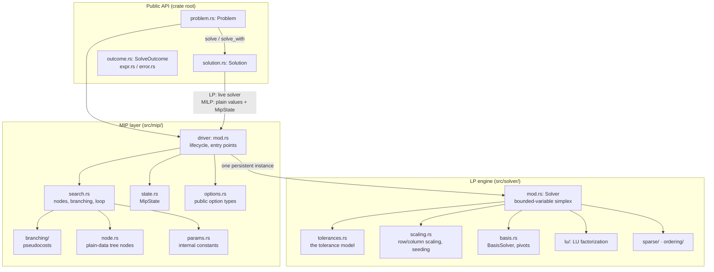
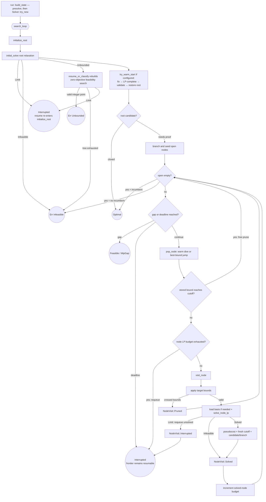
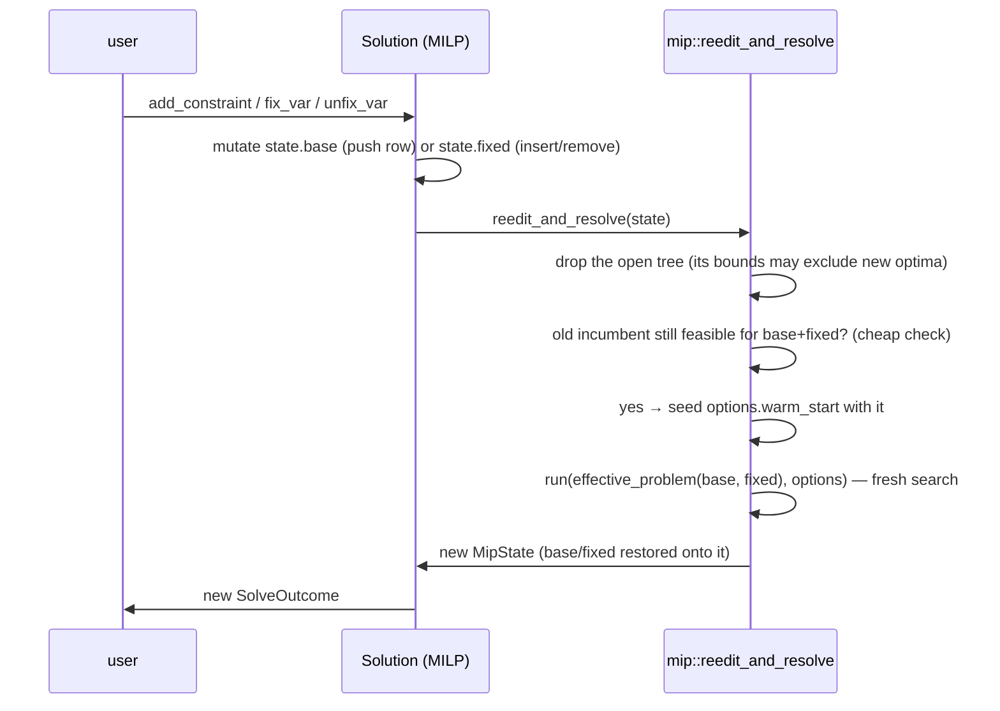

# microlp Architecture

This document explains how the solver works: how a problem flows from the public API
through the simplex engine and the branch & bound search, why the pieces are shaped the
way they are, and where to plug in improvements. It is written to be sufficient on its
own — a person (or an agent) who has read this should be able to navigate the codebase,
predict its behavior, and extend it safely.

---

## 1. The big picture

microlp solves **linear programs** (LP: continuous variables, linear constraints, linear
objective) and **mixed-integer linear programs** (MILP: same, but some variables must take
integer values). It is organized as two layers with a deliberately narrow interface between
them:



Three principles shape everything:

1. **One persistent LP solver per search.** The branch & bound tree never clones the solver
   and never grows the LP. Branching is expressed purely as *variable bound changes* on the
   single `Solver` instance, and tree nodes are plain data that describe how to reconstruct
   a state on that instance.
2. **No unfinished node LP is consulted.** A deadline is observed between completed simplex
   pivots and may stop a solve before optimality. The driver pushes that node back
   **unsolved** and makes no bound, candidate, or branch decision from the unfinished state.
   The next visit rebuilds the node from its own data. Node budgets and global search
   decisions are applied between node LP solves.
3. **Loud failures over silent wrong answers.** Child-LP errors are never conflated with
   infeasibility; numerical failures either recover through a documented valve or propagate
   as errors; candidate solutions are re-validated before being accepted. Where the code
   cannot do something properly it panics with a message rather than approximating.

### Module map

| File | Responsibility |
|---|---|
| `src/lib.rs` | Crate root: the module wiring and the `pub use` re-exports that define the public API's paths; every public item lives in a sibling module. |
| `src/problem.rs` | `Problem`, `VarDomain`, and the solve entry points. Owns solve/edit timing and the pure-LP model-to-engine seam in `Problem::solve_with` (presolve, then `Solver::try_new`). |
| `src/solution.rs`, `src/outcome.rs` | `Solution` (a validated assignment, its read-out and its post-solve edits) and `SolveOutcome` / `InterruptedSolve` (what a call returns and how it is resumed). |
| `src/expr.rs`, `src/error.rs` | The model vocabulary (`OptimizationDirection`, `Variable`, `LinearExpr`, `ComparisonOp`) and the `Error` type. |
| `src/presolve/` | Presolve's exact reductions: redundant-row elimination, and in MIP mode integer bound rounding and tightening, integer fixings (forcing and singleton rows, dual fixing) with substitution, and binary coefficient tightening; a continuous variable keeps its bounds. All on the original variable indices, so there is no postsolve (§2, §7). `mod.rs` holds the contract and the entry point, `work.rs` the reduction passes, `model.rs` the data, `params.rs` the constants. |
| `src/solver/` | The simplex engine. `mod.rs` is `Solver` itself (bounded-variable primal/dual simplex, basis management, and the small contract surface the MIP layer uses); `tolerances.rs` the tolerance model; `scaling.rs` the scaled representation and the starting vertex; `basis.rs` the basis inverse and the pivot descriptions; `costs.rs` the dual simplex's working costs and `bounds.rs` the primal simplex's working bounds; `cycling.rs` the cycling and stall detection of both; `proof.rs` the infeasibility proof and its last resorts (§3, §7). |
| `src/lu/`, `src/sparse/`, `src/ordering/` | LU factorization with eta-file updates, sparse containers, and the column ordering of the factorization (`order_simple`: the sparsest columns first, from the bucket queue in `ordering/cols_queue.rs`). |
| `src/mip/mod.rs` | The branch & bound lifecycle: building a search from a `Problem`, starting / resuming / re-editing it, bound and gap accounting, and validating a candidate against the user's original rows. |
| `src/mip/search.rs` | The search itself: node visits, warm starts, branching, pruning, and the outer search loop. |
| `src/mip/state.rs` | `MipState` (the complete, resumable search state) and `MipRun`. |
| `src/mip/options.rs` | The public option and report types: `SolveOptions`, `ResumeOptions`, `Tolerances`, `Stats`, `SolutionStatus`, `TerminationReason`. |
| `src/mip/node.rs` | `Node` (plain-data tree node) and `effective_bounds` (bound-change collapsing). |
| `src/mip/branching/` | Integrality checks and branch-variable selection (pseudocosts). |
| `src/mip/params.rs` | Named, documented internal constants (see §7). |
| `tests/suite/` | The problem-based correctness suite (see §9) — the safety net for all of this. |

---

## 2. Problem representation

`Problem` stores the model in original user terms: objective coefficients, per-variable
bounds and domains (`Real`, `Integer`, `Boolean`), and constraint rows.

These normalizations happen at the boundary and hold everywhere inside:

- **Internal objective space is always MINIMIZE.** `Maximize` problems negate their
  objective coefficients at variable-creation time (`internal_add_var`), and the sign is
  flipped back exactly once per read (`Solution::objective`, user-facing `Stats.best_bound`).
  Everything inside the driver — incumbents, bounds, pruning, gaps — is minimize-space.
  When editing driver code, never reason about direction; it does not exist there.
- **A bound of magnitude 2^52 or more on its side of infinity is infinite.** When a var is
  added (`internal_add_var`), `entry_bounds` turns a lower bound at or below
  `-INFINITE_BOUND` (`-2^52`) into `-∞` and an upper bound at or above `2^52` into `+∞`, and
  `Problem` stores the converted bounds, which presolve, the engine, the MIP's base problem,
  the post-edit incumbent prefilter and `Solution::fix_var`'s check all read (bounds that
  presolve derives are left as they are). So `f64::MAX` and `i64::MAX` behave as
  `f64::INFINITY` everywhere, and no check refuses an answer beyond such a bound. Each side is
  judged on its own (`x ∈ [5e15, f64::MAX]` is `x ≥ 5e15`: a value beyond the threshold is
  data, which the solve may report and `fix_var` fix a var at), and a range that is a point
  or empty keeps its bounds as written, so a var fixed beyond the threshold stays fixed and
  an empty range stays infeasible. The threshold is 2^52 because a row beside a var at a
  bound `B` with a coefficient `a` is held only to about `1e-14 |a| B` (§7), tens of units at
  2^52 when `|a|` is near one, so a larger bound written for infinity changes the answer once
  a var sits at it. The price: a bound of 2^52 or more meant as a bound is none (`max x` with
  `x ≤ 5e15` is `Unbounded`), even where small coefficients would let the rows resolve it.
  Both sides are pinned in `src/tests/regressions.rs`. A row's right-hand side is not cut
  off: it is used as given, so the same `x ≤ 5e15` written as a row binds.
- **Every constraint row gets a slack variable.** A row `a·x ≤ b` becomes `a·x + s = b`
  with `s ∈ [0, +∞)`; `≥` gives `s ∈ (−∞, 0]`; `=` gives `s ∈ [0,0]`. So the `Solver`'s
  variable universe is `num_vars` *structural* variables followed by one slack per row
  ("total vars"), and every constraint is an equality against the basis matrix. A row's
  original sense is recoverable from its slack's bounds — `Solver::first_violated_row`
  exploits exactly this.
- **The matrix is scaled by powers of two, rows and columns.** Before the simplex engine
  sees a model, `column_scales` derives a power-of-two factor per structural column: the
  rounded geometric mean of the column's extreme coefficients, iterated against row
  factors, skipped entirely when every coefficient already lies within `[1/8, 8]`, and never
  applied to a fixed column. The factors are limited only by the range of `f64`, since the
  engine takes any finite coefficient and a capped factor can leave a row wider than its
  pivot floors (see `column_scales`). Each row is then equilibrated so that its largest
  coefficient of a var that can move lies in `[1, 2)`. The engine works on
  `x'_j = x_j / s_j`; powers of two mean no datum is rounded, integrality of `s_j x'_j` is
  exact, and a bound change in user units maps to exactly one internal bound. Everything
  that crosses the `Solver` boundary — values, bounds, the objective, the row checks — is
  converted, so the MIP layer and the public API only ever see user units. A coefficient
  that is tiny only because its row or column is written in awkward units thereby becomes
  of order one, which is what makes the pivot tolerances below meaningful.

- **Presolve runs before the engine sees the model** (`src/presolve/`, on by default,
  `SolveOptions::presolve`). It never changes the variable set: a variable it removes is
  fixed by `lo == hi` bounds (the engine prices such vars out natively) and its value is
  substituted out of every row for presolve's own deductions; rows may be dropped or
  rewritten freely because nothing outside the `Solver` addresses them by index. That is
  what makes a postsolve layer unnecessary — solution read-out, resume, warm starts and
  post-solve edits all work off original indices, and the MIP search's root bounds are the
  presolved bounds. Surviving rows are emitted as the user wrote them, fixed terms included
  (a row keeps the tolerance of its full magnitude only with them in it); only a row whose
  coefficients were rewritten is rebuilt. `Mode::Lp` (the pure-LP path) applies only
  feasible-set-exact reductions, so the live solver stays sound under every later edit;
  `Mode::Mip` adds reductions that preserve the integer feasible set or merely some
  optimum, sound because MILP edits re-solve from the untouched base problem and incumbents
  are validated against the original rows. Every presolve decision is made against the
  engine's tolerance contract (§7), and presolve hands the rows it dropped or rewrote to
  the engine as they were written, for the checks at the boundary (§3.1): a reduction
  that is wrong shows as a loud error, never as a returned point that violates a row.
  Every reduction is exact: it keeps, up to round-off, every point of the model as written
  within the engine's box whose integer vars are exactly integral (each row within the
  budget, each var within its bound tolerance; dual fixing keeps an optimum), and a
  continuous var keeps its bounds (§7). No other point is guaranteed: a point beyond the
  box, within the contract by less than the round-off of evaluating a row, can be cut, and
  so can a point within the box only with an integer var off its integer, within
  `int_tol`, which the search can reach without
  presolve through its LP and which fixing the var, tightening its bounds or rewriting its
  coefficient can take away (§7, known limitations). So an `Infeasible` the engine or the
  search proves on the reduced model is final on every path (the solve, a resume, an edit),
  but for a model whose every point needs the integrality tolerance. When presolve finds the
  model infeasible, or reduces nothing, the solve goes on with the model as written
  (`presolve::reduced_model`, logged at debug level), so the verdict is the engine's, which
  returns `Infeasible` only on a proof, or the search's.

`prepare_row` is the single row-normalization contract used by both `Solver::try_new` and
incremental `Solver::add_constraint`. It settles the rows whose data alone decide them
(`trivial_row_verdict`, which presolve applies too: an empty row is held to the contract at
activity zero, an infinite right-hand side is no constraint on the side the row leaves open
and unsatisfiable on the side it constrains, and a NaN or an infinite coefficient makes a
row no point satisfies), computes the power-of-two scale, scales coefficients and the
right-hand side together, and derives slack bounds.
The two callers still own their genuinely different work: initial matrix/basis construction
versus extending a live matrix and repairing the current basis.

---

## 3. The LP engine (`src/solver/`)

The simplex core is the minilp lineage: a **bounded-variable
revised simplex** with both primal and dual iterations, steepest-edge pricing, the Harris
two-pass ratio test for numerical stability (in the dual simplex, a bound-flipping ratio
test in Harris groups: a boxed var the dual step passes is moved to its other bound instead
of entering), and an LU-factorized basis updated by eta matrices (refactorized when the eta
file outgrows the factors).

Both methods carry an anti-degeneracy package (details and constants in §7). A dual phase
works on *working costs* (`src/solver/costs.rs`): the costs in force, with its starting dual
infeasibilities corrected and an entering var's cost shifted wherever the dual step would
otherwise run backwards. A primal phase works on *working bounds* (`src/solver/bounds.rs`):
the true bounds, shifted wherever a basic var ends outside them beyond its tolerance. The
first phase of a re-solve, and the primal phase after a phase-1 dual phase on the
artificial objective (the real optimization), also perturb them at the start unless they
start near optimal; every other phase cleans up after the one before it, unperturbed. A
phase restores the true costs or bounds when it ends; `run_phases` verifies the result, and
the next phase removes the infeasibility that uncovers. A vertex hash makes a basis change
that keeps returning to visited vertices taboo, and a stall bound ends a phase whose
objective does not move (`src/solver/cycling.rs`); both end in a loud error, never a hang.

A basis the factorization finds singular is repaired wherever it is factorized: each
dependent column is replaced by the slack of a row no pivot took, whose unit column completes
the factors (`src/lu/`), the dependent var leaves the basis at its working bound nearest its
value (0 if free), and the values and reduced costs are recomputed. Within a phase, the change
back is taboo (§7), unless the step whose refactorization found the basis singular moved its
row.

The dual simplex returns `Infeasible` only on a proof (`src/solver/proof.rs`): a certificate
summed from the model's data that leaves a gap beyond the room the engine can give its
terms, the violated row's basic var its tolerance and every other term the room by which its
bound can be widened. A row that no var can repair and whose certificate proves nothing is
made taboo; when only such rows are left, two last resorts come before a loud error, the
second widening the bounds of the vars that can help by that room for the rest of the solve
(§7, *Infeasibility only from a proof*).

State you need to know when reading it:

- `basic_vars[row]` — which variable is basic in each row; `basic_var_vals` their values,
  `basic_var_mins`/`basic_var_maxs` their bounds (during a primal phase, the working bounds of
  `bounds.rs`).
- `nb_vars[col]` / `nb_var_vals` / `nb_var_states{at_min, at_max}` — non-basic variables
  sit exactly at one of their (working) bounds (or at 0 if free), and the state names that
  bound, never a tolerance test: a var whose range is narrower than its tolerance is at one
  bound and can move to the other. A var past a bound (it left the basis where it sat,
  within its tolerance, §7) is at that bound, and one between its bounds (a partial flip
  of the certificate repair) at neither. The bounds are those in force: the model's, or one
  the dual simplex's last resort widened by the var's tolerance for the rest of the solve
  (§7), which the boundary's checks and the edits never see.
- `is_primal_feasible` / `is_dual_feasible` — honest flags; every solve path is a state
  machine over them. `initial_solve` = restore primal feasibility (dual simplex /
  phase-1-style) then optimize (primal simplex).
- `cur_obj_val`, `nb_var_obj_coeffs` (reduced costs), `lp_iterations` (cumulative pivot
  counter for stats).

### 3.1 The contract surface the MIP layer relies on

The engine exposes a small contract surface; everything the B&B does goes through these.

**`set_var_bounds(var, min, max) -> Result<(), Error>`** — change a variable's bounds in
place. Basic variable: update the row's bound mirrors, flag primal-infeasible if its value
fell outside. Non-basic variable: move it to the new bound its state names (a var that was
fixed goes to the bound at which its reduced cost is dual feasible, and one between its
bounds stays where it is if they still hold it), propagate the delta into the basic values
through the variable's column (same mechanism as `fix_var`), and downgrade
`is_dual_feasible` if the move broke the reduced-cost/bound pairing. Crossing bounds
(`min > max`) or either bound being NaN returns `Err(Infeasible)` with state untouched.
Infinite bounds remain valid. It does **not** run simplex — callers decide when to
reoptimize.

*Why this is the branching primitive:* tightening a bound leaves every reduced cost
untouched, so the current basis stays **dual feasible** — re-solving is a short dual-simplex
run warm-started from the parent's optimal basis, typically a handful of pivots. This is the
single biggest performance lever in the design (see §10).

**`reoptimize() -> Result<StopReason, Error>`** — the re-solve entry: dual simplex if primal
feasibility is broken, then (only if needed, e.g. after loosening bounds or a basis load
with drift) recompute reduced costs and run primal simplex. Returns `StopReason::Limit` if
the deadline fires mid-run — leaving the honest feasibility flags so a later call continues
where it left off.

**`snapshot_basis() / load_basis(&Basis)`** — a `Basis` is one status per total variable:
`Basic | AtLower | AtUpper | Free` (~1 byte each). That is the *entire* warm-start state a
tree node needs. `load_basis` rebuilds everything from statuses + **current** bounds:
non-basic values from their status's bound, basic values and reduced costs recomputed from
scratch, LU refactorized, feasibility flags recomputed honestly. Two contracts matter:

- *Statuses are interpreted against the current bounds.* A status pointing at a bound that
  has since moved is remapped (nearest finite bound, else 0) rather than rejected — B&B
  jumps load a parent basis **after** applying different bounds, so this is load-bearing
  by design, not sloppiness.
- *A singular basis loads repaired* (§3): a dependent var leaves at the value the slack basis
  gives a non-basic var (the lower bound if finite, else the upper, else 0). `load_basis`
  fails only on a basis of the wrong shape, a bug, and leaves the state untouched then.

**`reported_values()`** — the verified point in user units, as the engine computed it: what
every read-out and every candidate is. Nothing is snapped: a fixed var's value is within its
bound tolerance of its value (a fixed integer var's on it, §7), an integer var's within the
search's `int_tol` of an integer.

**`first_violated_row(values)` / `first_violated_bound(values)` / `objective_of(values)`** —
evaluate an explicit structural-variable vector (user units) against the stored rows (sense
recovered from slack bounds) and bounds within the **absolute** user tolerance floored at
the round-off of the row or bound (`row_tolerance`, through `outside`), and compute its
objective. A value or row activity that is not finite violates every bound and row. These
are the contract check, applied by the incumbent guard (§5.4) and the pure-LP path
(`SolveOutcome::from_lp_stop`, on every solve, edit and resume). They evaluate a row exactly
as the engine's own verification does (`row_activity`, term for term in the same order), so
a point the engine has verified passes them by construction, and they are independent of
the current basis values.
`first_violated_row` also checks the rows presolve dropped or rewrote, as the user wrote
them (`validation_rows`, installed from `Presolved`): the engine never pivots on them, so the
answer is held to the whole model only here.

---

## 4. The MIP data model (`src/mip/node.rs`, `MipState`)

```rust
// A tree node is PLAIN DATA — no solver machinery anywhere:
Node {
    bound_changes: Vec<(var, lo, hi)>, // cumulative from the root; later entries win
    basis: Basis,                      // the PARENT's optimal basis (warm start)
    lp_bound: f64,                     // parent's LP objective = valid lower bound here
    depth, parent_id,                  // parent_id detects warm dives (§5.2)
    branch_var: Option<usize>,         // None for the root, Some(var) for children
    branch_up, branch_frac             // metadata feeding pseudocost updates (§5.6)
}
```

Reconstructing any node's starting state = apply its `bound_changes` on top of the root
bounds, load its `basis`, reoptimize. That is the whole trick: because nodes carry no live
state, they are trivially storable, resumable, and cheap (a basis is `total_vars` bytes; a
bound-change list is `depth` entries).

The optional branch variable is a correctness distinction: the root has no creating branch
and therefore must never record a pseudocost observation. Every child stores the variable
and direction that created it.

`MipState` is the complete, resumable search:

| Field | Role |
|---|---|
| `solver` | the ONE live LP engine |
| `root_bounds`, `applied` | original bounds + which changes are currently applied to the solver (for diffing when switching nodes) |
| `open: Vec<Node>` | the frontier (LIFO tail = current dive; best-bound scan on jumps) |
| `incumbent: Option<Incumbent>` | best integral solution: its values as computed + `objective = c·x` |
| `node_seq`, `last_solved_id`, `diving` | warm-dive detection + node-selection mode |
| `pseudocosts`, `stats`, `options`, `deadline`, `direction` | search intelligence and bookkeeping |
| `base: Problem`, `fixed: BTreeMap<var, val>` | the CLEAN user problem + user-level fixes — the substrate for post-solve edits (§5.8) |

`Solution` for a MILP holds `SolutionStatus`, `TerminationReason`, and this `MipState`
boxed. User reads come from its validated incumbent's values, as the engine computed them.
`InterruptedSolve` also retains the live state for resume, but exposes only its reason and
statistics. For a pure LP, `Solution` keeps the live solver (that is what makes LP
incremental editing cheap).

---

## 5. The branch & bound search (`src/mip/`)

### 5.1 Lifecycle



### 5.2 Visiting a node: warm dives vs jumps

When a node is popped, its target bounds are diffed against `applied`: variables no longer
constrained are reset to root bounds, changed ones are set. Then one question decides the
cost of the visit: **is the solver already sitting at this node's parent's optimum?**

- `last_solved_id == node.parent_id` → **warm dive**: the parent was the immediately
  previously solved node, its basis is live in the solver, and the child differs by exactly
  one tightened bound. Skip the basis load entirely; `reoptimize` is a short dual-simplex
  run. This is the common case while diving.
- Otherwise → **jump**: load the node's stored parent basis (one refactorization), then
  reoptimize. `last_solved_id` is cleared on every path where the solver moves away from a
  just-solved optimum (prune-after-solve, infeasible, requeue, incumbent adoption), so the
  warm-dive check can never false-positive: ids are unique per branching.

### 5.3 Node LP solving and the robustness valves

`solve_node_lp` wraps `reoptimize` and owns error discrimination:

- `Err(Infeasible)` → genuinely infeasible node → prune. Correct and cheap: the engine
  returns it only on a proof checked on the model's data (or on bounds that cross), never on
  a row it merely cannot repair, so an unproven verdict cannot prune a feasible subtree. The
  one gap is the proof's concession (§7): a coefficient on an infinite bound counts as zero
  where the error of the multipliers could make it zero, so a node could be pruned wrongly
  only if a coefficient the data leave lay within that error (some `1e-30` of its terms in
  well-conditioned bases) and, times its var's value, made room at every point of the node.
- `Err(Unbounded)` → impossible for a bounded node → surfaced as `InternalError`.
- Any other error, such as a row the dual simplex can neither repair nor prove infeasible
  → **retry once from the slack basis** (all slacks basic), re-solving the node from
  scratch; a second failure propagates. The retry is per-node-visit — it cannot mask a
  systematic failure.
- `Ok(Limit)` → the deadline fired mid-solve → the node is pushed back **unsolved** and the
  search returns `Interrupted`. Nothing uses the coherent but non-optimal state as a solved
  node: the next visit starts from its own bounds + basis data.

Inside the engine, `run_phases` alternates the dual phase (`restore_feasibility`) and the
primal phase (`optimize`) until a state passes verification (§7): a phase's own exit test
runs on incrementally updated numbers, so a phase may end on drifted values, and only a
verified state is reported as `Finished`. "No eligible entering column for a violated row"
is not a proof of infeasibility: the dual phase first rebuilds (fresh factorization, values,
reduced costs) and re-examines the row, where a phantom violation dissolves, and declares
infeasibility only if the row's certificate proves it (§7, *Infeasibility only from a
proof*). The rebuild is armed once per stall and any successful pivot re-arms it, so it
cannot loop; a row the proof leaves open is made taboo, and its last resorts end in a loud
error rather than a verdict.

### 5.4 Incumbents and the feasibility guard

When a node's LP solution is integral within `int_tol` (default `1e-6`), it is a *candidate*
— not yet an incumbent. Integral means every integer variable the search can branch on lies
within `int_tol` of an integer; a variable whose node bounds fix it cannot be branched on,
and the engine holds it exactly at its value (an integer variable its bounds fix has no
bound tolerance, §7). Every solver-produced candidate enters `try_adopt_incumbent`, which
takes the values as the engine computed them (nothing is rounded) and applies one validation
funnel:

1. `candidate_variables_feasible` rejects malformed lengths, non-finite values, invalid
   bounds, violations of the model's bounds (the root's: a warm-start hint fixes a variable
   up to `HINT_BOUNDS_SLACK` outside them, so the node's are not always within them), and
   integer variables off their integer by more than `int_tol`.
2. `Solver::first_violated_row` validates the vector against the rows, the ones presolve
   dropped or rewrote included, within the absolute `Tolerances::feasibility` (default
   `1e-7`) floored at each row's round-off (§7).
3. `objective_of` must produce a finite objective before the incumbent can change.

Post-edit warm-start filtering deliberately remains separate: `incumbent_feasible` checks
the clean `Problem` plus its fix overlay in original user scale before a solver exists. Both
paths share variable/domain validation, but their row representations are not conflated.

The engine verified its own rows and bounds at these very values, with the evaluation the
guard repeats, so a candidate can fail only on a row presolve dropped or rewrote:

- Guard **passes** → adopt the values with `objective = c·x`, and close the node: its
  objective is the node's bound.
- Guard **fails** → do not adopt; **branch on an integer variable off its integer** (at
  `int_tol = 0`: children `⌊v⌋` / `⌊v⌋+1` fix its bounds), and the dive resolves the truth.
  A row presolve rewrote holds as written only where its binaries are exactly integral
  (§7), and the LP vertex itself, not only its round-off, can put a binary off its integer
  within `int_tol`, or past its bound within its bound tolerance: `-x0 + x3 = 0` with
  `-2 x0 - 10 x3 <= 7.642e-7` puts `x0` at `-7.6e-8` once presolve has rewritten the second
  row. The row as written rejects that point, and the child that fixes the binary holds it
  exactly at its value, where the row holds
  (`a_binary_the_lp_puts_past_its_bound_under_a_row_presolve_rewrites_solves`); where the
  child's point then needs two rows' tolerances at once, the proof leaves the node open and
  the dual simplex's last resort widens the rows' slack bounds to reach it
  (`a_node_fixing_a_binary_feasible_only_within_two_rows_tolerances_is_solved`, §7).
  A candidate that fails with every integer variable exactly integral, nothing left to
  branch on, is returned as an internal error rather than force-accepted: presolve's
  reduction did not keep that point.

The **big-M caveat**: with `int_tol = 1e-6`, a relaxation value like `y = 1e-6` counts as
integral, and under a row `x <= 1e7 y` it lets `x` reach 10. That point meets the row as
written at its values, so it is a valid answer within the contract, and the search may
report it. Rounding such values, as the API docs advise where an exact integer is needed,
can break the row; the docs warn of it, and a big-M coefficient no larger than the model
needs keeps that room small.

During zero-objective unboundedness classification, the same funnel runs first; only a valid
integer point returns `Err(Unbounded)`. If classification is interrupted before an incumbent
exists, the public objective is evaluated from the original model coefficients and the
current working values rather than from the temporary zero objective.

The tolerance is deliberately **absolute**, never scaled by row magnitude: a relative
tolerance (`1e-7·|rhs|`) evaluates to ~100 on a 1e9-scale row and would accept violations
of that size. A false *rejection* from the absolute check is benign (extra exact-fixing
branching); a false acceptance would be a wrong answer.

### 5.5 Node selection, bound, and gap

- **Plunging DFS with best-bound jumps** (`pop_node`): while the last processed node
  produced children (`diving == true`), pop LIFO — cheap warm dives, incumbents found fast.
  When a dive dies out (prune/infeasible/leaf), jump to the open node with the **lowest**
  `lp_bound` (linear scan, first-minimum tie-break, `swap_remove`).
- **Global dual bound** = min over open nodes' `lp_bound`, clamped by the incumbent
  (stale nodes may carry looser bounds than a fresher incumbent). Open list empty →
  the bound *is* the incumbent: proof complete. Valid only between nodes — a popped node's
  subtree is otherwise unaccounted.
- **Gap** = `(incumbent − bound) / max(|incumbent|, ε)` in minimize space (sign-free — the
  formula is direction-invariant). `mip_gap > 0` may stop the search early with a feasible
  solution and `TerminationReason::MipGap`; the default `0.0` demands exact proof and adds
  zero overhead (the check short-circuits). During a positive-gap check, equality of the
  incumbent and global bound is still classified as an exact proof even when the open list
  contains dominated nodes.
- **Pruning** uses `cutoff(incumbent) = incumbent − max(ε, ε·|incumbent|)` with
  `ε = Tolerances::prune_epsilon` (default 1e-9), applied twice per node: against the stored
  parent bound *before* any LP work, and against the fresh objective after.

### 5.6 Pseudocost branching (`src/mip/branching/`)

The driver learns **pseudocosts**: per variable and direction, the average objective
degradation per unit of fractionality observed across solved child nodes.

- *Recording*: when a node with `branch_var = Some(var)` solves, its creating branch
  (`branch_up`, `branch_frac`) contributes
  `max(0, z_child − parent_bound) / branch_frac`. The root and every
  infeasible/interrupted node record nothing.
- *Selection*: maximize the product score
  `max(est_down·f_down, ε) · max(est_up·f_up, ε)` — variables whose BOTH directions hurt
  the relaxation are the ones worth deciding early. Before any observations exist, estimates
  fall back to `|objective coefficient| + ε` — with uniform coefficients this degrades
  gracefully to most-fractional.
- *Dive order*: of the two children, the one with the LOWER estimated degradation is pushed
  last (popped first) — dive toward the side more likely to stay feasible and good.

### 5.7 Warm starts

`SolveOptions::warm_start` accepts a (possibly partial) assignment. Evaluation happens once,
right after the root LP: fix the hinted variables to their (rounded, bounds-checked) values,
LP-complete the rest, and if the completion is integral, adopt it **through the same
feasibility guard as every other incumbent** — hints get no shortcut. Then restore the root
state (bounds back, root basis reloaded, everything recomputed, and re-solved, which only
verifies it unless the load had to repair it) so the search starts from the true
relaxation. Hints are advisory by design: unknown variables, out-of-range values,
infeasible or fractional completions, and completions that fail with an engine error all
just drop the hint with a debug log — a bad hint must never break a solve.
Dropping one costs at most speed, since the search solves the whole model without it (a node
LP's error, after its retry, stays fatal: skipping a node could lose the optimum). Only the
`Unbounded` verdict a completion can give during unboundedness classification (§5.4) is
returned, once the temporary bounds and root basis have been restored; an error restoring
them propagates.

A warm start seeds the *incumbent*, which powers pruning; it does **not** carry the search
tree. Restarting the same model with an unchanged hint and the same deterministic node
budget repeats the same search prefix. Wall-clock cutoffs may vary, but still retain no
frontier. Consequently:

- To **continue** an interrupted solve of an unchanged problem: use `SolveOutcome::resume` —
  it keeps the open list and continues where it stopped, budget-for-budget.
- Restart-with-hint is the right tool when the problem **changed** (edits) or the state was
  lost. In a restart loop, once the carried hint stops improving, grow the budget so a later
  round can progress beyond the repeated search prefix (see
  `tests/suite/cases/warm_restart.rs`).

### 5.8 Post-solve edits

Applying post-solve edits to whatever internal state the search ended in — an incumbent
*leaf*, with branch bound-fixings still applied — would let feasible edits report
`Infeasible`. The edit model makes that impossible:



`base` is a clean copy of the user's problem that accumulates edits; `fixed` is the
`fix_var` overlay (so `unfix_var` can restore original bounds). Every edit re-solves the
*composed* problem from the root, warm-started by the surviving incumbent. Edits exist only
on a validated `Solution`, including a feasible-but-unproven one; an `InterruptedSolve`
cannot be edited. `unfix_var` returns `Result<(SolveOutcome, bool), Error>`, so every
limited re-solve remains typed explicitly.

### 5.9 Interruption and resume, end to end

Timing is centralized without hiding the entry points' different policies:

- A pure LP's initial timer starts before presolve and `Solver::try_new`, so construction and
  the initial simplex solve share one deadline. `SolveOutcome::resume_with` uses its explicitly
  supplied fresh budget; LP edits use the current operation time limit. `timed_lp_call` always accumulates
  elapsed time, including calls that return an error.
- A MILP's initial run and each post-edit rebuild use its `SolveOptions`. `resume_with`
  replaces all three per-call controls on the retained search state with exactly the supplied
  `time_limit`, `node_limit`, and `mip_gap` values; `None` means unlimited budgets or no gap
  target. Plain `resume()` instead passes back the options used by the immediately preceding
  solve or resume call.

MIP interruption points, in loop order, are: empty open list; when a positive gap target is
active, exact incumbent/bound equality and then the gap target; deadline; then node budget.
Checking proof conditions first prevents a completed proof from being mislabeled as interrupted
or merely gap-satisfied. `node_limit` is per search call, so every `resume` receives a fresh node
budget; the retained frontier still supplies continuity between calls.

`SolveOutcome` makes answer safety structural:

| Outcome | Status/reason | Accessors |
|---|---|---|
| `Solution` | `Optimal / ProvenOptimal` | objective, values, gap, stats, edits |
| `Solution` | `Feasible / MipGap`, `TimeLimit`, or `NodeLimit` | objective, values, gap, stats, edits |
| `Interrupted` | `TimeLimit` or `NodeLimit` | reason, stats, resume only |

A limit is an outcome, never an `Error`. Solve failures use `Infeasible`, `Unbounded`,
`InvalidOptions`, `InvalidOperation`, or `InternalError`.

---

## 6. Public API tour

```rust
let mut problem = Problem::new(OptimizationDirection::Minimize);
let x = problem.add_integer_var(3.0, (0, 10));
let y = problem.add_var(4.0, (0.0, 10.0));
problem.add_constraint(&[(x, 1.0), (y, 2.0)], ComparisonOp::Ge, 5.0);

let mut options = SolveOptions::default();
options.time_limit = Some(Duration::from_secs(10));
options.node_limit = Some(100_000);          // deterministic alternative
options.mip_gap   = 0.01;                    // stop at a proven 1% gap
options.warm_start = Some(vec![(x, 2.0)]);   // advisory hint
options.tolerances.feasibility = 1e-7;       // expert knobs, see §7

let mut outcome = problem.solve_with(options)?;
if matches!(
    outcome.termination_reason(),
    TerminationReason::TimeLimit | TerminationReason::NodeLimit
) {
    let mut resume = ResumeOptions::default();
    resume.time_limit = Some(Duration::from_secs(10));
    outcome = outcome.resume_with(resume)?;
}

if let Some(sol) = outcome.solution() {
    let _ = (
        sol.status(),
        sol.termination_reason(),
        sol.objective(),
        sol.var_value(x),
        sol.gap(),
        sol.stats(),
    );
}

// resume() would reuse the satisfied gap. resume_with(default) replaces it
// with no gap target and continues toward exact proof.
let outcome = outcome.resume_with(ResumeOptions::default())?;
```

Reading values: `var_value`/`iter`/indexing return the values as the engine computed them:
the incumbent's for a MILP with an incumbent, the optimal live working values for a pure LP.
An integer variable's value lies within `int_tol` of an integer, not necessarily on it, and a
fixed one's on it (round it where an exact integer is needed, §5.4);
`var_value_raw` is a deprecated alias of `var_value`. Interrupted outcomes expose no
answer-value accessors.

---

## 7. Numerical policy — every tolerance, in one place

Two homes, by audience:

**User-facing — `SolveOptions` (+ nested `Tolerances`):**

| Knob | Default | Gates |
|---|---|---|
| `presolve` | `true` | run the reductions of `src/presolve/` before the solve (§2); off, the engine gets the model as written |
| `int_tol` | `1e-6` | "is this LP value integral?" — an integral LP point is adopted as computed and closes its node, so integer values are reported within it (§5.4). Must be finite and in `[0, 0.5)`. |
| `mip_gap` | `0.0` | early-stop proof quality (relative gap) |
| `tolerances.feasibility` | `1e-7` **absolute**, at least `1e-10` | the engine's box, the incumbent guard and the post-edit incumbent pre-filter (§5.4 explains why absolute) |
| `tolerances.integrality_rounding` | `1e-5` | integrality check in the edit pre-filter, and the integer `Solution::fix_var` fixes a value at |
| `tolerances.prune_epsilon` | `1e-9` | the pruning cutoff slack |

`tolerances.feasibility` reaches presolve and the engine: `Problem::solve_with` and the MIP
`build_state` pass it to `presolve` and `Solver::try_new`, the engine holds every row to it
(see below) and presolve decides against it, so what presolve assumes, what the engine
reports and what the guard accepts are the same contract.

**Internal — `src/mip/params.rs` and `src/solver/` consts (each documented at its
definition):** `SCORE_EPS`, `PSEUDOCOST_INIT_EPS`, `BRANCH_FRAC_GUARD` (all `1e-6`),
`GAP_DENOM_GUARD` (`1e-10`), `HINT_BOUNDS_SLACK` (`1e-9`), `DEADLINE_CHECK_INTERVAL`
(`1000` pivots), `LU_STABILITY_THRESHOLD` (`0.1`), `MIN_DUAL_EDGE_WEIGHT` (`1e-4`, the floor
of the dual steepest-edge weights; the primal weights are floored at their lower bound
`1 + lambda^2`), `INFINITE_BOUND` (`2^52`, §2), the anti-degeneracy constants of both
simplex phases (see *Anti-degeneracy* below), and the engine's tolerance model in
`solver/tolerances.rs`. That model is one rule: every tolerance is either the user's
contract or a property of the arithmetic, and every comparison of a computed quantity is
floored at that quantity's round-off:

| Comparison | Tolerance | Constants |
|---|---|---|
| Is a basic slack (row) within its bounds? | `slack_tol`: the contract `row_tolerance(feasibility × r, m)` in the row's scaled units, at the row's magnitude `m = |b| + Σ|a_j x_j|` at the current values (refreshed whenever the rows are checked), less the round-off of evaluating the row, `(n + 2)·2^-53·m` for `n` terms and at most half the contract: the engine's plain `f64` sum, and one more evaluation in another order (the boundary's, a user's). | `ROUNDOFF_FLOOR = 1e-14` |
| Is a structural var within its bounds? | `structural_tol`: the user contract in user units, `feasibility / s_j` in the engine's, floored at the round-off of the bound magnitude, for every var but an integer var its bounds fix (a branch, an edit, presolve), which gets none: the engine holds it exactly at its value, pivoting it out of the basis onto that value when it is basic off it, since a row presolve rewrote holds as written only at an exactly integral binary, and the search cannot branch on a binary its node fixes (§5.4). The reported value is the engine's times `s_j`, exactly, and nothing is snapped. Whether a non-basic var is at a bound is no tolerance test but the bound it sits at (§3). | |
| Is a reduced cost zero? | `dual_tol`: `EPS` floored at the round-off of `|c_j| + Σ|a_ij y_i|`, refreshed with the multipliers. | `EPS = 1e-10` |
| Is a tableau entry a candidate pivot? | genuine if above the round-off of computing it: `ENTRY_ROUNDOFF` of its column's largest entry (primal test), or of its row's largest entry over the columns not excluded that the scalings made comparable (dual test: all but those of vars fixed when the model entered the engine, which keep the user's units, so a fixed column's `1e17` cannot make a genuine `1` noise; an entry that cannot help still counts, as it shares the round-off of the row's solve). A genuine entry of at least `PIVOT_REL_TOL` of the largest genuine one among the vars that could enter and are not excluded (rows that could block, in the primal test) is preferred; a smaller one pivots only when nothing larger will do. In the primal test every genuine entry bounds the step, each basic var's Harris allowance counted from where it sits (see *Anti-degeneracy and cycling in the primal simplex*). In the dual test a boxed var the step passes is flipped instead of entering (*Bound flipping*), a row with no candidate is no verdict (next row), and the last resort takes any entry of at least `INSTABLE_PIVOT_TOL` (*Infeasibility only from a proof*). | `ENTRY_ROUNDOFF = 1e-15`, `PIVOT_REL_TOL = 1e-7`, `INSTABLE_PIVOT_TOL = 1e-10` |
| Does a row that no var can repair prove the model infeasible? | only through its certificate, summed from the model's data, whose gap must exceed the room the engine can give its terms: the tolerance it holds the row's basic var to, and every other term's widening room (its tolerance, a slack's less the evaluation margin; none for a var the engine keeps on its bounds); on an infinite bound a coefficient counts as zero only within the error of the multipliers, which the refinement bounds only where it converged (see *Infeasibility only from a proof*). | `REFINEMENT_CONVERGED = 2^-53` |
| Do the row and column computations of the pivot element agree? | to `PIVOT_AGREEMENT_TOL` relatively, or to `ENTRY_ROUNDOFF` of the computations' scale for an element above `LU_SINGULAR_REL` of that scale (below it, round-off agrees with anything of its size, so only relative agreement tells a genuine element from noise). Else rebuild (stale factorization), or, on a fresh one, exclude a noise entry, only for the column (primal test) or row (dual test) it was judged in and until the next pivot: carried to another column, an exclusion could hide a genuine blocking row. Noise is a column's element below `PIVOT_REL_TOL` of its column in the primal test; in the dual test, which chose the entry by the row's element and divides the step by the column's, either element below `PIVOT_REL_TOL` of the row and column, or the two of opposite signs. Any other entry is taken, with the column's element: a basis it leaves singular is repaired (§3). Once they agree, the column's element serves the primal step, the eta file and both steepest-edge updates, which apply it with the rest of the column, and the row's the dual simplex's reduced-cost update, which runs along the row. | `PIVOT_AGREEMENT_TOL = 1e-7` |
| Is the LU pivot column singular? | eligible part below `LU_SINGULAR_REL` of the column's largest transformed entry; the column is then replaced by the slack of a row no pivot took (the repair, §3). | `= ROUNDOFF_FLOOR` |

Two rules complete the model. **Absorption:** when no var can enter a violated row's pivot
regularly, a non-basic continuous var or slack may enter by crossing its bound (or, for a
slack, its fixed value) by no more than the tolerance the phase holds it to once basic (a
slack's stored one, and no more than its row's at the current values), so that it is not
violated in turn. This hands a round-off-level violation that a tightly held var cannot
carry to a row or var that can, such as an equality's slack; integer vars and fixed
structural vars never absorb, as the engine keeps them on their bounds (see *Infeasibility
only from a proof*). Such a pivot is no step of the dual simplex, so the
absorber enters on a zero dual step, its cost shifted by its whole reduced cost (see
*Anti-degeneracy* below). The shift is given back when the var leaves, so the dual
objective does not record an absorption, and two vars could hand a violation back and
forth: a var crosses a bound by absorbing once per solve, and a later need for that room
goes to the infeasibility proof, which grants it, and to the last resort's widening
(`an_lp_whose_equality_slack_must_absorb_twice_in_a_phase_solves`,
`a_node_feasible_only_through_two_tolerances_at_once_is_solved`). The absorber chosen is
the one whose shift does the least harm when it is given back: the ratio is its reduced
cost (zero for a fixed slack) over its entry, and among the absorbers within the Harris
relaxation of the smallest ratio the largest entry enters (one `PIVOT_REL_TOL` below the
largest absorbing entry is no candidate). The infeasibility proof counts every term's
room, so the last resort would reach such a point too; absorption reaches it at once,
where one term's tolerance takes the whole violation, and keeps the bound in force: an
absorber is basic past its bound within its tolerance, which the primal phase does not
widen further.
**Verified termination:** a phase reports `Finished` only after `verify_primal` and exact
reduced costs (recomputed only when pivots have updated them incrementally since).
`verify_primal` runs `check_rows`: every basic slack is re-derived from its row,
`s = b − Σ a_j x_j` at the current structural values, so that a row's violation lives in its
slack's value where the dual simplex sees it; the slack tolerances are refreshed from the
rows' magnitudes; and the residual of every row whose slack is non-basic (how far the basic
structural values are from solving it) must lie within the slack's tolerance on the side it
moves the slack (on a side whose bound the last resort widened, the evaluation margin, see
*Infeasibility only from a proof*), else the values are refined through the factorization,
then through a fresh one, then reported as a loud
`InternalError` (the basis cannot represent its vertex). Values within tolerance are not
refined: the contract asks no more, and moving last bits steers the branch & bound. The
objective is always recomputed from the values, and the verified point itself is what is
reported (`reported_values`, as computed), so it passes the checks at the boundary (§3.1),
and a row evaluated in another order within the round-off its tolerance keeps. Periodic
refactorization renews the
factorization and, once per full basis turnover of pivots, checks the rows and recomputes
the values if they drifted. A recompute is not a verification: on an ill-conditioned basis
a solve through the factorization can leave a residual above a row's tolerance, so
recomputed values stay unverified until the next phase exit checks and, if needed, refines
them.

**Presolve** (`src/presolve/`, module docs) makes its decisions with the same model, in
user units:

- a row is held to the engine's *budget*, `slack_tol(feasibility, m, n)`, the contract
  less the round-off of evaluating the row, `m` the magnitude of the corner the decision is
  about (never of the whole box, so a bound of `f64::MAX` cannot inflate a tolerance),
  counting the right-hand side as written, fixed terms not substituted out, and `n` the
  row's terms;
- activity ranges are widened by `Σ|a_j|·bound_tol_j` before a verdict is drawn or a row
  dropped, since every var, an integer one too, may sit outside its emitted bounds by its
  bound tolerance (an integer var they fix the engine holds exactly, so for it the widening
  only keeps more), and a row is forcing when its right-hand side equals an activity bound
  within `ROUNDOFF_FLOOR` of the sum;
- a bound implied by a row is relaxed by the row's budget, plus the round-off of the
  cancellation it came from, over the coefficient, so it never cuts a point the engine may
  return;
- a continuous var keeps its bounds as written: presolve fixes none, by a forcing row, an
  equality or dual fixing, and turns no row into bounds. Such a reduction takes from the var
  the room the model as written leaves it (the row's allowance over the coefficient, or its
  bound tolerance), and the rooms of several vars can add up in a row presolve keeps, beyond
  that row's tolerance. A singleton row over a continuous var goes only where the var's
  bounds, with its bound tolerance, meet it within its whole contract, less the round-off
  of evaluating it (as the boundary checks it once dropped);
- an integer var's bound implied by a row keeps every integral value that meets the row
  within its budget, the other vars within their working bounds: a singleton row rounds
  the var's implied bounds, and goes only where the rounded bounds, with their bound
  tolerance, meet it within its whole contract less round-off, and a forcing row, judged
  over the emitted bounds, fixes the var only where no other integer lies within the room
  the row leaves it (its sliver and its budget at its magnitude, round-off part included,
  over the coefficient) and every term of the row is resolvable above its round-off;
- coefficient tightening makes a big-M row's vacuous branch bound-tight, relaxed by the
  activity's round-off and the bound slack, and relaxes its binding branch (the binaries of
  the rewrites that shrink the bound at one) by the contract the rewrites take out of it:
  the contract at the magnitude of the bound, those binaries' terms and the other fixed
  terms as written, less the contract at the same rewritten. A term fixed after the
  rewrites grows the relaxation with the contract. The rewritten row's bound is derived
  from the one as written, less the cuts of the binding branch's coefficients, plus its
  relaxation, in compensated arithmetic and rounded outward, so that branch is the row as
  written relaxed, never tighter: carried in `f64` through the fold of the fixed terms, the
  rewrites and back, the bound is off by their round-off, some ulps of the row's largest
  term, which the vacuous branches' relaxation covers and the binding branch's does not.
  The rest of the row adds the same magnitude to both contracts, so the rewritten row, held
  to the engine's budget, admits no point beyond the row's contract, and keeps every point
  of the row's budget whose binaries are exactly at one, up to half the round-off of the
  magnitude of its unfixed other terms. A point within the budget only with a binary
  off its integer, within `int_tol`, is not kept: the rewritten coefficient takes away the
  room the offset gives the row;
- a row all of whose vars are fixed is judged as the boundary will judge it once dropped: as
  written, at the fixed values, by `row_violation`, against the full contract (nothing the
  engine does moves it: a var fixed on entry never enters the basis, which prices it dual
  feasible, and neither absorbs nor has its bounds widened);
- infeasibility is declared only when no point the engine could accept exists, as far as
  the reductions can tell, and with no certificate, so the verdict is not final: the solve
  goes on with the model as written, where the engine decides. The engine's `Infeasible` on
  the reduced model is final but for a model whose every point needs the integrality
  tolerance (§2, known limitations below): the reductions keep, up to round-off, a point
  within the engine's box with its integer vars exactly integral wherever the model as
  written has one.

The layering rule: the engine's tolerances decide *simplex* questions; `int_tol` decides
*integrality* questions; `feasibility` is the contract presolve, the engine and *solution
acceptance* all hold to; `prune_epsilon` decides *tree* questions.

What makes this one contract rather than several checks: the engine, the MIP guard, the
pure-LP validation and presolve share `row_tolerance` (the rule), `bound_tolerance` (its
instance for a var's bounds) and `outside` (the one comparison, written the way the engine
tests a basic var, `value < lo − tol || value > hi + tol`, which in `f64` is not the same
test as `value − hi > tol`). What this rules out is two checks that disagree: a continuous
var's bound slack reaching a row through a coefficient above one, a fixed var's drift
reaching a row presolve dropped, a residual counted by both the engine and the guard (see
`property_counterexample_with_bound_slack_one_ulp_over_the_row_budget`).

**Bound flipping.** The dual ratio test takes the vars that can help a violated row in the
order the dual step reaches their breakpoints, in Harris groups: the first group is the
Harris pass's candidates, each next one the remaining candidates within the smallest relaxed
ratio of those remaining. While the groups so far leave the row short, the step passes the
next group. The pivot is the largest entry of the last group that has one above a tenth of
the largest grouped entry (or above one), and the groups before the pivot's are moved to
their other bound (no pivot, no basis change), so their reduced costs cross zero and they
are dual feasible where they land (Maros 2003; Koberstein 2005). When the first group
carries the row, this is the plain Harris pass with nothing flipped; flips come only with a
positive dual step, since a group after the first lies beyond the first group's bound.

**Infeasibility only from a proof** (`src/solver/proof.rs`). When no var can enter a
violated row and none can absorb its move, the ratio test says so and concludes nothing
(`DualRatioTest::NoCandidate`): the tableau row (entries computed through the eta file and
summed in `f64`, those below a round-off floor counted as zero) can take a genuine entry
below the floor, or the round-off of a computed vertex, for a row no var can repair.

- *Fresh data first*: the row is looked at again after a rebuild (fresh factorization,
  values, reduced costs), where a phantom violation from drift dissolves.
- *The proof*: the row of the basis inverse `rho` combines the rows into one equation over
  every var, the certificate, in which the leaving var has the coefficient one and every
  other basic var zero. Summed from the model's data in compensated arithmetic (the scaling
  is by powers of two, so the scaled data are the user's exactly), it proves infeasibility
  when the largest value it can take over the bounds falls short of its right-hand side by
  more than the room of its terms (*The tolerance* below). `rho` is first refined twice:
  through an
  ill-conditioned basis its residual `B^T rho − e_r` becomes a basic var's coefficient,
  which times a huge bound can alone void the proof of an infeasible node
  (`an_ill_conditioned_basis_does_not_void_a_nodes_proof`). Its corrections are kept in
  doubled precision, since `rho` rounded to `f64` keeps the error of its own
  representation, about `1e-17` of the terms of each basic column, which times bounds of
  `1e9` and more does the same. A row whose multiplier would need its slack's infinite
  bound is left out (any multipliers give a valid certificate). Every coefficient counts at
  its var's bound in the certificate's direction where that bound is finite, however far
  below its terms it cancelled: the certificate is exact for its multipliers, and such a
  coefficient can be the data's own (`1` and `-(1 + 2^-50)` leave `-2^-50`, which at a bound
  of `-2e9` makes room for a feasible model's rows). A number of the certificate that is not
  finite voids the proof.
- *The concession*: on an infinite bound a coefficient makes the range unbounded and the
  proof void, however small it is, unless the error of the multipliers could make it zero
  (each multiplier's error bound, its second correction, carried through the var's entries
  in the rows the certificate keeps, plus the round-off of the compensated sum); then it
  counts as zero. That covers what the error leaves of a coefficient that is zero for the
  exact multipliers: a basic var's, a non-basic var's whose tableau entry is zero, and one
  whose rows' exact multipliers are zero (as in the switchable networks of
  `issue_48_switchable_dc_network_solves`). The refinement bounds the error only where it
  converged (its second correction at most `REFINEMENT_CONVERGED` of the row in the max
  norm); otherwise only the round-off of the compensated sums counts as zero. Each
  multiplier is bounded by its own correction, not by the largest, which would concede far
  more to a var whose rows have tiny multipliers. No fixed threshold would do: a floor at
  the `f64` round-off of the terms or above takes the data's `-2^-50` for zero and proves
  feasible models infeasible, and a lower one fails the proofs of infeasible ones. What is
  left: a coefficient the data leave within the error bound (some `1e-30` of its terms in
  well-conditioned bases) counts as zero, and could make a proof of a feasible model.
- *The tolerance*: the gap is compared with the room the engine can give the
  certificate's terms, each as far as `f64` holds it past its bound and times its
  coefficient: the leaving var the tolerance the engine holds it to (`var_tols`, the one by
  which the dual simplex found the row violated: for a slack, its row's contract less the
  round-off of evaluating the row; for a structural var, its whole bound contract, none for
  an integer var its bounds fix), and every other term its widening room, the room by
  which the last resort can widen its bound in the direction that helps (its tolerance; a
  slack's less its row's evaluation margin, which a widened side keeps for the round-off of
  checking the row; none for a bound already widened, and none for an integer var or a
  structural var its bounds fix, which the engine keeps on their bounds). So the proof says
  that no point has every term within the room the engine can reach, and a row it leaves
  open is the last resort's, which can widen the same bounds by the same room: rows that
  agree only within their tolerances together are solved, not reported infeasible. A
  smaller room would leave a band where a row is violated for the simplex but not
  infeasible for the proof, and a larger one a band the engine cannot reach. The price: a
  model is reported infeasible when its points all need more room than that.
- *A failed proof* makes the row taboo, recorded as a bad basis change with no entering var,
  and the phase goes on with the other rows; a rebuild lifts the taboo, and the row is tried
  again on fresh data.
- *The last resorts* apply when only taboo rows are left on fresh data and one of them
  failed its proof. First comes the ratio test again, once on those data, with every entry
  of at least `INSTABLE_PIVOT_TOL` (`1e-10`, scaled units) a candidate, for a row whose
  regular floors a huge entry sets: a var fixed by an edit keeps its column in the round-off
  scale (`a_fixed_vars_huge_coefficient_in_an_added_row_does_not_silence_it`). Then, if the
  row is left again, comes the certificate repair (`Solver::certificate_repair`): the
  non-basic vars whose certificate coefficients are not round-off move toward the row. First
  they flip to their bound in that direction, largest reach first, or the last one only
  partway (between its bounds, which a basis snapshot records as `Free` and a load puts back
  at a bound, an open issue); the flips are kept only if the leaving var then lands,
  computed through their columns, and are tried once per row in a phase. Otherwise the
  bounds they sit at in that direction are widened, largest reach first, each by its
  widening room, until the leaving var reaches its target: the bound in force becomes the
  farthest value within the var's tolerance (`band_edge`), the var moves onto it and stays
  at the bound it sat at, dual feasible, and the side keeps no tolerance (a slack's, only its
  row's evaluation margin). The widened bounds stay in force for the rest of the solve,
  through the primal phases and the verification, and the dual simplex goes on over them:
  this is the dual phase over the box the proof certifies, reached bound by bound, with the
  cycling detection restarted after each widening, the LP having changed. A side is widened
  once per solve, so a phase widens finitely often. Never an integer var, where presolve's
  rewrite of a big-M row holds exactly and past which the row as written is tighter than the
  rewritten one by the cut coefficient times the move, nor a fixed structural var, at whose
  value presolve checks the rows it substituted it out of. The model's bounds stay those the
  boundary's checks, `get_var_bounds` and the edits see (`model_bounds`); a widened slack's
  bound follows its row's room at the current values before each verification
  (`refit_widened_slacks`), since the evaluation margin it keeps grows with the row's
  magnitude; and every solve starts by restoring the model's bounds
  (`restore_model_bounds`), so each node of a search and each edit widens only what it needs.
  The flips serve a row whose only repair is a boxed var with an entry below every pivot
  floor (the `wide_chain` fixtures of `src/tests/magnitudes.rs`), the widening rows that hold
  only within the tolerances of one or several terms
  (`the_repair_moves_vars_past_their_bounds_within_their_tolerances`,
  `a_node_feasible_only_within_its_rows_tolerances_is_solved`). A round-off coefficient
  moves nothing: the ratio tests do not see its entry, and the primal step would take the
  move back. After these, the phase fails loudly (`InternalError`: no var can repair the
  row, and it proves nothing).

Returning `Infeasible` only on a proof also means that the branch and bound prunes a node
only on one (§5.3).

**Anti-degeneracy and cycling in the dual simplex** (`src/solver/costs.rs`,
`src/solver/cycling.rs`). A dual phase works on *working costs*: the costs in force plus a
perturbation and shifts (`cost_perturbation`, `cost_shifts`); every reduced cost, multiplier
and objective value of the phase is the working costs'.

- *Perturbation* makes ties between breakpoints, and so dual steps of zero, the exception.
  When the phase starts, unless it starts near optimal (dual infeasible, if at all, by
  amounts whose square is below `EPS`, with fewer than 1000 rows violated and none by `1e-3`
  or more, in scaled units) or cleans up after another phase, a structural var's cost moves
  by `(1 + r_j)(|c_j| + 1)·5e-7·C`, `C` a scale set by the largest structural cost
  (`perturb_costs`), in the direction that keeps its reduced cost feasible at a bound it can
  sit at (not at all for a free or fixed var), and a slack's by `(0.5 − r_i)·1e-12`; `r` is a
  pseudo-random fraction fixed by the var's index, so every solve is deterministic. A cost of
  `INFINITE_COST` (`1e20`) or more takes no part, neither in `C` nor perturbed, so every
  perturbed cost stays finite and moves by less than a tenth of `|c_j| + 1`.
- *Correction*, when the phase starts and at every rebuild within it (a candidate of the
  ratio test found dual infeasible beyond its tolerance triggers one): a reduced cost on its
  infeasible side by at least its tolerance is removed by moving a boxed var to the bound
  where its sign is feasible (all at once, one solve), or by shifting any other var's cost
  until the reduced cost is `(1 + r)` times its tolerance on the feasible side (zero at
  neither bound). This gives the dual simplex its precondition, a dual feasible basis, on
  warm starts that lack it. Shifts replace flips at the start where the infeasibilities were
  small before the perturbation (a flip would move the point for nothing); in a phase that
  cleans up after another, where a flip can move a node's integer var off its branching
  bound into a row the phase cannot repair, and back, round after round
  (`a_cleanup_dual_phase_shifts_a_boxed_var_rather_than_flipping_it`); and at every rebuild
  within a phase, since the ratio test leaves an entry `PIVOT_REL_TOL` below the row's
  largest out of the step's bound, so a step can leave its var dual infeasible by far more
  than drift, and flipping it back can return the phase to a vertex it left.
- *Shifting*: the ratio test takes a breakpoint as the reduced cost on its feasible side
  over the entry, unclamped (the Harris pass may leave it just across zero); where the
  entering var's is not positive, or the var absorbs, the dual step is zero and the var's
  cost is shifted so its reduced cost is zero, instead of a step backwards; the shift is
  given back when the var leaves the basis. A row entry, or the reduced cost of a candidate
  or an absorber, that is not a finite number fails the test with an `InternalError`: it
  would compare false with every bound and drop out unseen.
- *Cleanup*: however the phase ends (`Finished`, a limit, an error), the costs in force are
  restored and the objective recomputed; `run_phases` then verifies the values
  (`verify_primal`) before it recomputes the reduced costs from the costs in force, and the
  primal phase removes the dual infeasibility that uncovers. In the other order, that primal
  phase could pivot on unverified values and stale slack tolerances and report a wrong
  optimum.
- *Cycling*: a shift or an absorber's zero step can move the working objective back (a
  fixed absorber's shift is its whole reduced cost), so vertices can come back. What
  repeats in a cycle is the vertex, so the vertex is hashed: the XOR of a term per basic var
  and a term per non-basic var at its upper bound, so that a pivot and a bound flip each
  toggle terms (a hash of the basic set alone would take progress for a revisit, since bound
  flips and the certificate repair move vars without a basis change, and a wrong verdict can
  end the phase in an error: `vertex_hash_makes_a_repeated_basis_change_taboo`). Every
  vertex a phase reaches by a pivot is recorded; when two consecutive basis changes both
  lead to visited vertices, the change is recorded as bad and its row made taboo (not chosen
  to leave) until a rebuild; a bad change seen again is taboo at once; a record is dropped
  once a pivot moves its row by more than the row's tolerance. A rebuild lifts the taboos
  but keeps the records, which last the phase, since the engine refactorizes too often for a
  record dropped at refactorization to outlive its cycle. A basis repair within the phase
  records its change back as bad, taboo at once. The rows a step moved are forgotten after its
  refactorization, so the record of a repair that the step's refactorization made goes too if
  the step moved its row: the phase may then take the change again, on the eta file, rather
  than run out of changes. A cycling change later in the phase is recorded as singular too,
  since it can lead back to that basis by another route. When a rebuild leaves only taboo
  rows violated, none of which failed an infeasibility proof (those get the last resorts), the
  phase fails with an `InternalError`, which names a singular basis when a change left leads
  to one.
- *Stall bound*: every `STALL_ITERATIONS` (10,000) iterations of a phase, the working
  objective must have risen beyond round-off, or the phase fails with an `InternalError`, so
  a cycle the hash misses ends loudly instead of never. A basis repair moves a var to a bound
  and so the objective by any amount: one shortly before a check can end a phase that
  progresses as stalled, rarely and loudly.

**Anti-degeneracy and cycling in the primal simplex** (`src/solver/bounds.rs`,
`src/solver/cycling.rs`). A primal phase works on *working bounds* (`working_mins`,
`working_maxs`; the basic vars' bounds are theirs), which the dual simplex never sees:

- *Perturbation*, when the phase starts, unless it starts near optimal (primal feasible,
  with fewer than 1000 dual infeasibilities and none of `1e-3` or more, in scaled cost
  units) or cleans up after another phase (the one after a phase-1 dual phase on the
  artificial objective does not: it is the real optimization): every finite bound of a var
  that is not fixed moves outward by `r·5e-7·max(1, |b|)`, `r` the var's pseudo-random
  fraction and `b` the bound in user units (for a slack, its row's right-hand side), mapped
  into scaled units as the tolerances are (perturbed in scaled units, a slack of a row
  scaled by `2^-20` would move by millions of times its tolerance). A non-basic var at a
  bound moves with it.
- *Shifting*: after the start, after every step and after every recomputation of the
  values, a basic var outside its working bounds beyond its tolerance has the bound moved to
  `(1 + r)` times its tolerance beyond where it sits, and the phase goes on over bounds its
  point satisfies. A step causes this through an entry below the column's round-off floor,
  which bounds no step.
- *Steps*: the Harris pass counts each basic var's allowance from where it sits; the leaving
  var goes exactly to its working bound, a fixed var to its true value (an equality's slack
  then holds its row as computed, and a fixed integer var the value a row presolve rewrote
  relies on). Where the leaving var already sits past that target, the step is zero, not
  backwards, and the var leaves where it sits: past a moved bound, the bound moves on to it;
  past its true bound, within its tolerance, it stays there, at that bound (§3). So no
  entering column is ever refused. A step backwards would move the entering var the wrong
  way by the leaving var's offset over the pivot element, which a small element amplifies
  past the entering var's tolerance
  (`property_counterexample_where_a_step_backwards_amplified_round_off`).
- *Cleanup*, however the phase ends: the working bounds become the true ones again. A
  non-basic var at a moved bound goes back to the true one, and when one did, the basic
  values are recomputed from scratch (else the values the steps left stand, for `run_phases`
  to verify). A non-basic var past a true bound it is at, within its tolerance at the
  current values, stays, since moving it would push its offset, divided by a tableau entry,
  into the basic vars, where a small entry makes it a violation the dual phase would undo
  by taking the var off its bound again, round after round; one beyond it moves onto the
  bound. The dual phase of the next round removes what violations the cleanup uncovers.
- *Rounds that loop*: each round of `run_phases` after the first cuts the primal ratio
  test's allowance a hundredfold (`LOOP_HARRIS_REDUCTION`), since a step that ends at a var's
  tolerance, which the verification's recomputation finds an ulp past, would otherwise be
  undone by the dual phase and redone by the primal one round after round. A var past its
  bound by more than the cut allowance (within its whole tolerance) admits no step toward
  it: its limit is zero, never negative, since a negative limit would come from the smallest
  entries of the vars past their bounds and pass over a row at its bound with a larger entry.
- *Cycling*: the vertex hash of the dual simplex, with the taboo on the change's entering
  var, which is not priced until a rebuild lifts the taboo; when a rebuild leaves only taboo
  vars to enter, the phase fails with an `InternalError`, which names a singular basis as in
  the dual simplex. The stall bound applies too, the objective having to fall. Every step is
  forward or zero, so the objective of a primal phase rises only by the round-off of a
  rebuild, or by a basis repair, which moves a var to a bound and so the objective by any
  amount: a repair shortly before a stall check can end the phase as stalled, rarely and
  loudly.

The phase-1 artificial objective of a cold start that is neither primal nor dual feasible is
perturbed like any costs in force.

Known limitations:

- a feasible model whose only repair is a pivot on an entry below `ENTRY_ROUNDOFF` of its row
  and below `INSTABLE_PIVOT_TOL`, of a var unbounded in its direction (so no move can test
  the entry), and whose other vars cannot absorb the miss within their tolerances, ends in
  an `InternalError`, and in a MIP, after the node's slack-basis retry, so does the solve:
  the certificate proves nothing, nothing checks such an entry reliably before the pivot,
  and a pivot on round-off leaves a basis the factorization finds singular;
- a feasible model whose optimum the simplex reaches only through a basis the factorization
  finds singular, after a pivot on an entry some `1e-14` of its column, can end in an
  `InternalError` that names a singular basis: the repair takes a column out, and the phase
  can run out of changes that do not lead back to that basis (the change back stays taboo
  when the step into that basis moved no row). The pinned model lies outside the
  recommended range, and its better point needs an equality at exactly its whole contract,
  which the engine's tolerance stops short of by the round-off of evaluating the row
  (`an_optimal_basis_the_factorization_finds_singular_is_a_known_limitation`);
- the primal ratio test's round-off scale is its column's largest entry, so a genuine
  blocking entry below `ENTRY_ROUNDOFF` of a huge entry in rows that cannot block counts as
  noise and a bounded LP can come back `Unbounded`; a scale over the blocking rows alone
  would pivot on round-off instead, so this needs an absolute pivot tolerance and a refined
  column;
- the cycling detection ends a cycle it cannot break, and the stall bound a stalled phase,
  in an `InternalError` rather than an answer; the stall bound, measured on the working
  objective alone, would also end a phase that progresses for `STALL_ITERATIONS` iterations
  without improving it (an unperturbed, near-optimal start on a zero objective, a check
  that falls while a large shift holds the objective down, or one shortly after a basis
  repair moved it back);
- the phases can alternate over a row that only entries below the round-off floor can
  repair: the primal step passes a genuine entry below its column's floor and leaves the row
  beyond its tolerance, the dual simplex repairs it, and the primal step comes back, until
  the solve fails with `InternalError` after `MAX_PHASE_ROUNDS`; a degenerate pivot on the
  tiny entry would resolve it, which needs absolute pivot tolerances. The pinned model lies
  outside the recommended range: only the var the step flips can repair the row, and the
  certificate repair flips it back
  (`phases_alternating_over_a_var_a_bound_flip_passes_is_a_known_limitation`);
- a feasible model whose only room is a coefficient of round-off size that its rows' own
  data leave (`x + y + z + q >= 3` and `t - (1 + 2^-50) z - q >= 1e-6` over
  `x, y, t ∈ [0, 1]` need `z <= -2^50 · 1e-6`) fails loudly, and in a MIP its node is not
  pruned: the certificate counts `z`'s coefficient and proves nothing, and nothing but a
  pivot on `2^-50` beside ones, below every pivot tolerance, repairs the row. The same holds
  where the coefficient is a basic var's, left by a row the certificate leaves out
  (`L + j + w = 1.000001`, `-(1 + 2^-50) j - w = 0` and `j + v <= 0`, `j` and `w` free);
- the infeasibility proof grants every term the room the engine can give it, so a point
  that needs every term within the round-off of its whole room, or whose values `f64`
  cannot compute within the tolerances (a var whose coefficient is so small beside the
  row's other terms that the row's round-off over it exceeds the var's tolerance), is no
  proof and no reachable point either: the solve fails loudly ("no var can repair row", or
  the phases alternating until `MAX_PHASE_ROUNDS`), and in a MILP the node is not pruned.
  The models found so have rows outside the recommended range;
- a MILP point within the engine's box only with an integer var off its integer, within
  `int_tol`, under a coefficient that makes the offset count (an LP value `1 - 3e-14` under
  `5e7` moves its row by `1.6e-6`), is not guaranteed. The search reaches it without
  presolve through its LP; presolve takes it away where it fixes the var, as a branch on the
  var does, and where it rewrites its big-M coefficient the point is reached only if other
  rows' tolerances let the LP move the var within `int_tol`. So on a model whose every point
  needs the integrality tolerance, presolve on can answer `Infeasible`, or a worse optimum,
  where presolve off finds one. The pinned model needs its big-M row `3%` beyond its
  contract with the binary at one, within it only with the binary under one within
  `int_tol`, and presolve fixes the binary
  (`a_point_needing_the_int_tol_of_a_binary_presolve_fixes_is_a_known_limitation`; where
  presolve rewrites it instead, the pin rows' tolerances let the LP put it `5e-10` under one:
  `a_point_needing_the_int_tol_of_a_binary_presolve_rewrites_is_found`).

The convention for such models is to pin each as a `#[should_panic]` test named
`..._is_a_known_limitation` in `src/tests/magnitudes.rs` (beside the engine's unit tests when
the model needs a constructed basis): it passes while the limitation stands and **fails as
soon as a change fixes it**, which is the signal to drop the attribute and keep the model as
an ordinary regression test. The wide-coefficient MILP property stays `#[ignore]`d while the
classes above stand (a random search cannot assert its own failure); run it with
`cargo test --lib -- --ignored`.

---

## 8. Error handling and robustness

| Situation | Behavior |
|---|---|
| An objective coefficient is NaN or infinite | `InvalidOperation` from `solve_with`, before presolve and the engine (the value as the user gave it, with the var's index) |
| Root LP unbounded on a MILP | run a resumable zero-objective integer-feasibility search; any integer point proves `Unbounded`, exhaustion proves `Infeasible` |
| Node LP infeasible | prune (correct: the engine returns `Infeasible` only on a proof, §7) |
| A violated row no var can repair and whose certificate proves nothing, after the rebuild, the taboo and the last resorts | `InternalError`, never `Infeasible`; on a node LP, the one slack-basis retry, then the error |
| Node LP unbounded | impossible when the node is bounded → `InternalError` |
| A basis the factorization finds singular (after a pivot on an entry tiny beside its column, or loaded) | repaired: the slack of a row no pivot took replaces each dependent column, and the solve goes on; within a phase the change back is taboo, unless the step whose refactorization found the basis singular moved its row (§3, §7) |
| Basis bookkeeping found inconsistent when a singular basis is repaired (a var basic twice, or a slack's non-basic position held by another var) | panic: a bug, never repaired |
| Integral candidate failing the guard with no integer variable to branch on | `InternalError`, never force-accepted. The engine verified the point on its own rows, and with nothing to branch on every integer variable is exactly integral (one its bounds fix the engine holds on its value), where a row presolve dropped or rewrote holds as written: the failure is a reduction that did not keep the point (§5.4) |
| Verified state unreachable (`MAX_PHASE_ROUNDS` alternations, or a basis that cannot represent its vertex) | `InternalError`, never an unverified optimum |
| A reduced cost the primal simplex would price or the dual ratio test would weigh, an entry of the dual ratio test's row or of the primal ratio test's column (or the value of a basic var it moves), or a steepest-edge weight, is not finite | `InternalError`: such a value would silently corrupt a verdict (a NaN compares false with every tolerance, so a NaN reduced cost could end a phase as optimal); a weight is checked before its floor, which would make a NaN finite |
| A basis of the wrong shape given to `load_basis` | `InternalError` (a bug), propagated |
| Phase-1 stall (“no entering column”) | rebuild (fresh LU + recomputed values and reduced costs, dual infeasibilities corrected) and retry once per stall; declare `Infeasible` only if the row, on fresh data, proves it (§7) |
| Simplex cycling: after a rebuild, every basis change left (a violated row's in the dual simplex, an entering var's in the primal) is taboo (it keeps leading to visited vertices, or to a basis the factorization found singular) | `InternalError`, never a hang, naming a singular basis when a change leads to one; on a node LP, the one slack-basis retry |
| Simplex stalled: the objective of a phase has not improved in `STALL_ITERATIONS` iterations | `InternalError`, never a hang |
| Deadline mid-LP | requeue the node unsolved; return `Interrupted` |
| Limit with no incumbent | `SolveOutcome::Interrupted`; only reason, stats, and resume are exposed |
| Search exhausted, no incumbent | `Err(Infeasible)` |
| Presolve finds the model infeasible | solve the model as written, without presolve (debug log): the engine or the search decides |
| Warm-start hint invalid, out of range, infeasible, fractional, or limited, or its LP completion fails with an engine error | hint dropped (debug log), root bounds and basis restored, solve proceeds cold |
| Error while restoring the root after a warm start | propagated: it belongs to the main search |
| Edit makes the problem infeasible | `Err(Infeasible)` from the re-solve — on the *composed base problem*, never on leaf state |

The standing project policy: when something cannot be done properly, fail loudly
(`panic!`/`unreachable!` with a comment) rather than approximate — a solver's silent wrong
answer is strictly worse than its crash.

---

## 9. Testing strategy

Three rings, innermost first:

1. **Unit tests** in each module: the solver primitives (bound changes vs fresh solves,
   basis round-trips, the repair of a singular basis), driver behaviors (optimum finding,
   infeasible detection, deterministic node-limit interruption/resume, exact-exhaustion
   status), pseudocost/selection arithmetic, and each presolve reduction with the tolerance
   policy it follows (`src/presolve/`; `src/tests/presolve_api.rs` checks the reductions end to
   end through the public API, edits and resumes included). Several encode adversarially
   verified invariants (e.g. the warm-start liveness test *fails if the hint wiring is
   disconnected*).
2. **Public-API integration tests** (`src/tests/mip_api/`, `src/tests/resume.rs`):
   status semantics, panics, sign handling, edit composition, warm starts, sliced resumes
   equal unlimited solves value-for-value.
3. **The correctness suite** (`tests/suite`, `cargo test --release --test suite`) — a
   problem-based harness (parallel runner, ≤ 8 cores) where every answer is independently
   known: netlib/MIPLIB published optima, constructed instances, DP/brute-force oracles,
   plus a shadow model that re-validates every claimed solution (feasibility, integrality,
   objective consistency, and solver-soundness checks like "a feasible incumbent must never
   beat the proven optimum"). Cases are tiered **easy / medium / hard / xhard**; a tier
   flag is a cumulative upper limit (`-- --hard` runs easy + medium + hard). Easy + medium
   is the default run; CI runs the full hard tier with each case's supplied solve budget
   clamped to five minutes (`-- --hard --max-case-seconds 300`). This is cooperative for
   custom cases: their runner must pass the supplied budget into every solve.
   **xhard** (`-- --xhard`) holds the MILPBench
   families beyond the solver's current ceiling, on 10-minute budgets with externally
   certified (HiGHS) optima — those cases assert clean interrupts and bound sanity rather
   than completion. File-based cases derive their tier from the folder their instance
   lives in (`tests/suite/data/<tier>/<source>/`), so moving a file re-tiers its cases.
   Both benchmark readers are thin adapters over external dev-dependency crates —
   `mps` for MPS files, `lp_parser_rs` for CPLEX-LP files — with the semantics layer
   (integer markers, bound conventions, objective offsets) owned and documented in
   `tests/suite/mps_milp.rs` and `tests/suite/lp_format.rs`.
   The `milp/warm-restart-*` and `milp/nodelimit-steps-*` families exercise the
   restart-with-hint loop on real problems with monotone-improvement assertions.

If you change ANYTHING in the solver, the default suite tier is the first thing to run.

---

## 10. Performance characteristics and current limits

**What bound-change branching buys, structurally:** a row-based B&B adds a constraint row
per branch (matrix rebuild + LU refactorization + a new slack column at every node) and
stores solver clones per tree node. This design's per-node cost is: one bound change + a short
warm-started dual simplex (dive), or one basis refactorization (jump); per-node memory is a
basis snapshot + a bound list. Pseudocost branching uses observed child degradation to
shrink the tree while preserving the same node-state representation.

**Known, accepted costs:** the best-bound jump and the (only when `mip_gap > 0`) bound scan
are `O(open)` linear scans — fine at current scales, a heap if profiling ever says otherwise.
Basis snapshots per node are `total_vars` bytes; basis *aging* (snapshot every k-th depth)
is the standard next step if memory becomes a concern on deep trees.

**Where the ceiling currently sits** (measured, MILPBench easy tier at 60s/instance):
Capacitated Facility Location instances solve to proven optimality in seconds; the
graph-structured families (MIS, MVC, Set Cover, Combinatorial Auctions, MIKS) at 20k–60k
rows produce clean `Interrupted` — the machinery survives 160k-variable models without
error, but proving optimality there needs the phase-4 items below.

---

## 11. Extension points (rough order of payoff)

The current seams give node propagation, reduced-cost fixing, root cuts, and incumbent
dives a specific home:

- **More presolve.** `src/presolve/` keeps the variable set and works on original
  indices (§2), so new reductions need no mapping layer — but a reduction that removed or
  aggregated variables would, and it would have to stay valid under the live pure-LP edit
  API or come with a deliberate rebuild policy. Any new reduction must be exact (keep, up
  to round-off, every point within the engine's box with its integer vars exactly integral,
  §2) and decide against the tolerance contract of §7 the way the existing ones do.
- **Node propagation.** Propagation belongs inside `visit_node`, after target bounds are
  applied and before `solve_node_lp`. Deduced bounds must be stored on the `Node` so children
  inherit them, and `state.applied` must mirror every partial tightening even when a
  contradiction prunes the node. The activity arithmetic and its tolerance rules already
  live in `src/presolve/`.
- **Reduced-cost fixing.** This belongs after a node LP solves and before candidate/branch
  inspection. Any bound change requires a reoptimization before integrality or branching
  reads the solver values.
- **Root cuts.** Root cut rounds belong in `initialize_root` before the first open node and
  its basis are snapshotted. Once the frontier exists, the row set must remain fixed because
  every stored basis is sized for it. Accepted cuts should use the same row-preparation
  contract as other solver rows.
- **Primal heuristics.** A bounded dive can run after a valid root or node LP. It must restore
  the search bounds/basis bookkeeping and submit a completed solver point through
  `try_adopt_incumbent(state)`; heuristic candidates receive no validation shortcut.
- **SOS1/SOS2.** Detection fits naturally in presolve. `Node.bound_changes` already supports
  multi-variable bound decisions, but propagation and basis bookkeeping must still obey the
  node-visit contracts above.
- **Basis aging / node memory**, **heap-based best-bound selection**, and an anti-cycling
  fallback remain independent engine/search-policy improvements; see §10.

---

## 12. Design boundaries

- Tree nodes remain plain data; live simplex machinery belongs only to `MipState::solver`.
- The open tree assumes a fixed solver row set. Any root transformation must finish before
  node bases are stored.
- Every solver-produced integer candidate goes through `try_adopt_incumbent`; user-scale
  prefilters do not replace active-solver row validation.
- `MipState::base` remains the clean user model. Search-only bounds, cuts, and transformed
  rows must not leak into the model used for public post-solve edits.
- Entry points own their time-budget policy; shared helpers may implement timing mechanics
  but must not make resume and edit budgets indistinguishable.
